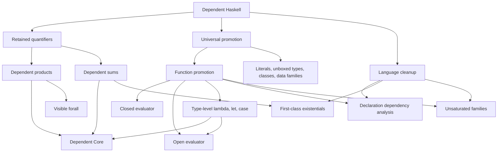

# Dependent Haskell program roadmap

## Design authority hierarchy

Every design, syntax, promotion, and typechecking decision on this fork follows a strict four-tier order of authority:

1. **GHC Proposal #378 (*Design for Dependent Types*)** whenever possible. Any already-implemented fork syntax, flag, or typing rule that diverges from `#378` takes priority for alignment.
2. **Other GHC proposals** (`#281`, `#242`, `#370`, `#402`, `#425`, `#509`, `#765`, `#23`/`#282`, etc.) for features not covered by `#378`.
3. **Serokell Dependent Haskell roadmap** ([ghc.serokell.io/dh](https://ghc.serokell.io/dh)) for scope tracking and prerequisite structure.
4. **Agda** (and *Programming Language Foundations in Agda*) for inspiration where GHC proposals do not specify a choice.

Serokell’s roadmap has 50 cards and 67 edges. Its 2026-11-12 snapshot marks
23 cards complete and seven proposals accepted. Twenty cards have no status
marker. On 2026-11-22, all 50 live card IDs and status labels still
matched this snapshot. An edge can identify a prerequisite or a subtask. The
[dependency index](#upstream-checklist-and-complete-dependency-index)
records every edge. The R numbers are local labels for those cards.
[Upstream roadmap](https://ghc.serokell.io/dh).

For the active checkout, combined build and next verification step, see
the [project handoff](HANDOFF.md).
The [HaskLib package](README.md#reuse-a-proof-with-hasklib) collects
the checked list laws for reuse by other modules.
The [PLFH notebook](../../PLFH-NOTES.md) tracks which proofs from
*Programming Language Foundations in Agda* can be stated and checked
with the same hypotheses in the fork.

## Where this fork stands

Serokell marks **23 of 50 cards complete**. Of its **27 open cards**,
the fork now completes **4**, partially implements **18** and has **5**
with no separate implementation on the published branch. Counting the
inherited 23 gives **27 of 50 complete** on the roadmap. These figures
count cards. They do not estimate the effort left or certify all inherited
GHC behavior on the fork.

PLFH's **DeBruijn** chapter checks progress for all seven constructors
of its closed, intrinsically typed terms. The beta step uses the book's
ordinary substitution function in its result type. The published **More**
chapter checks all 19 constructors of the extended language.
Its list case replaces two distinct variables under two binders. Both
proofs work in native code and in default GHCi with breakpoints enabled.
Lists now proves both inverse laws between a predicate witness and an
existential membership at a particular position. Confluence proves
reflexivity of parallel reduction by induction under a lambda.
Bisimulation now preserves its relation under an arbitrary type-preserving
renaming. The proof extends the renaming when it crosses a binder.
Simultaneous substitution with an arbitrary function is still open.
R03 and R16 remain partial.
[DeBruijn proof](examples/open-evaluation/BookBetaReduction.hs),
[More proof](https://github.com/Tritlo/PLFH/blob/81f8c63afdb722766d5ea6a1163f7d20345105d9/clients/PLFH/Part2/MoreProgress.hs),
[Lists proof](examples/open-evaluation/BookAnyWitnessProof.hs),
[Confluence proof](examples/open-evaluation/BookParallel.hs),
[Bisimulation report](https://github.com/Tritlo/PLFH/blob/67dc34b68d1dfcf4d379594986281831c20ae7fd/reproducers/R16_AbstractRenamingInType.hs),
[R16](roadmap/R16-open-term-evaluator.md#typed-substitution-under-a-binder).

| Area | Open cards with a tested implementation in the fork |
| --- | --- |
| Dependent binders, Core and equality | R03, R04, R05, R11, R22 |
| Promotion and evaluation | R07, R10, R12, R13, R14, R15, R16, R17, R19, plus R18, complete on the fork |
| Declaration dependencies, families and GADTs | R21, R23, R24, plus R41, complete on the fork |
| Namespace management and warnings | R27, plus R35 and R36, both complete on the fork |

The [PLFH preservation proof](CHECKPOINTS.md#one-step-preservation-with-same-module-substitution)
checks ordinary same-module substitution in a GADT result. It exercises the
partial binder and evaluation cards.

In PLFH batch 15, the Lists chapter defines ordinary recursive reversal
next to its proof (R13, R16 and declaration ordering in R21).
Connectives uses retained functions and inverse laws to prove that sums
and products commute (R03 and R04). The original foldr report still
blocks a proof over a retained callback. The De Bruijn progress proof
still needs substitution for an unknown function body. The published
book and the three-chapter patch have separate
[verification results](CHECKPOINTS.md#reversal-and-commutativity-in-batch-15).

### Release readiness

Four cards meet their documented scope on the fork. R35 and R36 were
qualified on normal compiler `2b64ffc406`. R41 was qualified on `71e5215115`. R18 was qualified on `b6ddbb4ce8`.

- [x] **[R18 Type-level lets](roadmap/R18-type-level-lets.md#release-check).**
  The normal compiler checks reusable intermediate types in six source
  contexts. Inserting an alias and renaming a local kind binder preserve
  the result through a compiled interface. Scope, errors, quotations and
  exact printing passed. Named product patterns still have a quotation
  restriction.
- [x] **[R36 Pun warnings](roadmap/R36-pun-warnings.md).** All eight
  checklist entries and all 16 registered warning cases passed. These
  cover independent scopes, conditional type binders, splices, staged
  imports, syntax and diagnostic precedence.
- [x] **[R35 Namespace management](roadmap/R35-namespace-management.md).**
  All four prerequisites have implementations. A client distinguishes a
  type, its same-spelled constructor and their annotations after a
  re-export through compiled interfaces. The negative case identifies
  both imports. All 25 namespace registrations passed.

- [x] **[R41 Nested quantification in GADTs](roadmap/R41-nested-quantification-in-gadts.md#release-check).**
  Prefix constructors accept fields, contexts and visible or invisible
  `forall` groups in source order. This includes empty groups and
  `type data`. Both normal compiler stages built. All 84 focused tests
  passed across the initial run and replay. All 553 Showcase outputs
  matched at native `-O0`, default `-O2` and in GHCi. Record constructors
  retain their fixed order.

R23 now supports both the ordinary
and promoted uses of a polymorphic `Endo` in real library clients.
The expected kind also fixes the omitted matchabilities in the bare
`Pure1 'Endo` use in `FoldrDefault_`. An unsigned `Apply` synonym can
accept both a data constructor and a type family. R23 remains partial.
The standalone flag now works without the umbrella. The fork also
accepts direct partial applications of built-in arithmetic. The stock
transformer kind synonym still needs a source migration.
Seven other upstream source programs also require matchability
annotations on the fork. [Stock GHC comparison](roadmap/R23-unsaturated-type-families.md#unchanged-source-on-stock-ghc-and-the-fork).
[564 arithmetic checks](CHECKPOINTS.md#built-in-arithmetic-callbacks-and-type-let-case-results).
[562 flag and interface checks](CHECKPOINTS.md#standalone-unsaturated-type-families).
[560 verification](CHECKPOINTS.md#inferred-matchability-in-type-synonyms).
[R23 package check](roadmap/R23-unsaturated-type-families.md#one-constructor-for-term-and-promoted-callbacks)
and [R41 scope](roadmap/R41-nested-quantification-in-gadts.md).

Five of the 27 open upstream cards have no separate implementation
counted on this branch.

| Card | What still holds it open |
| --- | --- |
| R01 Dependent Haskell | This is the overall goal. It depends on retained quantifiers (R02), universal promotion (R06) and language cleanup (R20). |
| R02 Dependent retained quantifiers | Complete both dependent products (R03) and sums (R04). The fork still restricts which runtime arguments can appear in results and which hidden indices it can infer. |
| R06 Universal promotion | Promotion of literals, unboxed types, classes, functions and data families is partial (R07, R10, R12–R14). An ordinary definition can still fall outside the evaluator. |
| R20 Clean up the language | Complete mixed declaration ordering, erased existentials, unsaturated families, constrained families and CUSK deprecation. |
| R34 Syntactic unification | Type syntax already works in some expressions. Patterns, the term and type grammars, and the frontend representations still need general unification. |

The [Serokell roadmap](https://ghc.serokell.io/dh) records the status of
the upstream work. The [dependency checklist](#upstream-checklist-and-complete-dependency-index)
maps its names to the local card numbers.

The Showcase reads two lists from IO and proves
`size (zip xs ys) :~: minSize (size xs) (size ys)` on those lists.
Both `size` and `minSize` are ordinary recursive Haskell functions.
The same minimum describes the length of `zipWith f xs ys` for an unknown
callback `f`. A separate example passes a constructed `Just` to a
retained comparison and leaves an unused field unevaluated.
HaskLib also proves the length of `zipWith combine (map pre xs) ys`.
A downstream client can derive that equation from two imported lemmas.
The [filter example](examples/open-evaluation/ParametricFilter.hs) shows
which proof steps still require the function's definition.
[Runtime-list proof](examples/open-evaluation/PreludeZipRuntime.hs),
[ordinary definitions](examples/open-evaluation/PreludeMapLengthSize.hs),
[callback length proof](examples/open-evaluation/PreludeZipWithLengthProof.hs),
[comparison](examples/open-evaluation/CompareOptional.hs) and
[verification status](HANDOFF.md#current-checkpoint).

Earlier [Showcase milestones and examples](CHECKPOINTS.md#showcase-history-through-502-outputs)
record how each behavior was introduced.

### Evidence for the 18 partial cards

Each row links to the test or card that supports it. The last column
identifies an outstanding obligation or a test that can expose it.
A passing example advances its row. Mark a row **complete on the fork**
when the normal compiler passes the tests for the card's scope. Record
the tested revision and link the tests. Use the upstream description
or accepted proposal to define that scope. The upstream checkboxes
continue to follow Serokell's published status.

| Card | What works on the published fork | What still needs evidence or a decision |
| --- | --- | --- |
| [R03 Dependent products](roadmap/R03-dependent-products.md) | An ordinary named function such as `HaskLib.size` can serve as both a runtime callback and the measurement in a result type. A caller can use an indexed function on a vector of runtime length. | Generalize beyond named callbacks with checked equations. Infer omitted indices through helper calls at more domains. |
| [R04 Dependent sums](roadmap/R04-dependent-sums.md) | The stored witness selects the payload type. The datatype and both projections can share a module. An ordinary caller can replace the vector after its runtime length matches. Two vector projections at the same stored length can be zipped in an ordinary client. Reading either field leaves the other lazy. Optional and tuple payloads can carry associated-family results. | Support generated dependent record selectors. Check packages with several runtime indices. |
| [R05 Dependent Core](roadmap/R05-dependent-core.md) | Optimized Core preserves retained indices in curried calls and keeps case evidence scoped. | Generalize dependent coercions, rewrite rules and exported unfoldings. Test a separately compiled optimized client with abstract evidence and a partial input. |
| [R07 Promote literals](REFERENCES.md#written-retained-natural-literals) | Written characters, strings and nonnegative numerals work at checked domains, including a user Peano type. | Support overloaded literals beyond the checked conversions. Check that type-level reduction uses the instance selected for the term. |
| [R10 Promote unboxed types](roadmap/R10-unboxed-promotion.md) | An imported family can match the machine-integer field of a promoted constructor. | Establish which other primitive representations support field values and pattern matching. Check target-width behavior and its interaction with homogeneous equality. |
| [R11 Homogeneous equality](roadmap/R11-homogeneous-equality.md) | Selected GADT workers carry a kind proof and same-kind evidence. A runtime proof that a length is one lets `safeHead` infer its tail index inside `withEquality`. | Account for the remaining coercion binders with endpoints of different kinds. Generalize inference beyond the checked nominal equality and constructor forms. |
| [R12 Promote classes](roadmap/R12-promote-classes.md) | An imported proof can use equations from the dictionary selected for a method, including supported `fmap` instances. | Specify and test general dictionary selection across superclass and recursive evidence, including two contexts that select different evidence. |
| [R13 Function promotion](roadmap/R16-open-term-evaluator.md) | The zip theorem uses ordinary `size` and `minSize`. HaskLib also proves the length of the ordinary list prefix function `takeSize`. | Extend beyond recognized recursion and equation shapes. A client must retain the same equations and evaluation order after optimization and separate compilation. |
| [R14 Data family promotion](roadmap/R14-data-family-promotion.md#next-acceptance-check) | Selected data-family instance constructors can appear in promoted indices. A runtime match can use a stored class dictionary. | Decide how to promote a constructor with an explicit class constraint. Direct promotion of `Stored` in the card's example is a useful boundary. |
| [R15 Closed evaluator](roadmap/R15-closed-term-evaluator.md) | A closed computation can return a table whose labels, cells and dimensions GHC reconstructs at the type level. | Generalize readback beyond the tested result shapes. Specify staging and the outcome when evaluation cannot produce the required constructor. |
| [R16 Open evaluator](roadmap/R16-open-term-evaluator.md) | With unknown lists, a client can prove length laws for `map`, `zipWith` and a size-bounded prefix. | Evaluate ordinary definitions on unknown inputs beyond the certified equations. Preserve demand and check the effect of visible rewrite rules. |
| [R17 Type-level lambdas](roadmap/R17-type-level-lambdas.md) | A row callback can capture a retained value. Untyped quotes preserve lambda binders and can splice a callback that captures an enclosing type variable. | Check inline lambdas in visible type arguments and conversion between named and inline callbacks. Typed expression quotes still reject an inline lambda. |
| [R19 Type-level cases](roadmap/R19-type-level-cases.md) | Independent modules compose a `Just x -> Proxy x` result and complete nested cases that test the same constructors in the same order. This works even with a rigid field. A [closed family equation](roadmap/R19-type-level-cases.md#a-case-in-a-closed-type-family-equation) can select a payload or recurse on a smaller input. | Indexed scrutinees and incomplete decisions still use ordinary reduction. Keep different field demands distinct when the scrutinee is unknown. Some deeper recursive cases still fail the size check on a generated helper. |
| [R21 Declaration dependencies](roadmap/R21-dependency-analysis.md) | For a previously checked package type, two projections can share a declaration group in either order. The result type of one projection can call the other. GHC diagnoses a genuine dependency cycle at the source call. | Establish general ordering for mixed groups. Cover declarations that introduce instances or deriving dependencies, while respecting splice boundaries. |
| [R22 Erased existentials](roadmap/R22-existential-quantification.md) | A pattern can open a hidden length. An argument's declared type can determine a witness beneath a callback's `forall`. | Specify inference for a package repacked across a scope, including the cases where its witness cannot be determined or would escape. |
| [R23 Unsaturated families](roadmap/R23-unsaturated-type-families.md) | A supplied promoted callback can determine its arrow matchabilities. The real `first-class-families` package supports the plain lambda and `'Endo Echo` in separate clients. | Complete higher-order inference and settle compatibility of existing unannotated programs. The unmodified `T15874` still fails on the released compiler. |
| [R24 Constrained families](roadmap/R24-constrained-type-families.md) | An associated family such as `Elem c` can require the owning dictionary. A source-hidden client rejects a missing premise before reduction. | Settle the general representation of domain evidence, including partial applications, and how the source formation rule corresponds to Core. |
| [R27 Deprecate CUSKs](roadmap/R27-deprecate-cusks.md) | The opt-in `-Wcusks` warning supplies checked edits or explains a kind. Fourteen standalone signatures preserved all 215 printed kinds in a three-package migration on the fork. | The fork deliberately retains the Haskell98 and Haskell2010 defaults. Disabling and retiring CUSKs as proposed upstream is deferred. |

The published evaluator work covers closed calls such as `Prelude.sum` and
open equations such as mapping `Prelude.not` over a list with a known head
and unknown tail. The proofs depend on what the function demands and on its
visible rewrite rules. Local lambdas, lets and mixed declarations have
source examples. General promotion remains open.
[R15 closed evaluation](roadmap/R15-closed-term-evaluator.md),
[R16 open evaluation](roadmap/R16-open-term-evaluator.md),
[R17 lambdas](roadmap/R17-type-level-lambdas.md),
[R18 lets](roadmap/R18-type-level-lets.md) and
[R21 declaration dependencies](roadmap/R21-dependency-analysis.md).

## Current work queue

| Card | Next result | Acceptance check |
| --- | --- | --- |
| [R17 Type-level lambdas](roadmap/R17-type-level-lambdas.md) | Qualify equality between a named family callback and a lambda that forwards its argument to that family. Check whether users can substitute one for the other inside a partially applied family. | Use a list of unknown shape. Read the proof through an interface. Check that two different captures still fail and that the equality cannot be used to infer an argument from a family result. |
| [R23 Unsaturated families](roadmap/R23-unsaturated-type-families.md#passing-built-in-arithmetic-to-map) | Direct and synonym-wrapped built-ins work in ordinary clients. The previous reader gives GHC-47808 for an interface containing a partial built-in. | Resolve the default matchability of unannotated transformer kind synonyms in ordinary modules. |
| [R16 Open evaluation](roadmap/R16-open-term-evaluator.md#map-length-and-sharing-under-stock-fusion) | Determine when a source-hidden client can use `lengthMap` with default optimization. The published proof has a stock fusion counterexample. | Preserve rejection when the mapped and plain counts have different definedness. An accepted use must account for rewrites exposed on either side, including rules on `filter`. Verify the same condition through a re-export. |
| [R16 Proofs over zip](roadmap/R16-open-term-evaluator.md#a-rule-can-change-the-result-even-when-both-lists-are-empty) | Admit the proof for two literal empty lists under stock optimization. The private compiler still rejects it with both the old and rebuilt HaskLib interfaces. | Keep rejecting a rule that changes the empty result by rewriting the list builder introduced by fusion. Also check independent counts for a producer that inspects its fold step. |
| [R03 Dependent products](roadmap/R03-dependent-products.md#using-an-imported-function-in-an-index) and [R15 Closed evaluation](roadmap/R15-closed-term-evaluator.md) | The 554-line release preserves the identity of imported functions in a retained index. The 555-line release publishes the checked lower-case and title-case equations. The 556-line release checks a local character predicate in its defining module and exports the synonym to ordinary clients. | An ordinary client must specialize an imported synonym at a Unicode literal. Changing a producer equation must invalidate its proof. An executable-only call must still track its object dependency. |
| [R16 Append proofs](roadmap/R16-open-term-evaluator.md#append-fusion-and-an-undefined-right-list) | Check which consumer observes the appended list in a source-hidden proof. | Distinguish the recursive cell count from a strict outer fold. Check the seed position, the consumer equations and the reachable rewrite rules. |
| [R21 Declaration dependencies](roadmap/R21-dependency-analysis.md#deriving-and-associated-equations) | A local producer can supply an associated equation. Its result datatype can have an attached deriving clause. The keyed-tree proof still awaits the cross-module proof guard. | Compare the instance and deriving diagnostics in both source orders and check a reader that imports only the interface. |
| [R04 Dependent sums](roadmap/R04-dependent-sums.md#separate-named-fields-and-dependent-projections) and [R21 Declaration dependencies](roadmap/R21-dependency-analysis.md) | The published compiler supports generated selectors and updates that replace the length and both payloads. Qualify an ordinary client that compares two stored lengths before copying one payload. | Test equal and unequal lengths through compiled interfaces. The comparison must provide the witness for an omitted payload. Keep the laziness and unequal-index controls. |

R41 is complete on the fork. R03 remains partial after the 554-line release.
R16 has a stock-compiler counterexample to unconditional append fusion.
The append-singleton case has a defined seed and still needs a check
of the client's rewrite rules. Use the [handoff](HANDOFF.md#current-checkpoint)
for the pinned compilers and test jobs.

### Earlier integration checks

The following changes entered the fork before the shared R11/R16 rebuild.
They remain regression checks for subsequent changes. Reuse one normal build
for all cards that change the same checker or interface format.

| Cards | Integrated change | Regression coverage |
| --- | --- | --- |
| [R03](roadmap/R03-dependent-products.md), [R04](roadmap/R04-dependent-sums.md), [R41](roadmap/R41-nested-quantification-in-gadts.md) | A constructor supplies a runtime result index to a nested call. A retained package can carry a polymorphic element. A quoted GADT preserves the order of its binders and fields. | Check source-hidden clients, lazy fields, rejected index and payload mismatches, interface markers, and ordinary Quick Look allocation. |
| [R10](roadmap/R10-unboxed-promotion.md) | A closed family matches a signed machine integer of type `Int#`. | Check target-width conversion and the imported family axiom with both compiler stages. |
| [R15](roadmap/R15-closed-term-evaluator.md), [R17](roadmap/R17-type-level-lambdas.md) | Rectangular and square matrices retain their shape during readback. A type family recognizes equal lambda closures across an interface. | Check zero-sized and mismatched dimensions, imported closure equality, and the cost of nested family applications. |
| [R36](roadmap/R36-pun-warnings.md) | The renamer can warn when a type and a term share a name at an unqualified use. | These controls passed on the normal compiler. See the [cross-module acceptance check](roadmap/R35-namespace-management.md). |
| [R18](roadmap/R18-type-level-lets.md#ordered-binding-groups) | A group of type-level let bindings uses source order. A later binding can refer to an earlier binding with the same name. Both braced and layout groups work directly in source. | Check free variables in implicitly quantified signatures, an out-of-scope forward reference, an interface-only client, quotations, and exact and ordinary printing. |

The R05/R16 compiler at `fd5a526ea1` checks the full interfaces of home
modules whose rewrite rules a final Core proof consulted. Adding an
applicable rule now invalidates the warm proof in both object-code and
`-fno-code` builds. The registered regression also checks the next build
with no further edits.
[Recovered branches and remaining checks](BRANCHES.md).

R11 and R16 now share a compiler and library rebuild. The R11 worker
uses scoped same-kind evidence for supported GADT equalities. The v79
reader rejects v69 interfaces before a client can link their object
code. Rebuild the provider and its clients together. More general GADT
equality telescopes remain open.
[Worker and solver evidence](roadmap/R11-homogeneous-equality.md).

R16 records the method and arguments used by a checked proof. A
client with a conflicting rewrite rule receives GHC-83605 at the
proof use. An explicitly opaque, closed observation computed in a
rules-off provider can be used by an optimized ordinary client.
R12/R16 tracks which branch of a nested family application used a
checked method. A rule that changes the selected method invalidates a
proof that uses its result. A constant family can ignore the same
argument. A warm build reviews eligible home providers once. An older
installed provider needs its source rebuilt to recover omitted evidence.
[Open evaluation](roadmap/R16-open-term-evaluator.md) and
[upgrade checks](CHECKPOINTS.md#shared-r11-and-r16-rebuild).

Four changes share the normal compiler at `bb45f2d668`. Each extends
a card already counted as partially implemented. Its Core unifier also
checks the types of retained variables before accepting a recursive
substitution. [Compiler qualification](CHECKPOINTS.md#four-roadmap-cards-and-the-core-occurs-check).

| Card | Behavior | Regression checks |
| --- | --- | --- |
| [R04 dependent sums](roadmap/R04-dependent-sums.md) | An ordinary caller matches the length stored in an indexed vector. | A known zero length should make the zero branch exhaustive. At an unknown length, omitting the successor branch should still warn. |
| [R12 class promotion](roadmap/R12-promote-classes.md) | A client proves that derived `fmap` applies a runtime predicate and preserves the other field of `These`. | An instance that discards the field must reject the original proof. A warm build must recover the same checked equations as a clean build. |
| [R13 function promotion](PLAN.md#constructor-specialization) | A recursive function can consume either list when the other list stays the same or also gets shorter. | Specialization at `-O2` must preserve the checked equations and which inputs each branch forces. |
| [R18 type-level lets](roadmap/R18-type-level-lets.md) | An ordered type-level `let` can give a local binding its own kind signature. | Scope, diagnostics, exact printing and Template Haskell must agree with the source. |

The 532-line integration added
a curried runtime comparator, mapping instances selected by the receiver
type, rectangular and square indices, a successor-indexed payload, a
quantified GADT equality, and tuple patterns in type-level lets. A clean
bootstrap exposed a missing dependency on the primitive tuple module.
The ambiguity check for a noninjective callback result could also panic.
The 534-line compiler includes both repairs. It also reads checked
mapping equations through GHCi debugger breakpoints.
Both normal compiler stages matched the native golden at `-O0` and
`-O2`. Self-hosted GHCi matched it in bytecode. All 27 selected
registered tests passed.
[Qualification record](CHECKPOINTS.md#runtime-tiles-and-curried-comparisons).

The following checks extend the same cards. An ordinary caller can
recover the dimensions and cells of a `Tile`. The partial application
`f pivot` can appear inside `Prelude.fmap` in a type when both arguments
and the result of `f` have abstract lifted types. Other component checks
compose scoped index equalities across several matches and infer an
erased shape from a runtime tile constructor. Both compiler stages
check nested tuple patterns in source and in type quotations.
[Tile](examples/packed-vector/IndexedMatrixClient.hs),
[mapping proof](examples/open-evaluation/TheseMapping.hs),
[equality](roadmap/R11-homogeneous-equality.md),
[existential construction](roadmap/R22-existential-quantification.md)
and [let patterns](roadmap/R18-type-level-lets.md).

For the remaining work on each card, use the table below. The
[previous queue](CHECKPOINTS.md#vector-split-and-package-checkpoints)
records the earlier source and interface checks.

## Remaining work by roadmap area

The table gives the completion criteria for each area.

| Roadmap area | Remaining local work | Main obligations before completion |
| --- | --- | --- |
| R03: dependent products | General domains, broader invisible argument inference, and runtime type operands | An opted-in caller can pass `(type Bool)` to a visible `foreach (a :: Type)` binder through its interface. An abstract operand needs `Typeable a`. Hidden witnesses and runtime type patterns remain open. |
| R04 and R22: sums and existentials | Broader inference and elimination for retained `some` and erased `exists` | Check nested packages and constructors with several run-time indices. Infer an erased witness across a scope only when its type is determined there. Preserve lazy projection and prevent a hidden witness from escaping. |
| R05: dependent Core | Typed conversion, proof operations, transformations, unfoldings and normal optimization | Reconcile the native forms with the calculi. Preserve roles, scope, demand, sharing and ordinary GHC behavior. |
| R15 and R16: closed and open evaluation | Computation in types over closed inputs and rigid variables | Specify staging, divergence, stuck terms and diagnostics. Reuse ordinary term definitions without parallel handwritten families. |
| R13, R17–R19 and R21: function promotion | More recursive definitions, type-level lambda, let and case, and mixed declarations | Preserve a function's checked equations and evaluation order across optimization and separate compilation. Cover local patterns and signatures and dependencies between source declarations. |
| R23 and R24: type families | Source unsaturation, inference/defaulting and family constraints | Complete the family design beyond the internal matchability foundation. Preserve noninjective application and evidence validity. |
| R07, R10–R12 and R14: promotion domains | General literals, unboxed types, homogeneous equality, classes and data families | Define each domain and its representation separately. Reuse inherited Char and Natural support. |
| R20, R27, R34–R36 and R41: language preparation | Remaining accepted cleanup and binder work | Follow each proposal and its current implementation. Track loose ends without reopening an entire completed upstream card. |
| R01, R02 and R06: aggregate goals | Integrate retained quantification, promotion and language preparation | Complete their required feature scope and broader compatibility checks. A single example cannot close an aggregate goal. |

## Local subset, library and assurance work

The user selected an opt-in dependent subset in modules. A small dependent-base
library should make that subset useful with ordinary Haskell libraries. These local tasks have their own acceptance criteria.

| Task | Roadmap relation | Next result and boundary |
| --- | --- | --- |
| Module interoperability | R03 and R05 | Check an indexed API from a module without dependent syntax. Preserve imported types and infer relationships where supported. Use an explicit adapter when a caller cannot express the contract. |
| Small dependent-base | R03 and R04 | Start with the existing Nat, Vec, Fin, equality and package operations. The example library provides list conversion, package elimination and the [exact-length adapter](PLAN.md#m95-check-ordinary-list-inputs-at-an-indexed-boundary). Package and module names remain provisional. |
| Conservative totality checking | Local assurance work related to R05 | Specify the property for lazy Haskell. Start with coverage and structural recursion. Keep checked results, trusted assumptions and unknown status distinct across imports. |
| Observational equality | R05 research | Compare explicit equality and transport with OTT. Keep checker conversion, contextual equivalence and inverse application distinct. No new equality rule is selected. |

A module flag enables source features. It does not remove imported contracts.
An ordinary import supplies no extra termination or proof guarantee unless a
check or an explicit trusted contract establishes it. Partial dependent code
can still preserve an index invariant when it returns. Totality remains a
separate promise. A termination checker alone does not establish logical
consistency; positivity, universes, proof elimination and unsafe operations
also need rules.
Specify the required inputs as well as the result. A checked function on total
inputs does not certify a result obtained from an unchecked lazy argument.

Use linear-base as the library and adapter reference. Use Idris and Agda as
references for conservative totality checks and imported assumptions.
[Design references](REFERENCES.md).

The first candidate is an advisory report for covered first-order functions
with direct structural recursion. Use the zonked source AST and the existing
coverage checker. Recompute the complete call graph; the inference graph omits
some signed-call edges. Unsupported recursion, callbacks and imports stay
unknown. No checker or new totality guarantee is implemented.

Use LiquidHaskell's [Refinement Types For Haskell](https://simon.peytonjones.org/assets/pdfs/refinement-types-for-haskell.pdf)
as Haskell-specific prior art. Its analysis distinguishes potentially divergent
terms, weak-head values and finite values. Keep the first report advisory.
It must not change conversion, proof erasure or imported type contracts.

## Main relationships

Arrows have the same direction as the upstream graph: a task points to a
prerequisite or subtask. This diagram omits completed preparation and smaller
branches. The full checklist below preserves every edge.

A retained-quantifier experiment can proceed before universal promotion is
complete. Completing that experiment will still leave the promotion and cleanup
branches open.

## Upstream checklist and complete dependency index

A checked box means **completed on the upstream roadmap snapshot**. It does not
mean that this fork completed the feature or that every related issue is closed.
`Accepted` is a design status. Leave its box unchecked until implementation is
verified. The `R` numbers are local reference labels; links retain upstream IDs.
`Needs/includes` records the graph relation without claiming that every edge is
a mandatory sequencing constraint. A leaf has no outgoing graph edge; it can
still require substantial research.

- [ ] **R01 [Dependent Haskell](https://ghc.serokell.io/dh#dependent-haskell)** — Unmarked. Needs/includes: R02, R06, R20.
- [ ] **R02 [Dependent retained quantifiers](https://ghc.serokell.io/dh#dependent-retained-quantifiers)** — Unmarked. Needs/includes: R03, R04.
- [ ] **R03 [Dependent products](https://ghc.serokell.io/dh#dependent-products)** — Unmarked. Needs/includes: R05, R39.
- [ ] **R04 [Dependent sums](https://ghc.serokell.io/dh#dependent-sums)** — Unmarked. Needs/includes: R05, R22.
- [ ] **R05 [Dependent Core language](https://ghc.serokell.io/dh#dependent-core-language)** — Unmarked. Needs/includes: no outgoing graph edge.
- [ ] **R06 [Universal promotion](https://ghc.serokell.io/dh#universal-promotion)** — Unmarked. Needs/includes: R07, R10, R12, R13, R14.
- [ ] **R07 [Promote literals](https://ghc.serokell.io/dh#promote-literals)** — Unmarked. Needs/includes: R08, R09, R24. M80 supplies nonnegative type numerals at registered index kinds. [M83](PLAN.md#m83-ordinary-numerals-in-retained-arguments) accepts term numerals in retained arguments when the actual conversion has checked equations. A complete monomorphic annotation can name the retained domain. [Written character literals](REFERENCES.md#written-character-indices) can supply retained indices directly or as elements of a written list. [Plain quoted strings](REFERENCES.md#quoted-strings-in-retained-operands) use the same lazy character lists. A saturated, certified binary method can compute the [result length of an indexed append](REFERENCES.md#certified-addition-in-an-indexed-append). [Written Natural literals](REFERENCES.md#written-retained-natural-literals) use DataKinds numerals and the ordinary boxed runtime representation with the standard `Num Natural` dictionary. General overloaded term promotion and constrained family evaluation remain open.
  [The one-cell vector package](examples/packed-vector/PackedProjection.hs)
  uses `1` at a registered Peano kind under `ExperimentalDependentTypes`.
  An ordinary caller can import its interface and prove that its length equals `'S 'Z`.
  Agda accepts decimal numerals directly at its builtin `Nat` in vector indices such as `1 + n`.
  Accepted GHC proposal #364 assigns ordinary type numerals the builtin `Natural` kind.
  [Agda vector operations](https://agda.github.io/agda-stdlib/v2.3/Data.Vec.Base.html)
  and [GHC proposal #364](https://ghc-proposals.readthedocs.io/en/latest/proposals/0364-unify-natural.html).
- [x] **R08 [Promote Char](https://ghc.serokell.io/dh#promote-char)** — Completed. Needs/includes: no outgoing graph edge. [Written character indices](REFERENCES.md#written-character-indices) use the existing DataKinds character literals.
- [x] **R09 [Promote Natural](https://ghc.serokell.io/dh#promote-natural)** — Completed. Needs/includes: no outgoing graph edge.
- [ ] **R10 [Promote unboxed types](https://ghc.serokell.io/dh#promote-unboxed-types)** — Unmarked. Needs/includes: R11. [Source probes and R11 acceptance check](roadmap/R10-unboxed-promotion.md).
- [ ] **R11 [Homogeneous equality](https://ghc.serokell.io/dh#homogeneous-equality)** — Unmarked. Needs/includes: no outgoing graph edge. Deferred heterogeneous equality holes and projected constructor, function, or matchable application Givens use same-kind evidence binders. Pattern-bound coercions can still have endpoints at different kinds. [Core check](roadmap/R10-unboxed-promotion.md#deferred-heterogeneous-equalities). The [v79 worker](roadmap/R11-homogeneous-equality.md) gives supported pattern-bound coercions a scoped kind proof. Rebuild native libraries for this compiler.
- [ ] **R12 [Promote classes](https://ghc.serokell.io/dh#promote-classes)** — Unmarked. Needs/includes: R13, R24. M82 connects a concrete instance method to a checked source function in a retained argument. M83 checks the selected ground `Num` instance’s conversion of a nonnegative literal. A direct class constraint can supply an opaque unary method in an exported index. The caller can infer an independent payload and its ordinary class constraints. Superclass selection and general class promotion remain open. [Abstract method example](roadmap/R12-promote-classes.md).
- [ ] **R13 [Function promotion](https://ghc.serokell.io/dh#function-promotion)** — Unmarked. Needs/includes: R15, R16, R17, R18, R19, R21, R23. The [map length example](roadmap/R16-open-term-evaluator.md#prove-that-map-preserves-length) calls the ordinary `size` function at runtime and uses its checked equations in a separate proof module.
- [ ] **R14 [Data family promotion](https://ghc.serokell.io/dh#data-family-promotion)** — Unmarked. Needs/includes: no outgoing graph edge. [Simple instance constructors](roadmap/R14-data-family-promotion.md).
- [ ] **R15 [Closed term evaluator](https://ghc.serokell.io/dh#closed-term-evaluator)** — Unmarked. Needs/includes: no outgoing graph edge. M99, M101 and M103 support qualified closed calls on a character or a list of natural number literals. The argument can determine a polymorphic function's specialization. M105 reads back one list layer of a supported scalar type. M106 composes qualified unary calls. M108 passes all supported result shapes between calls. M110 accepts written literals at those kinds. M111 checks the roadmap's length signature. M113 checks saturated calls with joint operand inference. M116 returns a boxed pair and passes it to a later call. M118 extends this to `Maybe` and `Either`. M120 adds recursive lists. M122 infers the kinds of constructor literals from the producer and the other inputs. M124 admits imported ordinary enumerations. M127 adds finite recursive datatypes with ground boxed fields. M129 admits GADT constructor equalities at a known index. M130 recovers constructor-local indices along nominally injective paths in the result. M132 consumes written existential packages. M135 recovers a runtime-selected index from a singleton field. M136 composes ordinary nested calls before observing their result. M139 uses a known expected kind to specialize a conversion. M140 passes a known domain to a nested conversion. M143 shares kinds between computed siblings. M145 carries kinds through a checked projection. M149 preserves a pair field’s laziness in an enclosing ordinary call. M153 also checks a direct projection of a copied field through interfaces. M157 exposed a compatibility failure for a computed field and remains experimental. M165 runs a closed call with an imported callback. See the [active card](roadmap/R15-closed-term-evaluator.md).
- [ ] **R16 [Open term evaluator](https://ghc.serokell.io/dh#open-term-evaluator)** — Unmarked. Needs/includes: no outgoing graph edge. M100 and M102 handle rigid projections. M104 retries a call before generalization when a pattern fixes a signature wildcard. M107 selects a branch with a known character and a rigid result operand. M109 publishes a closed family for finite character mappings and follows a checked alias across an interface. M114 checks boxed-pair projections and detects a blocked rigid pair. M119 preserves installed Prelude projections of an unknown pair in exported constraints. M121 also certifies an ordinary case that rebuilds a pair from its fields. M123 proves a projection of a swap for an unknown pair. M125 follows both projected fields through chains of checked pair constructors. M126 obtains an independent local producer from the current source module. M128 observes its chain of local helpers. M131 handles recursive value groups and tracks demanded source binders. M133 selects fields of known ordinary user constructors and checks the demanded imported unfoldings against rewrite rules. M137 returns supported constructors and boxed pairs with symbolic fields. M142 publishes checked pair cases from ordinary producers. M144 exports projections for ordinary sums. M146 checks nested constructor patterns and a fallback argument. M148 builds public constructors in the result of a case. M151 retains helper equations inside those constructors. M154 checks a private helper that itself returns a public lazy constructor. M155 follows acyclic private helper calls. M158 also checks a case inside a private helper. M159 publishes a structurally recursive unary call under a lazy output constructor. M162 checks a recursive call with an unchanged second operand. M168 and M169 preserve a callback during recursion on the second argument and check an ordinary client using its equation. See the [open-term examples and checks](roadmap/R16-open-term-evaluator.md).
- [ ] **R17 [Type-level lambdas](https://ghc.serokell.io/dh#type-level-lambdas)** — Unmarked. Needs/includes: R05, R16.
- [ ] **R18 [Type-level let-bindings](https://ghc.serokell.io/dh#type-level-let-bindings)** — Unmarked upstream. **Complete on the fork** at `b6ddbb4ce8`. Needs/includes: R05, R16. [Release check](roadmap/R18-type-level-lets.md#release-check). Braced and layout groups bind names in source order. An adjacent kind signature can check a local size computation used in a later binding and case. Source patterns support nested pairs and flat named products. [Ordered groups](roadmap/R18-type-level-lets.md#ordered-binding-groups), [named products](roadmap/R18-type-level-lets.md#a-named-product-binding), [optional vector header](roadmap/R18-type-level-lets.md#a-vector-with-an-optional-header), and [quotations](roadmap/R18-type-level-lets.md#type-quotations-and-splices).
- [ ] **R19 [Type-level case-expressions](https://ghc.serokell.io/dh#type-level-case-expressions)** — Unmarked. Needs/includes: R05, R16. Template Haskell can quote a retained signature, splice a case on an enclosing runtime binder, and reify a retained GADT constructor from a stripped interface. A source plugin can forward the type splice during typechecking. [Examples and limits](roadmap/R19-type-level-cases.md#quote-and-reify-retained-gadt-constructors).
- [ ] **R20 [Clean up the language](https://ghc.serokell.io/dh#clean-up-the-language)** — Unmarked. Needs/includes: R21, R22, R23, R24, R27, R28, R35, R39, R49.
- [ ] **R21 [Dependency analysis](https://ghc.serokell.io/dh#dependency-analysis)** — Accepted. Needs/includes: no outgoing graph edge. M126 schedules an independent local producer for open evaluation. M128 extends scheduling to a chain of acyclic value bindings. M131 also schedules mutually recursive value groups, with or without complete signatures. M134 schedules local datatypes and synonyms with their ordinary value prerequisites. M138 admits deriving and default declarations with ready prerequisites. M147 installs ordinary class instance heads and associated type equations before local producers, then checks the methods. M150 also schedules associated data and standalone family instances. M152 schedules a local producer before the equations of a fresh local family. M156 checks independent local functions used by an imported family equation. M160 accepts imported functions with independent polymorphic signatures in those local producers. M163 admits saturated ordinary data constructors and checks their field types. M164 also infers an unsigned producer. [Scope and remaining dependencies](roadmap/R21-dependency-analysis.md).
- [ ] **R22 [Existential quantification](https://ghc.serokell.io/dh#existential-quantification)** — Unmarked. Needs/includes: no outgoing graph edge. The first acceptance check opens an erased package from another module. An implicitly packed vector filter must also return its first cell without forcing the tail. A reader can take the result of a conditional between two polymorphic vector producers. Ordinary type inference checks the branches once. [Source examples and Core checks](roadmap/R22-existential-quantification.md).
- [ ] **R23 [Unsaturated type families](https://ghc.serokell.io/dh#unsaturated-type-families)** — Accepted. Needs/includes: R25. M141 restores omitted-arrow inference for a dependent argument. M166 passes a partial user family through an interface at a known unmatchable arrow. General inference and ordinary-program compatibility remain open. [Checks and remaining work](roadmap/R23-unsaturated-type-families.md#m166-passing-an-unsaturated-family-to-an-unmatchable-binder).
- [ ] **R24 [Constrained type families](https://ghc.serokell.io/dh#constrained-type-families)** — Unmarked. Needs/includes: no outgoing graph edge. The fork checks associated family domains across module interfaces, including a kind that selects the class instance. Functional dependencies and superclass equalities can determine class parameters omitted from the family. Marked family defaults and explicit associated equations can use the owning class and its superclasses. A partial application must supply the owner parameters declared by the family. Imported type synonyms carry the same domain check. Partial signatures can use written premises. Inferred results must still satisfy the domain in their final context. Qualified family kinds and general Core evidence remain open. [Checked scope and open questions](roadmap/R24-constrained-type-families.md).
- [x] **R25 [Modifiers syntax](https://ghc.serokell.io/dh#modifiers-syntax)** — Completed. Needs/includes: no outgoing graph edge.
- [x] **R26 [Standalone kind signatures](https://ghc.serokell.io/dh#standalone-kind-signatures)** — Completed. Needs/includes: no outgoing graph edge.
- [ ] **R27 [Deprecate CUSKs](https://ghc.serokell.io/dh#deprecate-cusks)** — Accepted. Needs/includes: R26, R29.
- [x] **R28 [Invisible type arguments](https://ghc.serokell.io/dh#invisible-type-arguments)** — Completed. Needs/includes: R29, R30, R31, R32, R33.
- [x] **R29 [Invisible binders in types](https://ghc.serokell.io/dh#invisible-binders-in-types)** — Completed. Needs/includes: R26.
- [x] **R30 [Invisible binders in functions](https://ghc.serokell.io/dh#invisible-binders-in-functions)** — Completed. Needs/includes: no outgoing graph edge.
- [x] **R31 [Invisible binders in constructors](https://ghc.serokell.io/dh#invisible-binders-in-constructors)** — Completed. Needs/includes: no outgoing graph edge.
- [x] **R32 [Visible type applications](https://ghc.serokell.io/dh#visible-type-applications)** — Completed. Needs/includes: no outgoing graph edge.
- [x] **R33 [Visible kind applications](https://ghc.serokell.io/dh#visible-kind-applications)** — Completed. Needs/includes: no outgoing graph edge.
- [ ] **R34 [Syntactic unification](https://ghc.serokell.io/dh#syntactic-unification)** — Accepted. Needs/includes: R44, R45, R46, R47. [Function arrows in required type patterns](#r34-function-arrows-in-required-type-patterns).
- [ ] **R35 [Namespace management](https://ghc.serokell.io/dh#namespace-management)** — Accepted. Needs/includes: R36, R37, R38, R42. [Complete on the fork](roadmap/R35-namespace-management.md).
- [ ] **R36 [Pun warnings](https://ghc.serokell.io/dh#pun-warnings)** — Accepted. Needs/includes: no outgoing graph edge. [Proposal #765](https://ghc-proposals.readthedocs.io/en/latest/proposals/0765-pun-warnings.html) specifies the two opt-in diagnostics. [Complete on the fork](roadmap/R36-pun-warnings.md).
- [x] **R37 [Namespace-specified imports](https://ghc.serokell.io/dh#namespace-specified-imports)** — Completed. Needs/includes: no outgoing graph edge.
- [x] **R38 [No list or tuple puns](https://ghc.serokell.io/dh#no-list-or-tuple-puns)** — Completed. Needs/includes: no outgoing graph edge.
- [x] **R39 [Visible forall](https://ghc.serokell.io/dh#visible-forall)** — Completed. Needs/includes: R34 (loose end), R40, R41 (loose end), R43.
- [x] **R40 [Visibility coercions](https://ghc.serokell.io/dh#visibility-coercions)** — Completed. Needs/includes: no outgoing graph edge.
- [ ] **R41 [Nested quantification in GADTs](https://ghc.serokell.io/dh#nested-quantification-in-gadts)** — Accepted. Needs/includes: no outgoing graph edge. Prefix constructors accept consecutive constraint groups before the first field ([GHC proposal #402](https://ghc-proposals.readthedocs.io/en/latest/proposals/0402-gadt-syntax.html), [#27424](https://gitlab.haskell.org/ghc/ghc/-/issues/27424)). An ordinary prefix constructor can end with a required forall after its last field. Its wrapper and pattern keep written argument order. A context before the fields can refer to the earlier type binders. Its constraints are available when checking the field and terminal type patterns. The promoted kind keeps written argument order when the constructor is promotable. Template Haskell can round-trip terminal-group prefix declarations with field bangs and multiplicities. A prefix constructor can also use `Int -> forall a. Eq a => T a`. Its caller supplies the field before the type argument and dictionary. A context can also follow the fields directly, as in `K :: a -> Eq a => F`. Pattern matching introduces the existential field type before checking the field and the dictionary afterward. Several specified `forall` groups can occur between value fields. The ordinary client supplies each type argument after the preceding field. Lifted prefix constructors can interleave class or equality contexts with fields and `forall` groups. A leading required binder can precede a context and a later group with inferred and specified binders. Template Haskell preserves that order and any field bangs. The worker keeps its representation order. The fork also supports the remaining prefix combinations, including ordered `type data` and empty groups. The upstream implementation issues remain tracked ([#27425](https://gitlab.haskell.org/ghc/ghc/-/issues/27425), [#27426](https://gitlab.haskell.org/ghc/ghc/-/issues/27426)). [Checklist and source example](roadmap/R41-nested-quantification-in-gadts.md).
- [x] **R42 [Embed types](https://ghc.serokell.io/dh#embed-types)** — Completed. Needs/includes: no outgoing graph edge.
- [x] **R43 [Term variable capture](https://ghc.serokell.io/dh#term-variable-capture)** — Completed. Needs/includes: no outgoing graph edge.
- [x] **R44 [No star kind syntax](https://ghc.serokell.io/dh#no-star-kind-syntax)** — Completed. Needs/includes: R50.
- [x] **R45 [The forall keyword](https://ghc.serokell.io/dh#the-forall-keyword)** — Completed. Needs/includes: no outgoing graph edge.
- [x] **R46 [The tilde operator](https://ghc.serokell.io/dh#the-tilde-operator)** — Completed. Needs/includes: R48.
- [x] **R47 [The dot type operator](https://ghc.serokell.io/dh#the-dot-type-operator)** — Completed. Needs/includes: R48.
- [x] **R48 [Whitespace-sensitive operators](https://ghc.serokell.io/dh#whitespace-sensitive-operators)** — Completed. Needs/includes: no outgoing graph edge.
- [x] **R49 [Unify type and kind variables](https://ghc.serokell.io/dh#unify-type-and-kind-variables)** — Completed. Needs/includes: R50.
- [x] **R50 [Unify types and kinds](https://ghc.serokell.io/dh#unify-types-and-kinds)** — Completed. Needs/includes: no outgoing graph edge.

Serokell marks `R39 -> R34` and `R39 -> R41` as loose-end edges.
Required type arguments already exist upstream. On this fork, R41 meets
its release checks and R34 remains open. The checklist above records
Serokell’s own status for each card.

### R34 function arrows in required type patterns

Given `Pack :: forall a -> a -> Box a`, the stage-2 compiler for release
556 (`54c4c62287`) and stock GHC 9.14.1 accept `Pack (Int -> Int) (+ 1)` and
`Pack (type (Int -> Int)) (+ 1)` as expressions. For an indexed scrutinee
of type `Box (Int -> Int)`, writing `Pack (type (a -> b)) f` or
`Pack ((->) a b) f` in a pattern binds `a` and `b` in the body.
Both spellings work with either setting of `ViewPatterns`. The examples
use `ExplicitForAll`, `ExplicitNamespaces`, `GADTs` and
`RequiredTypeArguments` with Haskell2010.

- With `NoViewPatterns`, the parser rejects the bare `Pack (a -> b) f`
  with `GHC-32181` (illegal function arrow in pattern).
- With `ViewPatterns`, the parser produces a view pattern for `a -> b`.
  Pattern-to-type conversion rejects it with `GHC-88754` (ill-formed type
  pattern). An ordinary value view pattern such as `not -> x` compiles.
- For a scrutinee of type `Box t` with a rigid `t`, the explicit
  `Pack (type (Int -> Int)) f` parses and reaches type checking. GHC
  reports `GHC-25897` because `t` cannot unify with `Int -> Int`.

The bare-arrow production in #281 §1.7.1 predates the final decision.
The accepted prose reserves the bare arrow in type patterns until an
alternative to view-pattern syntax exists.
[Specification](https://ghc-proposals.readthedocs.io/en/latest/proposals/0281-visible-forall.html#syntax)
and [review change](https://github.com/ghc-proposals/ghc-proposals/pull/626#discussion_r1442817608).

## Research and provenance

The [reference ledger](REFERENCES.md) connects implementation decisions to
GHC proposals, Agda, the singleton encoding and the published Core calculi.
The [paper notes](papers/README.md) record the sections studied. The
[historical port](PORT.md) identifies Eisenberg’s branch and the commits
used for the native Core design.
