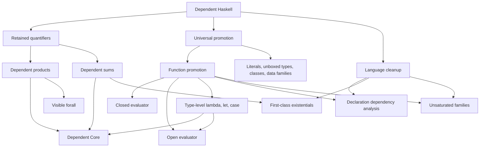

# Dependent Haskell program roadmap

Serokell’s roadmap has 50 cards and 67 edges. Its 2026-11-12 snapshot marks
23 cards complete and seven proposals accepted. Twenty cards have no status
marker. An edge can identify a prerequisite or a subtask. The
[dependency index](#upstream-checklist-and-complete-dependency-index)
records every edge. The R numbers are local labels for those cards.
[Upstream roadmap](https://ghc.serokell.io/dh).

## Where this fork stands

An ordinary module can check a signed offset once against a vector.
On success, `mkFinVec` returns a position of type `Fin n`. The caller
can use that position on any vector of length `n`. A negative offset
returns `Nothing` without inspecting the vector. A match on `FS p` in
a retained function identifies the actual predecessor `p`. Its proof
leaves that predecessor unevaluated. The same function accepts written
`FZ` and `FS p` as retained arguments. A constructor result can also
determine multiple erased parameters.
[Written constructors](roadmap/R03-dependent-products.md#write-indexed-constructors-in-retained-applications)
and [signed lookup and predecessor proof](roadmap/R03-dependent-products.md#retain-a-bounded-position-and-its-actual-predecessor).

An ordinary caller can split a vector at a runtime cut and obtain a
proof that appending the two pieces gives back its original input.
`splitAtValue` returns two retained vectors and a homogeneous equality.
For an independently read cut and total, `checkedSplitAtValue` returns
`Nothing` if the cut exceeds the total. On success, checking the suffix
length leaves the vector unevaluated. Opening the contents proof takes
the recursive path down the input spine. The expected result and the
length equality now select the original vector at the constructor call.
[Split theorem](examples/packed-vector/CertifiedSplit.hs) and
[ordinary caller](examples/packed-vector/CertifiedSplitClient.hs).

The 371-line Showcase runs in native code and source-loaded GHCi.
The source-hidden proof regression passes at `-O0`, `-O1`, and `-O2`.
Removing the induction premise fails at the final `Refl`. The certified split
checks without `UndecidableInstances`. The 368-line signed-lookup checkpoint
also passed both stages of a normal Hadrian build.
[Verification scope](CHECKPOINTS.md#family-and-package-checkpoints).

A retained function can name an entire indexed vector as its argument.
`foreach (xs :: Vec a n) -> xs :~: xs` returns `Refl` even for an
undefined vector. Using two different vector binders in the same equality
fails at `Refl`. A type synonym can also name a dependent consumer. An
ordinary module uses the exported synonym to pass an indexed payload.
A match on `VNil` now refines the value `xs` and its length. The
branch can return a heterogeneous equality between `xs` and `VNil`.
Matching `VCons x rest` refines the input to its actual head and tail.
The match forces the outer constructor. The fields stay lazy until the
caller inspects them.
[Dependent products](roadmap/R03-dependent-products.md) and
[named consumer](examples/packed-vector/DependentPair.hs).

`splitAtVec` takes a runtime cut `n` and a vector of length `Add n m`.
It returns two vectors of lengths `n` and `m`. An expected pair of
vectors determines the suffix length. So does the result of `dropVec`.
Use `takeVec @m` when only the prefix occurs in the result.

For a cut read independently of the vector, `splitAtVecChecked cut total xs`
returns `Nothing` when the cut exceeds the length. A successful split
packages a suffix length, the two vectors, and a proof of
`Add cut suffix :~: total`. An ordinary caller can match on `Refl` and
rejoin the vectors at the original length. Checking the bound only inspects
the lengths. [Checked split](examples/packed-vector/PackedVecLibrary.hs)
and [ordinary caller](examples/packed-vector/ListVectorClient.hs).

The Showcase also
checks the contents of a concrete split. Appending the two parts of
`[True, False]` gives that same vector. Swapping the elements makes the
equality proof fail at `Refl`. The ordinary polymorphic `appendVec` can itself appear in a type.
GHC infers the input lengths of two written vectors, reduces their sum,
and checks the exact output elements. An ordinary client can also use
`appendEmptyAt xs` to prove that appending an empty vector preserves
its runtime input. The proof does not inspect `xs`. The recursive
equation also applies to a runtime head, left tail, and right vector.
Reconstructing an arbitrary input after splitting still needs a proof
that identifies the vector matched in the successor branch.
[Split and prior art](REFERENCES.md#split-a-vector-at-a-retained-length) and
[contents proof](../../testsuite/tests/dependent/should_run/NativeClosedIndexedVec.hs).

A case on an ordinary comparator can return a witness for `p x` in all
three `Ordering` branches. A separately compiled ordinary module uses
the witness to choose an `Int`, `Bool`, or `Char` payload. It leaves the
other two payloads unevaluated. [Provider](examples/open-evaluation/RuntimeOrdering.hs)
and [ordinary client](examples/open-evaluation/OrderingPayload.hs).

An ordinary client can partition a vector with a runtime predicate and
return the two parts appended at the original input length. The producer
returns two nested `some` packages and proves that their lengths add up to
the input length. Returning just the kept vector at that length fails at
the returned expression. A caller can also choose either partition at
runtime and pass its length and vector to the same consumer. [Partition proof](examples/packed-vector/ConservedPartition.hs),
[ordinary caller](examples/packed-vector/ListVectorClient.hs) and
[verification](CHECKPOINTS.md#family-and-package-checkpoints).

A function can read a Boolean from an `IORef` and use it as the index
of an ordered type case in a value signature. The sample renders the
two results as `"7"` and `"'f'"`. A call that ignores its arguments
still returns 42 with an undefined index and payload. An ordinary client
can also open a hidden vector inside a pair without forcing the other
field. In a GADT field example, each branch passes the original runtime
Boolean to the field. Its result has type `Int` at `True` and `Char` at
`False`.
[Showcase](Showcase.hs) and [verification](CHECKPOINTS.md#family-and-package-checkpoints).

A rewrite rule can omit the types of its Boolean index and dependent
payload. GHC infers both from the function's retained signature. An
ordinary client can use the optimized rule. The rule fires even when the index comes from
an `IORef`. A call whose result ignores the index can return 19 with an
undefined Boolean. GHC checks type cases in ordinary and rank-n
constructor fields. The same higher-order class method can map over
values indexed by `Maybe` or by a partially applied type family.
[Rewrite rules](examples/qualified-pi/RetainedRules.hs),
[field cases](examples/open-evaluation/NativeNestedCase.hs) and
[class method client](examples/open-evaluation/IndexedMapClient.hs).

The module that defines the Peano list `size` can keep dependent syntax
off. Its `-fwrite-source-equations` option publishes the checked
recursive equations, including when compiling without object code.
The same source function runs at runtime. Separate ordinary proof
modules use its interface to reason about installed `map` and `filter`.
[Size definition](examples/open-evaluation/PreludeMapLengthSize.hs)
and [ordinary module boundary](BOUNDARY-EVIDENCE.md).

An ordinary caller can package a list's computed length with the vector
indexed by that length. A separate proof module uses the checked
equations for Prelude `(++)` to prove that append adds lengths and that
`map` distributes over append for finite lists. Its tests also check
that the right list and the elements remain lazy where promised.
[List-to-vector example](roadmap/R04-dependent-sums.md)
and [append proofs](roadmap/R16-open-term-evaluator.md#prove-that-map-distributes-over-append).

GHC checks that filtering a finite list cannot increase its `size`.
The list and the cutoff captured by its predicate can both come from
`IO`. A case on the predicate result supplies the evidence for the
checked `Prelude.filter` equation at that element. The proof takes an
explicit predicate argument that GHC erases. A decider for a different
predicate fails to typecheck. Observing the complete proof requires a
defined decision at each element.
[Filter proof](examples/open-evaluation/PreludeFilterLengthProof.hs),
[runtime cutoff](examples/open-evaluation/PreludeFilterCutoff.hs) and
[verification](CHECKPOINTS.md#family-and-package-checkpoints).

A function can repeat the same type-level case in its argument and result.
For `caseIdentity`, the result type is `Int` at `True` and `Bool` at
`False`. The body simply returns its argument even while the index is
unknown. An ordinary client reads the signature through the provider
interface and obtains `(42,False)`. A second example checks that an outer
index under a type family stays distinct from a shadowing pattern binder.
A staged interpreter can use the arrow kind supplied by its caller to
produce `(Just 3,Right 3)`.
[Value signature](examples/open-evaluation/NativeCase.hs),
[scoped indices](examples/open-evaluation/NativeNestedCase.hs) and
[staged interpreter](examples/open-evaluation/InterpretedKindUseSite.hs).

An ordinary module proves that `Prelude.map` preserves the length of
any finite list spine for any callback. The proof counts constructors
with the same Haskell `size` function that the program calls at runtime.
The empty case is immediate. The cons case uses the installed map equation
and the induction hypothesis for the tail. A claim that mapping adds one
element fails at the empty case. Omitting the induction hypothesis leaves
the tail equality unsolved. The runtime example counts two elements
without evaluating the callback.
[Proof](examples/open-evaluation/PreludeMapLengthProof.hs)
and [assumptions and checks](roadmap/R16-open-term-evaluator.md#prove-that-map-preserves-length).

A GADT field can package three vectors with two runtime lengths. Two
vectors share the outer length and can be zipped directly. The third
uses the inner length. The sample reads lengths 2 and 1 and the first
aligned pair `('h','s')` without evaluating either remaining tail or
the third vector. Giving either length the wrong vector is a type error
in the client that constructs the package.
[Source](examples/packed-vector/StoredVector.hs)
and [constructor and interface checks](roadmap/R04-dependent-sums.md#sums-in-constructor-fields).

A vector partition can store its two result lengths in one erased package.
The producer writes `Rows yes no`. An ordinary function equation can
inspect the passing vector with `firstPassing (Rows (VCons x _) _) = Just x`.
The match leaves both unused tails lazy. With `ImpredicativeTypes`, a
client can use `map rowLists` over partitions with different hidden lengths.
Quick Look can infer a complete erased package as a type argument. It
still checks runtime dependencies under the package binder.
[Partition equations](examples/erased-existentials/ImplicitVector.hs)
and [ordinary list client](examples/erased-existentials/PartitionChoices.hs).

A function with a proof of `a :~: b` can change a filtered vector's
element type from `a` to `b` under the same hidden length. A type-level
case can also use an equality for an earlier constructor index when
checking a later argument whose kind refers to that index. When a family
cannot reduce, the case still waits for more information.
[Type-level case](examples/open-evaluation/NativeNestedCase.hs).

An existential witness can itself be polymorphic. A producer can write
`(id, atTwoTypes)` for `exists t. (t, t -> (Int, Bool))`. The second field
determines that the first has type `forall a. a -> a`. A consumer can write
`observePair (f, k) = k f`. If it tries to return `f` at an arbitrary type,
the error identifies both the use and the pattern that opened the package.
A function can also hide the witness shared by all its calls. The consumer
can write `case builder @Int n of Callback f call -> call f` and use `f` at
both `Int` and `Bool` inside the case.
[Callback example](examples/erased-existentials/RankedPackage.hs).

A library can export optimizer rules that construct or open an erased
package. For example, a rule for `readHidden (x, k) = k x` with
`x :: Int` fires for an integer package. A package that holds a `Bool`
keeps its own callback. Both the provider and a client compiled from
its interface fire all four example rules at default `-O1` and `-O2`.
[Rules and provider](examples/erased-existentials/LexicalPackageRules.hs).

A stream can hide its state in an ordinary tuple with its step function.
The same consumer reads a list-backed stream and an integer stream that
skips even values. A one-element prefix leaves the rest of the input list
unevaluated. [Stream example](examples/erased-existentials/ErasedStream.hs).

A kind family can select a matchable arrow for `Maybe` and an unmatchable
arrow for a type family. Both results apply to `Int`. Before this change,
the fork rejected the second application. An ordinary client now prints
`(Just 7,[7])` from the producer interface. [Computed arrow kinds](examples/open-evaluation/InvisibleFamily.hs).

An interpreter can define arrow kinds before a declaration splice and
apply the interpreted type constructor after it. Interpreting two
applications of `Maybe` gives `Just (Just True)`. A class can also give
one associated type default, `type Callback a = a -> Maybe a`. An
ordinary client uses the default as both the kind of the promoted
constructor `'Just` and the type of a runtime callback.
[Interpreter](examples/open-evaluation/InterpretedKind.hs) and
[callback client](examples/open-evaluation/LegacyKindArgument.hs).

A second interpreter can apply `Either` to two argument types and can
also describe the type of `(&&)`. The choice of arrow in a family's
result can differ from the choice in its kind. The client prints
`(Right 7,False)` and leaves the second Boolean unevaluated. The
original `GADTSingletons` program compiles with a matchable arrow on
`(~>)` and a separate matchable `Promote` equation. Its bare equation
continues to handle ordinary function types.
[Interpreter and compatibility boundary](roadmap/R23-unsaturated-type-families.md#compatibility-with-existing-haskell).

The list interface of a stream with hidden state supports two ordinary
`foldr` consumers. With a separately compiled provider, both consume the
producer's builder at `-O1` and `-O2`. The first-element fold returns
`Just True` for a stream with an undefined tail. The integer fold reads
the odd digits in order and gives 531. The focused checks also run the
same source at `-O0`.
[Source folds](examples/erased-existentials/StreamFold.hs) and
[Core and recompilation checks](roadmap/R05-dependent-core.md#a-list-fold-over-a-hidden-stream-state).

A family argument can keep its last invisible binder while GHC infers
the earlier ones. For `RunVisible @Bool (ReadAt 'True)`, GHC infers
the result kind `Bool` and leaves the input type for `RunVisible`.
The same family produces `Int` when the receiver requests kind `Type`.
[Source and ordinary client](roadmap/R23-unsaturated-type-families.md#inferring-a-kind-after-supplying-a-visible-argument).

An ordinary client can prove two equations about the installed
`Prelude.filter Prelude.not`. A `False` head survives. A `True` head
is skipped. Both proofs leave the list tail unknown. The client reads
only the producer interface and disables rewrite rules in the module
that proves the equations. Keeping rewrite rules enabled reports
GHC-83605 at the proof. A runtime check reads the kept head with an
undefined tail. The Showcase checks the two proofs and this
demand behavior.
[Proof source](examples/open-evaluation/PreludeFilterProof.hs),
[filter alias](examples/open-evaluation/PreludeFilterSource.hs)
and [Showcase](Showcase.hs).

The upgrade tests cover a change to a family, a packed projection from
a home or installed module, and combinations of dependent projections
and ordered type cases. They check a first rebuild, reuse on a second
build, and rejection of stale evidence. The old and new compilers use
the same target libraries for each comparison. At three interface
compression levels the old reader rejects new constructor evidence at
the header. The new reader checks the coercion's role and scope.
For a provider that exports both an ordered case and a list filter, either
older compiler rebuilds that provider exactly once. A provider that needs only
the check its compiler already performed stays up to date.
[R05 interface checks](roadmap/R05-dependent-core.md#default-optimized-interfaces)
and [two-way filter and case upgrade](examples/open-evaluation/check-filter-scope-upgrade.sh).

| Card | What works | Remaining gap |
| --- | --- | --- |
| [R03 dependent products](roadmap/R03-dependent-products.md) and [R04 dependent sums](roadmap/R04-dependent-sums.md) | GADT data constructors can store nested retained sums and refer to erased parameters from the constructor signature. | Broaden dependent product domains and inference. Extend retained field checking to more constructor signatures. |
| [R05 dependent Core](roadmap/R05-dependent-core.md) | The standard `-O2` pipeline specializes a recursive consumer and keeps retained case proofs scoped. A provider and an interface-only client can match rules that construct or open an erased package. Source rules can have an imported head and a local anchor, or come from a visible orphan module. | Rules for retained functions and general dependent coercions remain open. |
| [R16 open evaluator](roadmap/R16-open-term-evaluator.md) | The installed `filter not` handles a known Boolean head and an unknown tail. A separate ordinary client proves length preservation for the installed `map` by induction over a finite spine. | General open evaluation across arbitrary ordinary definitions. |
| [R19 type-level cases](roadmap/R19-type-level-cases.md) | Retained signatures can match a runtime index or an application of a checked function. Two qualified imports of the same checked function can share a case in one declaration group. The upgrade test rebuilds an affected home provider once. | Separately compiled modules still need a shared result type at an unknown index. Older installed providers need rebuilding to export a shared result. |
| [R22 erased existentials](roadmap/R22-existential-quantification.md) | A constructor pattern can open a hidden vector length inside a tuple. A typed consumer can fix the higher-rank witness of a guarded callback. | Extend inference to callbacks without a result declaration that determines the witness. |
| [R23 unsaturated families](roadmap/R23-unsaturated-type-families.md) | An unsigned closed family can infer a callback that accepts constructors and partially applied families. A later GADT argument can fix a receiver's matchability. The original `KindEqualities2` checks across its declaration splice. | Extend higher-order inference beyond the tested closed-family cases and check compatibility of existing unannotated programs. |

The published evaluator work covers closed calls such as `Prelude.sum` and
open equations such as mapping `Prelude.not` over a list with a known head
and unknown tail. The proofs depend on what the function demands and on its
visible rewrite rules. Local lambdas, lets and mixed declarations have
source examples. General promotion remains open.
[R15 closed evaluation](roadmap/R15-closed-term-evaluator.md),
[R16 open evaluation](roadmap/R16-open-term-evaluator.md),
[R17 lambdas](roadmap/R17-type-level-lambdas.md),
[R18 lets](roadmap/R18-type-level-lets.md) and
[R21 declaration dependencies](roadmap/R21-dependency-analysis.md).

## Current work queue

The vector split now exercises dependent products, dependent sums, Core,
and open evaluation together. The empty and cons equations for ordinary
append pass through separate compilation. The split returns a
reconstruction proof for an arbitrary cut within the vector.
[Split evidence](roadmap/R04-dependent-sums.md#prove-a-split-preserves-the-original-vector)
and [append equations](roadmap/R16-open-term-evaluator.md#prove-that-empty-vector-append-preserves-its-right-operand).

1. **R03 and R05.** Extend the checked match beyond the one exact
   expected result slot used by the split. Keep ordinary type errors
   for independent values at one index. A Given equality between
   open family applications can expose a solver rewrite cycle.
   [Checked input inference](roadmap/R03-dependent-products.md)
   and [independent inputs](../../testsuite/tests/dependent/should_fail/NativeIrredIndexEvidence.hs).
2. **R05.** Preserve explicit `INLINE` unfoldings when an ordinary
   signature has a retained body. Select the required optimizer path
   when another module imports the unfolding. Check the demand of a
   partial application and report unsupported cases at the source.
   [Written unfolding checks](../../compiler/GHC/HsToCore/Binds.hs).

### Other open work

1. **R05.** A rule can match a retained head from another module.
   The same checked type application supplies the domains of `m`
   and `x` in `keepReading @Bool m x`. An ordinary value can precede
   the type argument. R03 must admit an erased binder inside a retained
   binder before a rule can use that order in a source signature.
   [Rule and interface support](roadmap/R05-dependent-core.md).
2. **R23 and R24.** A recursive family can forward a constructor
   or a partial family across stripped interfaces. When a signature
   contains one eligible written application, GHC locates its arity
   error there and suggests the extension. In a complete signature,
   the body can determine a nested callback arrow's matchability. An
   unconstrained callback arrow still takes its ordinary default.
   For R24, check a separate
   client's obligation when it forms an associated family application.
   [Domain example](roadmap/R24-constrained-type-families.md),
   [inferred callback arrows](roadmap/R23-unsaturated-type-families.md#inferring-a-callback-arrow-in-a-closed-family),
   [later argument](roadmap/R23-unsaturated-type-families.md#choosing-a-prefixs-matchability-from-a-later-argument)
   and [singletons migration](roadmap/R23-unsaturated-type-families.md#arrow-patterns-in-family-equations).
3. **R22 and R04.** An ordinary module can put an explicit existential
   package inside an implicit one and open both in a pattern. A direct call
   can infer a polymorphic consumer's parameter from a named mixed
   package or a call with a declared mixed result. The next boundary is
   a producer whose result type also needs inference.
   The list-to-vector producer carries a computed witness.
   [Retained list pairs](roadmap/R04-dependent-sums.md),
   [Guarded witness](roadmap/R22-existential-quantification.md#inferring-a-higher-rank-witness)
   and [nested patterns](roadmap/R22-existential-quantification.md#constructor-cases-on-the-payload).
4. **R19.** A branch on an ordinary Boolean can pass that same value to
   a retained field. Matching on an expression such as `not b` in
   the field selects the result type using the function in scope.
   Template Haskell still needs a representation for the retained field binder.
   [Retained scrutinees and scope](roadmap/R19-type-level-cases.md#compute-a-retained-scrutinee).
5. **R16.** The checked list worker supports the length theorem for
   `Prelude.reverse`. The next task is structural recursion with an
   arbitrary step function and seed, starting with a list right fold.
   [Append and map proofs](roadmap/R16-open-term-evaluator.md#prove-that-map-distributes-over-append).

6. **R21.** A retained field's worker can use a saturated local synonym
   such as `WorkerArgument Bool` in its signature. A worker in a later
   splice group gives GHC-76037 at the function name. A worker that needs
   the unfinished constructor still gives GHC-68947.
   [Declaration groups and aliases](roadmap/R21-dependency-analysis.md#local-synonyms-in-a-retained-field-worker).

Use this queue for current priorities, the linked card for its acceptance
criteria, and the [implementation log](PLAN.md) for results from individual
checkpoints. Earlier work orders and measurements are in the
[historical records](CHECKPOINTS.md#historical-roadmap-checkpoints).

## Remaining work by roadmap area

The table gives the completion criteria for each area.

| Roadmap area | Remaining local work | Main obligations before completion |
| --- | --- | --- |
| R03: dependent products | General domains, broader invisible argument inference, runtime `Type` operands | Separate retention from visibility. Define a runtime universe bridge. Required erased `forall` and existing `TypeRep` do not supply that bridge. |
| R04 and R22: sums and existentials | First-class erased `exists` and retained `some` | Specify formation, introduction, elimination, scope and representation. Existing retained ADT fields provide a storage baseline. |
| R05: dependent Core | Typed conversion, proof operations, transformations, unfoldings and normal optimization | Reconcile the native forms with the calculi. Preserve roles, scope, demand, sharing and ordinary GHC behavior. |
| R15 and R16: closed and open evaluation | Computation in types over closed inputs and rigid variables | Specify staging, divergence, stuck terms and diagnostics. Reuse ordinary term definitions without parallel handwritten families. |
| R13, R17–R19 and R21: function promotion | Type-level lambda, let and case; mixed declaration dependencies | Integrate typed evaluation and matchability. Demonstrate one source function used at both levels across an interface. |
| R23 and R24: type families | Source unsaturation, inference/defaulting and family constraints | Complete the family design beyond the internal matchability foundation. Preserve noninjective application and evidence validity. |
| R07, R10–R12 and R14: promotion domains | General literals, unboxed types, homogeneous equality, classes and data families | Define each domain and its representation separately. Reuse inherited Char and Natural support. |
| R20, R27, R34–R36 and R41: language preparation | Remaining accepted cleanup and binder work | Follow each proposal and its current implementation. Track loose ends without reopening an entire completed upstream card. |
| R01, R02 and R06: aggregate goals | Integrate retained quantification, promotion and language preparation | Complete their required feature scope and broader compatibility checks. A single example cannot close an aggregate goal. |

## Local subset, library and assurance work

The user selected an opt-in dependent subset in modules. A small dependent-base
library should make that subset useful with ordinary Haskell libraries. These local tasks have their own acceptance criteria.

| Task | Roadmap relation | Next result and boundary |
| --- | --- | --- |
| Module interoperability | R03 and R05 | Check an indexed API from a module without dependent syntax. Preserve imported types and infer relationships where supported. Use an explicit adapter when a caller cannot express the contract. |
| Small dependent-base | R03 and R04 | Start with the existing Nat, Vec, Fin, equality and package operations. The example library provides list conversion, package elimination and the [exact-length adapter](PLAN.md#m95-check-ordinary-list-inputs-at-an-indexed-boundary). Package and module names remain provisional. |
| Optional checks at the dependent boundary | Local interoperability work, using R15 and R16 | Check a closed obligation about an ordinary producer. Export the exact witness to dependent and ordinary clients. Keep property-test reports separate from evidence used to discharge a constraint. [Boundary evidence](BOUNDARY-EVIDENCE.md). |
| Conservative totality checking | Local assurance work related to R05 | Specify the property for lazy Haskell. Start with coverage and structural recursion. Keep checked results, trusted assumptions and unknown status distinct across imports. |
| Observational equality | R05 research | Compare explicit equality and transport with OTT. Keep checker conversion, contextual equivalence and inverse application distinct. No new equality rule is selected. |

A module flag enables source features. It does not remove imported contracts.
An ordinary import supplies no extra termination or proof guarantee unless a
check or an explicit trusted contract establishes it. Partial dependent code
can still preserve an index invariant when it returns. Totality remains a
separate promise. A termination checker alone does not establish logical
consistency; positivity, universes, proof elimination and unsafe operations
also need rules.
Specify the required inputs as well as the result. A checked function on total
inputs does not certify a result obtained from an unchecked lazy argument.

Use linear-base as the library and adapter reference. Use Idris and Agda as
references for conservative totality checks and imported assumptions. Their
current guarantees do not transfer to this fork. See the new boundary and
observational-equality entries in [REFERENCES.md](REFERENCES.md).

The first candidate is an advisory report for covered first-order functions
with direct structural recursion. Use the zonked source AST and the existing
coverage checker. Recompute the complete call graph; the inference graph omits
some signed-call edges. Unsupported recursion, callbacks and imports stay
unknown. No checker or new totality guarantee is implemented.

Use LiquidHaskell's [Refinement Types For Haskell](https://simon.peytonjones.org/assets/pdfs/refinement-types-for-haskell.pdf)
as Haskell-specific prior art. Its analysis distinguishes potentially divergent
terms, weak-head values and finite values. Keep the first report advisory.
It must not change conversion, proof erasure or imported type contracts.

## Main relationships

Arrows have the same direction as the upstream graph: a task points to a
prerequisite or subtask. This diagram omits completed preparation and smaller
branches. The full checklist below preserves every edge.

A retained-quantifier experiment can proceed before universal promotion is
complete. Completing that experiment will still leave the promotion and cleanup
branches open.

## Upstream checklist and complete dependency index

A checked box means **completed on the upstream roadmap snapshot**. It does not
mean that this fork completed the feature or that every related issue is closed.
`Accepted` is a design status. Leave its box unchecked until implementation is
verified. The `R` numbers are local reference labels; links retain upstream IDs.
`Needs/includes` records the graph relation without claiming that every edge is
a mandatory sequencing constraint. A leaf has no outgoing graph edge; it can
still require substantial research.

- [ ] **R01 [Dependent Haskell](https://ghc.serokell.io/dh#dependent-haskell)** — Unmarked. Needs/includes: R02, R06, R20.
- [ ] **R02 [Dependent retained quantifiers](https://ghc.serokell.io/dh#dependent-retained-quantifiers)** — Unmarked. Needs/includes: R03, R04.
- [ ] **R03 [Dependent products](https://ghc.serokell.io/dh#dependent-products)** — Unmarked. Needs/includes: R05, R39.
- [ ] **R04 [Dependent sums](https://ghc.serokell.io/dh#dependent-sums)** — Unmarked. Needs/includes: R05, R22.
- [ ] **R05 [Dependent Core language](https://ghc.serokell.io/dh#dependent-core-language)** — Unmarked. Needs/includes: no outgoing graph edge.
- [ ] **R06 [Universal promotion](https://ghc.serokell.io/dh#universal-promotion)** — Unmarked. Needs/includes: R07, R10, R12, R13, R14.
- [ ] **R07 [Promote literals](https://ghc.serokell.io/dh#promote-literals)** — Unmarked. Needs/includes: R08, R09, R24. M80 supplies nonnegative type numerals at registered index kinds. [M83](PLAN.md#m83-ordinary-numerals-in-retained-arguments) accepts term numerals in retained arguments when the actual conversion has checked equations. A complete monomorphic annotation can name the retained domain. General overloaded term promotion and constrained family evaluation remain open.
- [x] **R08 [Promote Char](https://ghc.serokell.io/dh#promote-char)** — Completed. Needs/includes: no outgoing graph edge.
- [x] **R09 [Promote Natural](https://ghc.serokell.io/dh#promote-natural)** — Completed. Needs/includes: no outgoing graph edge.
- [ ] **R10 [Promote unboxed types](https://ghc.serokell.io/dh#promote-unboxed-types)** — Unmarked. Needs/includes: R11.
- [ ] **R11 [Homogeneous equality](https://ghc.serokell.io/dh#homogeneous-equality)** — Unmarked. Needs/includes: no outgoing graph edge.
- [ ] **R12 [Promote classes](https://ghc.serokell.io/dh#promote-classes)** — Unmarked. Needs/includes: R13, R24. M82 connects a concrete instance method to a checked source function in a retained argument. M83 checks the selected ground `Num` instance’s conversion of a nonnegative literal. General classes and abstract dictionary arguments remain open.
- [ ] **R13 [Function promotion](https://ghc.serokell.io/dh#function-promotion)** — Unmarked. Needs/includes: R15, R16, R17, R18, R19, R21, R23. The [map length example](roadmap/R16-open-term-evaluator.md#prove-that-map-preserves-length) calls the ordinary `size` function at runtime and uses its checked equations in a separate proof module.
- [ ] **R14 [Data family promotion](https://ghc.serokell.io/dh#data-family-promotion)** — Unmarked. Needs/includes: no outgoing graph edge.
- [ ] **R15 [Closed term evaluator](https://ghc.serokell.io/dh#closed-term-evaluator)** — Unmarked. Needs/includes: no outgoing graph edge. M99, M101 and M103 support qualified closed calls on a character or a list of natural number literals. The argument can determine a polymorphic function's specialization. M105 reads back one list layer of a supported scalar type. M106 composes qualified unary calls. M108 passes all supported result shapes between calls. M110 accepts written literals at those kinds. M111 checks the roadmap's length signature. M113 checks saturated calls with joint operand inference. M116 returns a boxed pair and passes it to a later call. M118 extends this to `Maybe` and `Either`. M120 adds recursive lists. M122 infers the kinds of constructor literals from the producer and the other inputs. M124 admits imported ordinary enumerations. M127 adds finite recursive datatypes with ground boxed fields. M129 admits GADT constructor equalities at a known index. M130 recovers constructor-local indices along nominally injective paths in the result. M132 consumes written existential packages. M135 recovers a runtime-selected index from a singleton field. M136 composes ordinary nested calls before observing their result. M139 uses a known expected kind to specialize a conversion. M140 passes a known domain to a nested conversion. M143 shares kinds between computed siblings. M145 carries kinds through a checked projection. M149 preserves a pair field’s laziness in an enclosing ordinary call. M153 also checks a direct projection of a copied field through interfaces. M157 exposed a compatibility failure for a computed field and remains experimental. M165 runs a closed call with an imported callback. See the [active card](roadmap/R15-closed-term-evaluator.md).
- [ ] **R16 [Open term evaluator](https://ghc.serokell.io/dh#open-term-evaluator)** — Unmarked. Needs/includes: no outgoing graph edge. M100 and M102 handle rigid projections. M104 retries a call before generalization when a pattern fixes a signature wildcard. M107 selects a branch with a known character and a rigid result operand. M109 publishes a closed family for finite character mappings and follows a checked alias across an interface. M114 checks boxed-pair projections and detects a blocked rigid pair. M119 preserves installed Prelude projections of an unknown pair in exported constraints. M121 also certifies an ordinary case that rebuilds a pair from its fields. M123 proves a projection of a swap for an unknown pair. M125 follows both projected fields through chains of checked pair constructors. M126 obtains an independent local producer from the current source module. M128 observes its chain of local helpers. M131 handles recursive value groups and tracks demanded source binders. M133 selects fields of known ordinary user constructors and checks the demanded imported unfoldings against rewrite rules. M137 returns supported constructors and boxed pairs with symbolic fields. M142 publishes checked pair cases from ordinary producers. M144 exports projections for ordinary sums. M146 checks nested constructor patterns and a fallback argument. M148 builds public constructors in the result of a case. M151 retains helper equations inside those constructors. M154 checks a private helper that itself returns a public lazy constructor. M155 follows acyclic private helper calls. M158 also checks a case inside a private helper. M159 publishes a structurally recursive unary call under a lazy output constructor. M162 checks a recursive call with an unchanged second operand. M168 and M169 preserve a callback during recursion on the second argument and check an ordinary client using its equation. See the [open-term examples and checks](roadmap/R16-open-term-evaluator.md).
- [ ] **R17 [Type-level lambdas](https://ghc.serokell.io/dh#type-level-lambdas)** — Unmarked. Needs/includes: R05, R16.
- [ ] **R18 [Type-level let-bindings](https://ghc.serokell.io/dh#type-level-let-bindings)** — Unmarked. Needs/includes: R05, R16.
- [ ] **R19 [Type-level case-expressions](https://ghc.serokell.io/dh#type-level-case-expressions)** — Unmarked. Needs/includes: R05, R16.
- [ ] **R20 [Clean up the language](https://ghc.serokell.io/dh#clean-up-the-language)** — Unmarked. Needs/includes: R21, R22, R23, R24, R27, R28, R35, R39, R49.
- [ ] **R21 [Dependency analysis](https://ghc.serokell.io/dh#dependency-analysis)** — Accepted. Needs/includes: no outgoing graph edge. M126 schedules an independent local producer for open evaluation. M128 extends scheduling to a chain of acyclic value bindings. M131 also schedules mutually recursive value groups, with or without complete signatures. M134 schedules local datatypes and synonyms with their ordinary value prerequisites. M138 admits deriving and default declarations with ready prerequisites. M147 installs ordinary class instance heads and associated type equations before local producers, then checks the methods. M150 also schedules associated data and standalone family instances. M152 schedules a local producer before the equations of a fresh local family. M156 checks independent local functions used by an imported family equation. M160 accepts imported functions with independent polymorphic signatures in those local producers. M163 admits saturated ordinary data constructors and checks their field types. M164 also infers an unsigned producer. [Scope and remaining dependencies](roadmap/R21-dependency-analysis.md).
- [ ] **R22 [Existential quantification](https://ghc.serokell.io/dh#existential-quantification)** — Unmarked. Needs/includes: no outgoing graph edge. The first acceptance check opens an erased package from another module. An implicitly packed vector filter must also return its first cell without forcing the tail. [Source examples and Core checks](roadmap/R22-existential-quantification.md).
- [ ] **R23 [Unsaturated type families](https://ghc.serokell.io/dh#unsaturated-type-families)** — Accepted. Needs/includes: R25. M141 restores omitted-arrow inference for a dependent argument. M166 passes a partial user family through an interface at a known unmatchable arrow. General inference and ordinary-program compatibility remain open. [Checks and remaining work](roadmap/R23-unsaturated-type-families.md#m166-passing-an-unsaturated-family-to-an-unmatchable-binder).
- [ ] **R24 [Constrained type families](https://ghc.serokell.io/dh#constrained-type-families)** — Unmarked. Needs/includes: no outgoing graph edge. [Source boundary and first check](roadmap/R24-constrained-type-families.md).
- [x] **R25 [Modifiers syntax](https://ghc.serokell.io/dh#modifiers-syntax)** — Completed. Needs/includes: no outgoing graph edge.
- [x] **R26 [Standalone kind signatures](https://ghc.serokell.io/dh#standalone-kind-signatures)** — Completed. Needs/includes: no outgoing graph edge.
- [ ] **R27 [Deprecate CUSKs](https://ghc.serokell.io/dh#deprecate-cusks)** — Accepted. Needs/includes: R26, R29.
- [x] **R28 [Invisible type arguments](https://ghc.serokell.io/dh#invisible-type-arguments)** — Completed. Needs/includes: R29, R30, R31, R32, R33.
- [x] **R29 [Invisible binders in types](https://ghc.serokell.io/dh#invisible-binders-in-types)** — Completed. Needs/includes: R26.
- [x] **R30 [Invisible binders in functions](https://ghc.serokell.io/dh#invisible-binders-in-functions)** — Completed. Needs/includes: no outgoing graph edge.
- [x] **R31 [Invisible binders in constructors](https://ghc.serokell.io/dh#invisible-binders-in-constructors)** — Completed. Needs/includes: no outgoing graph edge.
- [x] **R32 [Visible type applications](https://ghc.serokell.io/dh#visible-type-applications)** — Completed. Needs/includes: no outgoing graph edge.
- [x] **R33 [Visible kind applications](https://ghc.serokell.io/dh#visible-kind-applications)** — Completed. Needs/includes: no outgoing graph edge.
- [ ] **R34 [Syntactic unification](https://ghc.serokell.io/dh#syntactic-unification)** — Accepted. Needs/includes: R44, R45, R46, R47.
- [ ] **R35 [Namespace management](https://ghc.serokell.io/dh#namespace-management)** — Accepted. Needs/includes: R36, R37, R38, R42.
- [ ] **R36 [Pun warnings](https://ghc.serokell.io/dh#pun-warnings)** — Accepted. Needs/includes: no outgoing graph edge.
- [x] **R37 [Namespace-specified imports](https://ghc.serokell.io/dh#namespace-specified-imports)** — Completed. Needs/includes: no outgoing graph edge.
- [x] **R38 [No list or tuple puns](https://ghc.serokell.io/dh#no-list-or-tuple-puns)** — Completed. Needs/includes: no outgoing graph edge.
- [x] **R39 [Visible forall](https://ghc.serokell.io/dh#visible-forall)** — Completed. Needs/includes: R34 (loose end), R40, R41 (loose end), R43.
- [x] **R40 [Visibility coercions](https://ghc.serokell.io/dh#visibility-coercions)** — Completed. Needs/includes: no outgoing graph edge.
- [ ] **R41 [Nested quantification in GADTs](https://ghc.serokell.io/dh#nested-quantification-in-gadts)** — Accepted. Needs/includes: no outgoing graph edge.
- [x] **R42 [Embed types](https://ghc.serokell.io/dh#embed-types)** — Completed. Needs/includes: no outgoing graph edge.
- [x] **R43 [Term variable capture](https://ghc.serokell.io/dh#term-variable-capture)** — Completed. Needs/includes: no outgoing graph edge.
- [x] **R44 [No star kind syntax](https://ghc.serokell.io/dh#no-star-kind-syntax)** — Completed. Needs/includes: R50.
- [x] **R45 [The forall keyword](https://ghc.serokell.io/dh#the-forall-keyword)** — Completed. Needs/includes: no outgoing graph edge.
- [x] **R46 [The tilde operator](https://ghc.serokell.io/dh#the-tilde-operator)** — Completed. Needs/includes: R48.
- [x] **R47 [The dot type operator](https://ghc.serokell.io/dh#the-dot-type-operator)** — Completed. Needs/includes: R48.
- [x] **R48 [Whitespace-sensitive operators](https://ghc.serokell.io/dh#whitespace-sensitive-operators)** — Completed. Needs/includes: no outgoing graph edge.
- [x] **R49 [Unify type and kind variables](https://ghc.serokell.io/dh#unify-type-and-kind-variables)** — Completed. Needs/includes: R50.
- [x] **R50 [Unify types and kinds](https://ghc.serokell.io/dh#unify-types-and-kinds)** — Completed. Needs/includes: no outgoing graph edge.

`R39 -> R34` and `R39 -> R41` are the two loose-end edges. Required type
arguments already exist while syntax unification and nested GADT quantifiers
remain incomplete. Do not infer completion by propagating checkmarks through
the graph.

## Research and provenance

The [reference ledger](REFERENCES.md) connects implementation decisions to
GHC proposals, Agda, the singleton encoding and the published Core calculi.
The [paper notes](papers/README.md) record the sections studied. The
[historical port](PORT.md) identifies Eisenberg’s branch and the commits
used for the native Core design.
