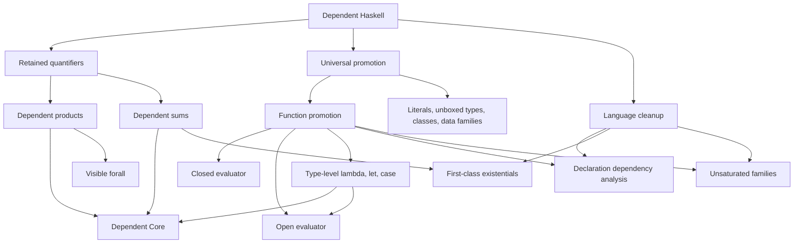

# Dependent Haskell program roadmap

Serokell’s roadmap has 50 cards and 67 edges. Its 2026-11-12 snapshot marks
23 cards complete and seven proposals accepted. Twenty cards have no status
marker. An edge can identify a prerequisite or a subtask. The
[dependency index](#upstream-checklist-and-complete-dependency-index)
records every edge. The R numbers are local labels for those cards.
[Upstream roadmap](https://ghc.serokell.io/dh).

## Where this fork stands

The fork accepts runtime-indexed functions, constructor fields and selected
ordinary functions in types. A pair can store an abstract lifted witness.
An ordinary client can read its payload without forcing the witness, even
when that witness comes from IO.

Both native compiler stages reproduce the 277 lines of the [Showcase](Showcase.hs)
at `-O0` and default `-O1`. The self-hosted compiler also matches the golden
output with stripped interfaces and in GHCi. An inherited class method fills
a length-indexed vector. A conversion discards a stored witness and keeps its
indexed payload. A closed family matches two independently written sums.
[Run the Showcase](README.md#run-the-showcase).

At `939079e263`, all 56 focused tests that ran passed. In the dependent
directory, 282 of 312 executed normal-way tests passed. The same 30 tests
failed at `250b4e328a`, where 279 of 309 passed. An ordinary client can
bind an imported pair locally and project its payload at `-O1`. The
exceptional witness stays lazy. Both compiler stages also compile an ordinary
client that imports the matchability types from `GHC.Matchability` in base.

The upgrade tests cover a change to a family, a packed projection from
a home or installed module, and combinations of dependent projections
and ordered type cases. They check a first rebuild, reuse on a second
build, and rejection of stale evidence. The old and new compilers use
the same target libraries for each comparison. At three interface
compression levels the old reader rejects new constructor evidence at
the header. The new reader checks the coercion's role and scope.
[R05 interface checks](roadmap/R05-dependent-core.md#default-optimized-interfaces).

| Card | What works | Remaining gap |
| --- | --- | --- |
| [R03 dependent products](roadmap/R03-dependent-products.md) and [R04 dependent sums](roadmap/R04-dependent-sums.md) | A function signature can name its argument or result sum directly with `some`. Independent sums can satisfy a repeated argument in a closed family. | Extend sum syntax to constructor fields. Broaden dependent product domains and inference. |
| [R05 dependent Core](roadmap/R05-dependent-core.md) | An ordinary client inherits a length-indexed default method and projects an imported pair at `-O1`. Worker/wrapper preserves an erased package and its payload scope in a GHC API test. | Admit surviving package operations to every scheduled optimizer pass. |
| [R16 open evaluator](roadmap/R16-open-term-evaluator.md) | The integrated Showcase checks a mapper’s cons rule on an unknown tail and composes two checked traversals. Observing the result constructor leaves the inner callback lazy. | General open evaluation across arbitrary ordinary definitions. |
| [R19 type-level cases](roadmap/R19-type-level-cases.md) | A constructor row can precede a wildcard or named catch-all. The case stays stuck when an unknown input blocks an earlier constructor test. | General mixed patterns and open GADT indices. |
| [R22 erased existentials](roadmap/R22-existential-quantification.md) | The recursive vector filter infers its result length under `exists (n :: Nat). Vec a n`. A caller can bind the result in a local `let`. A lambda can produce a packaged function. | Apply a hidden function directly, preserve witness scope across other expressions, and support general witness projections. |
| [R23 unsaturated families](roadmap/R23-unsaturated-type-families.md) | The integrated compiler reports conflicting arrow matchabilities and suppresses the argument-count hint for a stuck family. | General family unsaturation and compatibility with ordinary programs. |

The published evaluator work covers closed calls such as `Prelude.sum` and
open equations such as mapping `Prelude.not` over a list with a known head
and unknown tail. The proofs depend on what the function demands and on its
visible rewrite rules. Local lambdas, lets and mixed declarations have
source examples. General promotion remains open.
[R15 closed evaluation](roadmap/R15-closed-term-evaluator.md),
[R16 open evaluation](roadmap/R16-open-term-evaluator.md),
[R17 lambdas](roadmap/R17-type-level-lambdas.md),
[R18 lets](roadmap/R18-type-level-lets.md) and
[R21 declaration dependencies](roadmap/R21-dependency-analysis.md).

## Current work queue

1. **R22.** Integrate direct application of an implicitly packaged function.
   The private compiler at `a29d155eb0` checks the call inside a fresh
   witness scope. Verify the consumer, linear use and escape diagnostics
   with the combined compiler.
2. **R04.** Verify direct sum types in ordinary constructor fields.
   Check strict boxed storage, selector calls and the lifetime of a local
   index during float-in. Check that TH can reify a field while generated
   case helpers remain private.
3. **R05.** At `4c454fdddc`, worker/wrapper preserves lazy erased packages.
   The private call-arity change at `7bef69196c` also handles repeated
   calls to a stored function. Check both floating passes, specialisation,
   exitification and CSE before admitting raw packages to the normal pipeline.
4. **R19 and R23.** Broaden type cases over indexed scrutinees. Use the
   ordinary-program regression baseline when extending family unsaturation.

Use this queue for current priorities, the linked card for its acceptance
criteria, and the [implementation log](PLAN.md) for results from individual
checkpoints. Earlier work orders and measurements are in the
[historical records](CHECKPOINTS.md#historical-roadmap-checkpoints).

## Remaining work by roadmap area

The table gives the completion criteria for each area.

| Roadmap area | Remaining local work | Main obligations before completion |
| --- | --- | --- |
| R03: dependent products | General domains, broader invisible argument inference, runtime `Type` operands | Separate retention from visibility. Define a runtime universe bridge. Required erased `forall` and existing `TypeRep` do not supply that bridge. |
| R04 and R22: sums and existentials | First-class erased `exists` and retained `some` | Specify formation, introduction, elimination, scope and representation. Existing retained ADT fields provide a storage baseline. |
| R05: dependent Core | Typed conversion, proof operations, transformations, unfoldings and normal optimization | Reconcile the native forms with the calculi. Preserve roles, scope, demand, sharing and ordinary GHC behavior. |
| R15 and R16: closed and open evaluation | Computation in types over closed inputs and rigid variables | Specify staging, divergence, stuck terms and diagnostics. Reuse ordinary term definitions without parallel handwritten families. |
| R13, R17–R19 and R21: function promotion | Type-level lambda, let and case; mixed declaration dependencies | Integrate typed evaluation and matchability. Demonstrate one source function used at both levels across an interface. |
| R23 and R24: type families | Source unsaturation, inference/defaulting and family constraints | Complete the family design beyond the internal matchability foundation. Preserve noninjective application and evidence validity. |
| R07, R10–R12 and R14: promotion domains | General literals, unboxed types, homogeneous equality, classes and data families | Define each domain and its representation separately. Reuse inherited Char and Natural support. |
| R20, R27, R34–R36 and R41: language preparation | Remaining accepted cleanup and binder work | Follow each proposal and its current implementation. Track loose ends without reopening an entire completed upstream card. |
| R01, R02 and R06: aggregate goals | Integrate retained quantification, promotion and language preparation | Complete their required feature scope and broader compatibility checks. A single example cannot close an aggregate goal. |

## Local subset, library and assurance work

The user selected an opt-in dependent subset in modules. A small dependent-base
library should make that subset useful with ordinary Haskell libraries. These local tasks have their own acceptance criteria.

| Task | Roadmap relation | Next result and boundary |
| --- | --- | --- |
| Module interoperability | R03 and R05 | Check an indexed API from a module without dependent syntax. Preserve imported types and infer relationships where supported. Use an explicit adapter when a caller cannot express the contract. |
| Small dependent-base | R03 and R04 | Start with the existing Nat, Vec, Fin, equality and package operations. The example library provides list conversion, package elimination and the [exact-length adapter](PLAN.md#m95-check-ordinary-list-inputs-at-an-indexed-boundary). Package and module names remain provisional. |
| Optional checks at the dependent boundary | Local interoperability work, using R15 and R16 | Check a closed obligation about an ordinary producer. Export the exact witness to dependent and ordinary clients. Keep property-test reports separate from evidence used to discharge a constraint. [Boundary evidence](BOUNDARY-EVIDENCE.md). |
| Conservative totality checking | Local assurance work related to R05 | Specify the property for lazy Haskell. Start with coverage and structural recursion. Keep checked results, trusted assumptions and unknown status distinct across imports. |
| Observational equality | R05 research | Compare explicit equality and transport with OTT. Keep checker conversion, contextual equivalence and inverse application distinct. No new equality rule is selected. |

A module flag enables source features. It does not remove imported contracts.
An ordinary import supplies no extra termination or proof guarantee unless a
check or an explicit trusted contract establishes it. Partial dependent code
can still preserve an index invariant when it returns. Totality remains a
separate promise. A termination checker alone does not establish logical
consistency; positivity, universes, proof elimination and unsafe operations
also need rules.
Specify the required inputs as well as the result. A checked function on total
inputs does not certify a result obtained from an unchecked lazy argument.

Use linear-base as the library and adapter reference. Use Idris and Agda as
references for conservative totality checks and imported assumptions. Their
current guarantees do not transfer to this fork. See the new boundary and
observational-equality entries in [REFERENCES.md](REFERENCES.md).

The first candidate is an advisory report for covered first-order functions
with direct structural recursion. Use the zonked source AST and the existing
coverage checker. Recompute the complete call graph; the inference graph omits
some signed-call edges. Unsupported recursion, callbacks and imports stay
unknown. No checker or new totality guarantee is implemented.

Use LiquidHaskell's [Refinement Types For Haskell](https://simon.peytonjones.org/assets/pdfs/refinement-types-for-haskell.pdf)
as Haskell-specific prior art. Its analysis distinguishes potentially divergent
terms, weak-head values and finite values. Keep the first report advisory.
It must not change conversion, proof erasure or imported type contracts.

## Main relationships

Arrows have the same direction as the upstream graph: a task points to a
prerequisite or subtask. This diagram omits completed preparation and smaller
branches. The full checklist below preserves every edge.

A retained-quantifier experiment can proceed before universal promotion is
complete. Completing that experiment will still leave the promotion and cleanup
branches open.

## Upstream checklist and complete dependency index

A checked box means **completed on the upstream roadmap snapshot**. It does not
mean that this fork completed the feature or that every related issue is closed.
`Accepted` is a design status. Leave its box unchecked until implementation is
verified. The `R` numbers are local reference labels; links retain upstream IDs.
`Needs/includes` records the graph relation without claiming that every edge is
a mandatory sequencing constraint. A leaf has no outgoing graph edge; it can
still require substantial research.

- [ ] **R01 [Dependent Haskell](https://ghc.serokell.io/dh#dependent-haskell)** — Unmarked. Needs/includes: R02, R06, R20.
- [ ] **R02 [Dependent retained quantifiers](https://ghc.serokell.io/dh#dependent-retained-quantifiers)** — Unmarked. Needs/includes: R03, R04.
- [ ] **R03 [Dependent products](https://ghc.serokell.io/dh#dependent-products)** — Unmarked. Needs/includes: R05, R39.
- [ ] **R04 [Dependent sums](https://ghc.serokell.io/dh#dependent-sums)** — Unmarked. Needs/includes: R05, R22.
- [ ] **R05 [Dependent Core language](https://ghc.serokell.io/dh#dependent-core-language)** — Unmarked. Needs/includes: no outgoing graph edge.
- [ ] **R06 [Universal promotion](https://ghc.serokell.io/dh#universal-promotion)** — Unmarked. Needs/includes: R07, R10, R12, R13, R14.
- [ ] **R07 [Promote literals](https://ghc.serokell.io/dh#promote-literals)** — Unmarked. Needs/includes: R08, R09, R24. M80 supplies nonnegative type numerals at registered index kinds. M83 accepts term numerals in retained arguments when the actual Peano conversion has checked equations. General overloaded term promotion and constrained family evaluation remain open.
- [x] **R08 [Promote Char](https://ghc.serokell.io/dh#promote-char)** — Completed. Needs/includes: no outgoing graph edge.
- [x] **R09 [Promote Natural](https://ghc.serokell.io/dh#promote-natural)** — Completed. Needs/includes: no outgoing graph edge.
- [ ] **R10 [Promote unboxed types](https://ghc.serokell.io/dh#promote-unboxed-types)** — Unmarked. Needs/includes: R11.
- [ ] **R11 [Homogeneous equality](https://ghc.serokell.io/dh#homogeneous-equality)** — Unmarked. Needs/includes: no outgoing graph edge.
- [ ] **R12 [Promote classes](https://ghc.serokell.io/dh#promote-classes)** — Unmarked. Needs/includes: R13, R24. M82 connects a concrete instance method to a checked source function in a retained argument. M83 checks the selected ground `Num` instance’s conversion of a nonnegative literal. General classes and abstract dictionary arguments remain open.
- [ ] **R13 [Function promotion](https://ghc.serokell.io/dh#function-promotion)** — Unmarked. Needs/includes: R15, R16, R17, R18, R19, R21, R23.
- [ ] **R14 [Data family promotion](https://ghc.serokell.io/dh#data-family-promotion)** — Unmarked. Needs/includes: no outgoing graph edge.
- [ ] **R15 [Closed term evaluator](https://ghc.serokell.io/dh#closed-term-evaluator)** — Unmarked. Needs/includes: no outgoing graph edge. M99, M101 and M103 support qualified closed calls on a character or a list of natural number literals. The argument can determine a polymorphic function's specialization. M105 reads back one list layer of a supported scalar type. M106 composes qualified unary calls. M108 passes all supported result shapes between calls. M110 accepts written literals at those kinds. M111 checks the roadmap's length signature. M113 checks saturated calls with joint operand inference. M116 returns a boxed pair and passes it to a later call. M118 extends this to `Maybe` and `Either`. M120 adds recursive lists. M122 infers the kinds of constructor literals from the producer and the other inputs. M124 admits imported ordinary enumerations. M127 adds finite recursive datatypes with ground boxed fields. M129 admits GADT constructor equalities at a known index. M130 recovers constructor-local indices along nominally injective paths in the result. M132 consumes written existential packages. M135 recovers a runtime-selected index from a singleton field. M136 composes ordinary nested calls before observing their result. M139 uses a known expected kind to specialize a conversion. M140 passes a known domain to a nested conversion. M143 shares kinds between computed siblings. M145 carries kinds through a checked projection. M149 preserves a pair field’s laziness in an enclosing ordinary call. M153 also checks a direct projection of a copied field through interfaces. M157 exposed a compatibility failure for a computed field and remains experimental. M165 runs a closed call with an imported callback. See the [active card](roadmap/R15-closed-term-evaluator.md).
- [ ] **R16 [Open term evaluator](https://ghc.serokell.io/dh#open-term-evaluator)** — Unmarked. Needs/includes: no outgoing graph edge. M100 and M102 handle rigid projections. M104 retries a call before generalization when a pattern fixes a signature wildcard. M107 selects a branch with a known character and a rigid result operand. M109 publishes a closed family for finite character mappings and follows a checked alias across an interface. M114 checks boxed-pair projections and detects a blocked rigid pair. M119 preserves installed Prelude projections of an unknown pair in exported constraints. M121 also certifies an ordinary case that rebuilds a pair from its fields. M123 proves a projection of a swap for an unknown pair. M125 follows both projected fields through chains of checked pair constructors. M126 obtains an independent local producer from the current source module. M128 observes its chain of local helpers. M131 handles recursive value groups and tracks demanded source binders. M133 selects fields of known ordinary user constructors and checks the demanded imported unfoldings against rewrite rules. M137 returns supported constructors and boxed pairs with symbolic fields. M142 publishes checked pair cases from ordinary producers. M144 exports projections for ordinary sums. M146 checks nested constructor patterns and a fallback argument. M148 builds public constructors in the result of a case. M151 retains helper equations inside those constructors. M154 checks a private helper that itself returns a public lazy constructor. M155 follows acyclic private helper calls. M158 also checks a case inside a private helper. M159 publishes a structurally recursive unary call under a lazy output constructor. M162 checks a recursive call with an unchanged second operand. M168 and M169 preserve a callback during recursion on the second argument and check an ordinary client using its equation. See the [open-term examples and checks](roadmap/R16-open-term-evaluator.md).
- [ ] **R17 [Type-level lambdas](https://ghc.serokell.io/dh#type-level-lambdas)** — Unmarked. Needs/includes: R05, R16.
- [ ] **R18 [Type-level let-bindings](https://ghc.serokell.io/dh#type-level-let-bindings)** — Unmarked. Needs/includes: R05, R16.
- [ ] **R19 [Type-level case-expressions](https://ghc.serokell.io/dh#type-level-case-expressions)** — Unmarked. Needs/includes: R05, R16.
- [ ] **R20 [Clean up the language](https://ghc.serokell.io/dh#clean-up-the-language)** — Unmarked. Needs/includes: R21, R22, R23, R24, R27, R28, R35, R39, R49.
- [ ] **R21 [Dependency analysis](https://ghc.serokell.io/dh#dependency-analysis)** — Accepted. Needs/includes: no outgoing graph edge. M126 schedules an independent local producer for open evaluation. M128 extends scheduling to a chain of acyclic value bindings. M131 also schedules mutually recursive value groups, with or without complete signatures. M134 schedules local datatypes and synonyms with their ordinary value prerequisites. M138 admits deriving and default declarations with ready prerequisites. M147 installs ordinary class instance heads and associated type equations before local producers, then checks the methods. M150 also schedules associated data and standalone family instances. M152 schedules a local producer before the equations of a fresh local family. M156 checks independent local functions used by an imported family equation. M160 accepts imported functions with independent polymorphic signatures in those local producers. M163 admits saturated ordinary data constructors and checks their field types. M164 also infers an unsigned producer. [Scope and remaining dependencies](roadmap/R21-dependency-analysis.md).
- [ ] **R22 [Existential quantification](https://ghc.serokell.io/dh#existential-quantification)** — Unmarked. Needs/includes: no outgoing graph edge. The first acceptance check opens an erased package from another module. An implicitly packed vector filter must also return its first cell without forcing the tail. [Source examples and Core checks](roadmap/R22-existential-quantification.md).
- [ ] **R23 [Unsaturated type families](https://ghc.serokell.io/dh#unsaturated-type-families)** — Accepted. Needs/includes: R25. M141 restores omitted-arrow inference for a dependent argument. M166 passes a partial user family through an interface at a known unmatchable arrow. General inference and ordinary-program compatibility remain open. [Checks and remaining work](roadmap/R23-unsaturated-type-families.md#m166-passing-an-unsaturated-family-to-an-unmatchable-binder).
- [ ] **R24 [Constrained type families](https://ghc.serokell.io/dh#constrained-type-families)** — Unmarked. Needs/includes: no outgoing graph edge.
- [x] **R25 [Modifiers syntax](https://ghc.serokell.io/dh#modifiers-syntax)** — Completed. Needs/includes: no outgoing graph edge.
- [x] **R26 [Standalone kind signatures](https://ghc.serokell.io/dh#standalone-kind-signatures)** — Completed. Needs/includes: no outgoing graph edge.
- [ ] **R27 [Deprecate CUSKs](https://ghc.serokell.io/dh#deprecate-cusks)** — Accepted. Needs/includes: R26, R29.
- [x] **R28 [Invisible type arguments](https://ghc.serokell.io/dh#invisible-type-arguments)** — Completed. Needs/includes: R29, R30, R31, R32, R33.
- [x] **R29 [Invisible binders in types](https://ghc.serokell.io/dh#invisible-binders-in-types)** — Completed. Needs/includes: R26.
- [x] **R30 [Invisible binders in functions](https://ghc.serokell.io/dh#invisible-binders-in-functions)** — Completed. Needs/includes: no outgoing graph edge.
- [x] **R31 [Invisible binders in constructors](https://ghc.serokell.io/dh#invisible-binders-in-constructors)** — Completed. Needs/includes: no outgoing graph edge.
- [x] **R32 [Visible type applications](https://ghc.serokell.io/dh#visible-type-applications)** — Completed. Needs/includes: no outgoing graph edge.
- [x] **R33 [Visible kind applications](https://ghc.serokell.io/dh#visible-kind-applications)** — Completed. Needs/includes: no outgoing graph edge.
- [ ] **R34 [Syntactic unification](https://ghc.serokell.io/dh#syntactic-unification)** — Accepted. Needs/includes: R44, R45, R46, R47.
- [ ] **R35 [Namespace management](https://ghc.serokell.io/dh#namespace-management)** — Accepted. Needs/includes: R36, R37, R38, R42.
- [ ] **R36 [Pun warnings](https://ghc.serokell.io/dh#pun-warnings)** — Accepted. Needs/includes: no outgoing graph edge.
- [x] **R37 [Namespace-specified imports](https://ghc.serokell.io/dh#namespace-specified-imports)** — Completed. Needs/includes: no outgoing graph edge.
- [x] **R38 [No list or tuple puns](https://ghc.serokell.io/dh#no-list-or-tuple-puns)** — Completed. Needs/includes: no outgoing graph edge.
- [x] **R39 [Visible forall](https://ghc.serokell.io/dh#visible-forall)** — Completed. Needs/includes: R34 (loose end), R40, R41 (loose end), R43.
- [x] **R40 [Visibility coercions](https://ghc.serokell.io/dh#visibility-coercions)** — Completed. Needs/includes: no outgoing graph edge.
- [ ] **R41 [Nested quantification in GADTs](https://ghc.serokell.io/dh#nested-quantification-in-gadts)** — Accepted. Needs/includes: no outgoing graph edge.
- [x] **R42 [Embed types](https://ghc.serokell.io/dh#embed-types)** — Completed. Needs/includes: no outgoing graph edge.
- [x] **R43 [Term variable capture](https://ghc.serokell.io/dh#term-variable-capture)** — Completed. Needs/includes: no outgoing graph edge.
- [x] **R44 [No star kind syntax](https://ghc.serokell.io/dh#no-star-kind-syntax)** — Completed. Needs/includes: R50.
- [x] **R45 [The forall keyword](https://ghc.serokell.io/dh#the-forall-keyword)** — Completed. Needs/includes: no outgoing graph edge.
- [x] **R46 [The tilde operator](https://ghc.serokell.io/dh#the-tilde-operator)** — Completed. Needs/includes: R48.
- [x] **R47 [The dot type operator](https://ghc.serokell.io/dh#the-dot-type-operator)** — Completed. Needs/includes: R48.
- [x] **R48 [Whitespace-sensitive operators](https://ghc.serokell.io/dh#whitespace-sensitive-operators)** — Completed. Needs/includes: no outgoing graph edge.
- [x] **R49 [Unify type and kind variables](https://ghc.serokell.io/dh#unify-type-and-kind-variables)** — Completed. Needs/includes: R50.
- [x] **R50 [Unify types and kinds](https://ghc.serokell.io/dh#unify-types-and-kinds)** — Completed. Needs/includes: no outgoing graph edge.

`R39 -> R34` and `R39 -> R41` are the two loose-end edges. Required type
arguments already exist while syntax unification and nested GADT quantifiers
remain incomplete. Do not infer completion by propagating checkmarks through
the graph.

## Research and provenance

The [reference ledger](REFERENCES.md) connects implementation decisions to
GHC proposals, Agda, the singleton encoding and the published Core calculi.
The [paper notes](papers/README.md) record the sections studied. The
[historical port](PORT.md) identifies Eisenberg’s branch and the commits
used for the native Core design.
