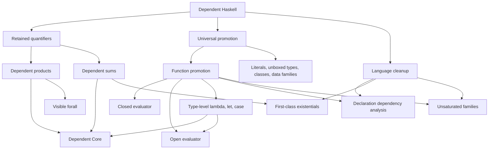

# Dependent Haskell program roadmap

Use this file to plan the whole program. Use [PLAN.md](PLAN.md) for individual
compiler increments, [CORE.md](CORE.md) for the current Core contract, and
[REFERENCES.md](REFERENCES.md) for design provenance. The work queue below owns
project priorities. The `M` checkpoints in PLAN.md record implementation and
evidence; their numbers do not define the program's structure.

The primary map is [Serokell's Dependent Haskell roadmap](https://ghc.serokell.io/dh),
dated **2026-11-12** and reviewed on **2026-11-18**. This checklist records its
50 feature cards and all 67 feature-to-feature graph edges. Layout nodes are
excluded. The graph describes prerequisites **or subtasks**. It is not a build
order. In particular, two edges below are explicitly loose ends of a completed
feature. The card lists omit already completed children; the graph retains them.

The upstream snapshot has 23 completed cards, seven accepted cards, and 20 cards
without a status marker. These counts do not measure implementation effort.
An unmarked card can have research or an implementation prototype.

## Where this fork stands

We have an end-to-end native experiment within the retained-quantifier part of
the map. Source programs use a runtime value as a type index, refine that index
by pattern matching, store it with dependent fields, and run compiled code.
The supported static subset and native pipeline remain restricted.

The [Showcase](Showcase.hs) reads lengths from IO and uses them to
replicate, append, index, and flatten vectors. [M95](PLAN.md#m95-check-ordinary-list-inputs-at-an-indexed-boundary)
accepts an ordinary list at a requested length or packages it with its
own length. [M96](PLAN.md#m96-infer-retained-indices-for-partial-constructor-callbacks)
uses ordinary `fmap` to add a cell while preserving the tail's runtime
index. The largest remaining obligations are normal Core optimization,
general computation in types, and general dependent functions and pairs.
The [remaining work table](#remaining-work-by-roadmap-area) lists their
dependencies. The [local library and assurance tasks](#local-subset-library-and-assurance-work)
track module boundaries and totality separately.

The restricted `-O0` simplifier can remove an ordinary constructor
immediately inspected in a dependent module. For example, wrapping a
runtime-indexed vector in `Just` and extracting it again required an
extra 16 bytes per call in the measured loop. M97 removes that cost
while preserving strict fields, shared thunks and index-only uses.
[Core contract](CORE.md#cases-of-known-ordinary-constructors)
and [allocation measurements](PLAN.md#m97-simplify-a-case-of-an-ordinary-constructor-in-dependent-core).

| Area | Demonstrated in this fork | Work before the roadmap task is complete |
| --- | --- | --- |
| Dependent Core (`R05`) | `TermVarTy`, `DepFunTy`, retained fields, scoped coercions, Core Lint, interfaces, and a checked backend path | Reconcile the representation with the published calculi. Complete transformations, normal optimization, unfoldings, and compatibility with the rest of GHC. |
| Dependent products (`R03`) | Visible `foreach`, leading `foreach (n :: Nat).` with a written or inferred runtime operand, dependent equations and checked lambdas, qualified higher-order values, and checked positions for retained `[a]` | General domains and applications, and predictable inference beyond the measured subset. |
| Dependent sums (`R04`) | ADTs with retained field telescopes, including a length with its vector and a bound proof | First-class existential and dependent-pair types. Current constructor syntax does not implement general `exists` or `some`. |
| Function promotion (`R13`, under `R06`) | A list-length function works at any lifted element type. Multiplication calls checked addition on a recursive result. Both functions supply closed-family equations to interface clients. | General function promotion, polymorphic helper calls, and lambda/let/case expressions in types. |
| Evaluation (`R15`, `R16`) | An imported length computes a vector index. Installed `Data.Char` functions compute character and Boolean indices. `Prelude.sum` uses ordinary instance resolution. `Prelude.reverse` returns a promoted list. A saturated call can use several inputs to determine its dictionaries and can return nested pairs, `Maybe`, and `Either`. Open projections select a rigid type variable from a known pair. Installed Prelude projections of an unknown pair can remain in exported equalities. A pattern can fix a wildcard and unblock a call before generalization. Qualified closed calls can be nested. | More closed operand forms, more result types, and checked evidence for applications that remain in exported constraints. |
| Numeric literals (`R07`) | The vector library registers an interpretation for nonnegative literals. Clients can write `Vec Bool 3`, `replicateNative 3 x` and `replicateNative (n + 1) x`. The retained calls check the actual `Num Nat` dictionary. | More general literal conversions and literal constraints such as finite bounds. |
| Language preparation (`R20`) | Existing GHC facilities such as DataKinds, required type arguments, type abstractions, and explicit namespaces | The remaining upstream tasks below. Reuse their implementations and track their known restrictions. |

The example `Nat` is the source datatype `data Nat = Z | S Nat`. It is not a
claim about native support for every built-in numeric or unboxed domain.
Runtime names retain lexical identity: two separately bound lengths need a
proof to be interchangeable, even when their runtime values happen to agree.
This follows the identity rule in [proposal #378, term variables in types](https://ghc-proposals.readthedocs.io/en/latest/proposals/0378-dependent-type-design.html#term-variables-in-types).

These declarations already compile in the public vector example:

```haskell
replicateNative :: forall a. foreach (n :: Nat) -> a -> Vec a n
reverseNative :: forall a. foreach (n :: Nat) -> Vec a n -> Vec a n
appendNative :: forall a. foreach (n :: Nat) -> foreach (m :: Nat)
             -> Vec a n -> Vec a m -> Vec a (Add n m)
```

In M79, `Add n m` names the result of the ordinary Peano function
`plus n m`. The public append signatures use that source function directly.
M80 adds the infix spelling `n + m` and decimal lengths. A required
type argument makes `replicateAt 3 True :: Vec Bool 3` possible.
M81 accepts `replicateNative (plus n m) True :: Vec Bool (n + m)`
when both lengths come from IO. It checks the function's equations
at compile time and leaves the sum lazy at runtime.
M82 lets this expression use `n + m` with Prelude addition. The
selected `Num Nat` instance defines `(+) = plus`. The compiler checks
that dictionary before using the equations to type the vector.
M83 extends this call to `n + 1` and accepts `replicateNative 3 x`. The
compiler checks the concrete instance's conversion from nonnegative integers.
M84 lets a caller take the head of `replicateNative (1 + n) x` directly.
M85 also accepts `safeHead (sourceVector (x : xs))`. The list constructor
determines the element type even if it contains a runtime index.
M86 allows an unused length to be written as `_` in a function equation or
a package pattern. Later fields and the result still refer to the same length.
General evaluation of Haskell functions in types remains open.

M74 checks consecutive invisible retained arguments. The two vectors in
`appendHidden xs ys` supply separate runtime lengths, and the result has
index `Add n m`. A caller can also write either the leading operand or both
operands. Both stages match 133 Showcase output lines through seventeen
source modules, including the banner. R03, R05 and R23 remain open.
M75 lets a type use an ordinary source function on a finite enumeration.
The imported `flipBit` determines a payload type. The three equations of a
traffic-light function reduce in a client with only the object interface.
Both use checked clauses from the producer. M76 adds shallow field patterns.
An ordinary predecessor function now computes the return index of `dropFirst`.
M77 admits structural recursion on the tail of a list. An ordinary
`listCount :: [Bool] -> Nat` now indexes the result of a vector
constructor in the public example.

```haskell
boolVector :: foreach (xs :: [Bool]) -> Vec Bool (listCount xs)
boolVector []       = VNil
boolVector (b : bs) = VCons b (boolVector bs)
```

GHC checks the cons branch using the source equation
`listCount (b : bs) = S (listCount bs)`. This works with an unknown tail,
including a list read from an `IORef`. The producer exports the checked
equations in its interface. M78 generalizes the same definition to
`sourceLength :: forall a. [a] -> Nat`. A module can write
`sourceLength @a (x ': xs)` and prove that it equals `S (sourceLength xs)`.
Overloaded functions, including Prelude's `length`, remain open.
See [M75](PLAN.md#m75-closed-evaluation-of-a-source-function),
[M76](PLAN.md#m76-constructor-fields-in-a-source-equation),
[M77](PLAN.md#m77-structural-recursion-on-a-list-spine), and
[M78](PLAN.md#m78-one-list-length-function-for-every-lifted-element-type).

M62 supplied the earlier 88-line source group through fourteen modules.
M56 provides
the closed parameterized domains. M57 provides nominal scalar-domain conversion
in Core. M58 exposes that conversion and scoped body solving from source.
M59 compares bodies beneath fixed function domains and selects ordinary payloads.
Its compiler checkpoint is `5c527cd8b92a`; its source fixture checkpoint is
`5e33b194f1e6`. Its independently audited documentation is `a5bdd43f6764`.
The canonical audit is
`_build/verification/dependent-haskell-M59-final-audit-v1.json`.
See [the M59 specification](PLAN.md#m59-bodies-beneath-fixed-function-domains).
M60 composes safe indexing with the existing compiler. Both stages pass its
nineteen runtime observations, five rejections, compile-only equal-count reuse
and the 84-observation Showcase. Its separate audit passes 616 checks.
The canonical record is
`_build/verification/dependent-haskell-M60-final-audit-v1.json`.
Observation counts measure those programs. They do not count roadmap features.

M61 checks opaque whole-function casts with both rebuilt compilers and the
selected API/source/registered cohort. A bounded native beta-substitution fix
prevents a function alias from escaping through a partial result type. The
existing cast supports the measured lowering path. Its independent audit passes.
The canonical record is
`_build/verification/dependent-haskell-M61-final-audit-v1.json`.
General opaque proof projection stays open.

## Current work queue

**[R15, closed term evaluator](roadmap/R15-closed-term-evaluator.md) and
[R16, open term evaluator](roadmap/R16-open-term-evaluator.md) are active.**
They are separate subtasks of function promotion. The upstream graph has
no dependency from one evaluator to the other. Work on the two cards in
parallel, with one owner and one source acceptance example per card.
Use a source test on each card. R15 checks the result of running an
ordinary closed call. R16 checks what the ordinary function demands
when some of its operands are unknown.

| Card | Next evidence | Dependency or boundary |
| --- | --- | --- |
| [R15, closed evaluator](roadmap/R15-closed-term-evaluator.md) | Support a list of compound elements, such as `[Maybe Natural]`, as a result and an operand. | [M116](PLAN.md#m116-return-a-boxed-pair-from-a-closed-call) checked pair results. [M118](PLAN.md#m118-check-maybe-and-either-results) handles `Maybe` and `Either` with supported fields. The list codec still requires scalar elements. |
| [R16, open evaluator](roadmap/R16-open-term-evaluator.md) | Check an open projection composed with another ordinary function, such as `fst (swap p)` for a rigid pair. | [M119](PLAN.md#m119-export-checked-projections-of-unknown-pairs) exports installed `fst p` and `snd p` through interfaces and preserves earlier ground calls under rewrite rules. General residual expressions still need a representation and nominal evidence (R05). |
| [R21, dependency analysis](roadmap/R21-dependency-analysis.md) | Allow the producer to be defined in the consumer module, respecting declaration order and cycles. | A separately compiled producer lets R15 proceed while R21 remains open. A local identity fails with GHC-68947 in both declaration orders. Making its checked body available for open evaluation is separate from loading runtime code for a closed call. |

[R03](roadmap/R03-dependent-products.md), [R05](roadmap/R05-dependent-core.md)
and [R23](roadmap/R23-unsaturated-type-families.md) retain their own completion
criteria. The [R23 compatibility results](roadmap/R23-unsaturated-type-families.md#compatibility-with-existing-haskell)
include ordinary programs rejected because of arrow matchability. Revisit
a dependency when it blocks an active card's executable example. Treat the arrows as prerequisites or subtasks, as on Serokell's
graph. A workaround in an example library does not close a dependency.

### Local checkpoints

The table records implementation history and proposed local work.
M75–M88 include examples motivated by R15. Their computation rules
compile checked clauses to type families under R13.
M98's two-list zip is a proposed extension of that mechanism. The
evaluator work has priority.

| Order | Owner and contribution | State | Gate and next result |
| --- | --- | --- | --- |
| 1 | R03: fixed function-domain body comparison; exercises R05 evidence | Complete bounded increment: M59 | Both stages and independent audit pass. The larger R03/R05 features remain open. |
| 2 | R03: safe indexing over a retained `[Bool]` | Complete bounded increment: M60 | Both stages and the evidence audit pass. The next compiler task is the R05 opaque-cast probe. |
| 3 | R05: application through opaque whole-function evidence | Complete bounded increment: M61 | Both builds, selected cohort and independent audit pass. Typed opaque proof projection remains separate. |
| 4 | R03: explicit complete retained-function type arguments | Complete bounded increment: M62 | Both builds, nested source arguments, worker demand, the selected cohort and independent audit pass. Next: the R23 foundation. |
| 5 | R23: matchability foundation; also advances R05 | M63/M64 foundation integrated and published | Explicit arrow and forall metadata pass Core, source, interface, TH and reflection checks. The generic native client and source family unsaturation remain open. |
| 6 | R05: function values in closed algebraic indices; enables R03 source work | Complete bounded increment: M65 | Both rebuilt stages pass source/interface controls and Showcase100/16. Seven registered tests pass. Generic `[a]`, higher-order endpoints and changed dependent domains remain open. |
| 7 | R05: bounded family views in native frontend inference | Complete bounded increment: M66 | Both builds, exact source diagnostics, finite controls, Showcase100/16 and seven registered tests pass. Other pure normalization paths remain separate. |
| 8 | R05: structural generic domains and dependent-domain transport; enables R03 | Complete bounded increment: M67 | Both builds, selected API/source controls, Showcase116/16 and seven registered tests pass. Generic elements include arbitrary lifted and runtime-index-bearing values. Old readers reject the new typed signature cleanly. R05 and general source domains remain open. See M67 in PLAN.md. |
| 9 | R03: ordinary callers of imported retained APIs; preserves R05 evidence | Complete bounded increment: M68 | Both rebuilt stages pass source/interface checks, scope and multiplicity controls, Showcase118/17 and seven registered tests. Published M67 readers accept the interfaces. Explicit syntax, Expr inference modes and native pipeline policies retain their scope. |
| 10 | R03: safe indexing over a generic retained list | Complete bounded increment: M69 | Reuses Fin and GenericCount with scoped list refinement. Both rebuilt stages pass the reviewed primary/focused source collections, API1/37, Showcase124/17 and seven registered tests. Guarded list-declaration advice preserves the original runtime-vector callback. Case-based ordinary clients pass. Measured literal-list/fmap and NoEDT native let-list inference retain their limits; named-list fmap is unmeasured. No new Core judgment or wire field. R03, R05 and R23 remain open. |
| 11 | R03: higher-order calls with native list arguments | Complete bounded increment: M70 | List fields supply an anchor to the existing argument cache. The literal fmap call passes with and without the dependent source extension. Both stages pass the 125-line Showcase, and seven selected registered tests pass. |
| 12 | R05: invisible retained function types and coercions; enables R03 | Complete bounded increment: M71 | Both stages compile. The API, versioned interface and object tests cover visibility and demand. |
| 13 | R03: source definitions and omitted invisible runtime operands | Complete bounded increment: M72 | The imported call passes the IO-sourced Nat from a later vector declaration. Native object tests cover ignored bottom, name shadowing and located missing and conflicting operands. |
| 14 | R03: explicit invisible runtime operands | Complete bounded increment: M73 | Written `@{n}` works with or without erased `@Int`. The interface-only client preserves demand. A wrong written index reports the later argument where the two indices disagree. |
| 15 | R03: consecutive invisible runtime operands | Complete bounded increment: M74 | The interface-only vector append infers two lengths and checks their sum in the result type. Constructor inference respects term scope and records import usage. |
| 16 | R13: finite tables of source equations | M75 finite constructor tables | Check the complete table once and export its equations. A body change invalidates an unchanged client proof. |
| 17 | R13: constructor fields in a source equation | [M76](PLAN.md#m76-constructor-fields-in-a-source-equation) | The checked `previous` clause returns the length of the tail. A `VCons` branch can therefore return its tail directly from `dropFirst`. |
| 18 | R13: structural recursion on a list spine | [M77](PLAN.md#m77-structural-recursion-on-a-list-spine) | A checked recursive call on the tail computes the Peano result index of `boolVector`. A call on the rebuilt list has no checked equation. |
| 19 | R13: parametric list length | [M78](PLAN.md#m78-one-list-length-function-for-every-lifted-element-type) | One checked family proves the cons equation for an abstract element type and tail. The named length function indexes a vector built from a list of `Int` read at runtime. |
| 20 | R13: a second ordinary argument | [M79](PLAN.md#m79-addition-from-an-ordinary-two-argument-function) | The runtime addition function computes the length index of vector append. The second length can stay unknown. |
| 21 | R07 and R13: numerals and infix addition | [M80](PLAN.md#m80-numerals-and-infix-addition-in-vector-types) | Use `Vec a 3` and `Vec a (n + 1)` with the original Peano-indexed GADT. |
| 22 | R03 and R13: a computed retained argument | [M81](PLAN.md#m81-a-computed-retained-length) | Pass the ordinary call `plus n m` directly as a vector length. Keep its index through Core Lint and share its value as a lazy STG thunk. |
| 23 | R12 and R03: a concrete class method | [M82](PLAN.md#m82-overloaded-addition-in-a-retained-argument) | Pass the overloaded `n + m` as a retained length when the selected instance's addition method is the checked `plus`. |
| 24 | R07, R12 and R03: term numerals as retained lengths | [M83](PLAN.md#m83-ordinary-numerals-in-retained-arguments) | Use a checked `fromInteger` for `replicateNative 3 x` and `replicateNative (n + 1) x`. |
| 25 | R03: infer a runtime index from a nested call | [M84](PLAN.md#m84-infer-a-nonempty-vectors-tail-at-a-nested-application) | Match the checked successor equations in `safeHead (replicateNative (1 + n) x)` and preserve the unevaluated tail. |
| 26 | R03: infer parameters from constructor fields | [M85](PLAN.md#m85-infer-the-parameters-of-a-retained-constructor-argument) | Read the fields of a saturated constructor in a retained argument to select erased parameters. |
| 27 | R03 and R04: wildcard argument and field patterns | [M86](PLAN.md#m86-wildcard-patterns-for-retained-arguments-and-fields) | Ignore a runtime field while preserving its identity in later types. |
| 28 | R05: interactive bytecode | [M87](PLAN.md#m87-persistent-dependent-definitions-in-ghci) | Store a retained function and call it from a subsequent GHCi command. |
| 29 | R13: composition of source equations | [M88](PLAN.md#m88-compose-checked-source-equations) | Check multiplication in terms of addition and use the product as the length of a flattened rectangle. |
| 30 | R03 and R05: nested retained operands | [M89](PLAN.md#m89-nested-computations-in-retained-operands) | Pass `1 + rows * cols` directly to a vector constructor and preserve demand on the product. |
| 31 | R03 and R05: equality for lazy local definitions | [M90](PLAN.md#m90-equality-for-lazy-local-definitions) | Give a named checked product its defining index and share its runtime value. |
| 32 | R03 and R05: dictionary evidence for local definitions | [M91](PLAN.md#m91-dictionary-evidence-for-a-local-index-definition) | Use the selected multiplication and literal conversion to check a local vector length. |
| 33 | R03 and R05: signed and grouped local lengths | [M92](PLAN.md#m92-signed-and-grouped-local-lengths) | Check signed runtime lengths in dependency order and compose their equalities in the body. |
| 34 | R05: retained types in editor metadata | [M93](PLAN.md#m93-retained-types-in-hie-files) | Write and read retained binders, runtime indices and opaque applications in HIE files. |
| 35 | R03: inferred nonempty local lengths | [M94](PLAN.md#m94-infer-a-nonempty-tail-through-local-length-definitions) | Infer the tail of a vector through checked let and where definitions, then check the call against its actual argument. |
| 36 | R03 and R04: ordinary lists at an indexed boundary | [M95](PLAN.md#m95-check-ordinary-list-inputs-at-an-indexed-boundary) | Check a requested length or package the list's own length. Match ordinary list patterns in retained equations. |
| 37 | R03: partial constructor callbacks | [M96](PLAN.md#m96-infer-retained-indices-for-partial-constructor-callbacks) | Use a checked input's runtime index in `VCons x <$> fromListExact n xs`. Preserve constructor multiplicities and check the full callback type. General callback inference remains open. |
| 38 | R05: simplify a case of a known constructor | [M97](PLAN.md#m97-simplify-a-case-of-an-ordinary-constructor-in-dependent-core) | Remove a measured allocation and dispatch while keeping dependencies in types, lazy field sharing and strict-field demand. |
| 39 | R13: the length of ordinary zip | [M98, deferred](PLAN.md#m98-the-length-of-zip-over-two-ordinary-lists) | Check equations that inspect two list spines and recurse on both tails. Preserve the empty-first equation with an unknown second input. |
| 40 | R15: evaluate an imported closed call | [M99, verified for literal Natural lists](PLAN.md#m99-evaluate-an-imported-closed-call) | The source call computes the vector length. The unchanged client observes an ABI-preserving implementation change. |
| 41 | R16: evaluate with a rigid argument | [M100, verified for polymorphic identities](PLAN.md#m100-reduce-an-ordinary-identity-at-a-rigid-type-variable) | Both compilers accept the upstream signature. Changing a worker behind an imported alias invalidates the unchanged consumer. |
| 42 | R15: closed character calls | [M101](PLAN.md#m101-evaluate-closed-character-calls-from-installed-libraries) | The ordinary `Data.Char.toUpper` and `Data.Char.isDigit` check equality witnesses. Both interpreters track the producer code they loaded. |
| 43 | R16: open projections | [M102](PLAN.md#m102-reduce-open-projections) | Prelude's `const` and an independent second projection return the selected rigid type variable. A strict second projection identifies the operand blocking evaluation. |
| 44 | R15: overloaded closed calls | [M103](PLAN.md#m103-infer-a-closed-overloaded-call-from-its-argument) | `Prelude.sum '[2, 3, 5]` computes the index 10 using ordinary dictionaries. The client records the selected instance even if the interpreter calls its method implementation directly. |
| 45 | R16: retry after local inference | [M104](PLAN.md#m104-retry-a-type-call-after-inference-determines-its-input) | A pattern fixes the input. GHC checks the computed result before generalization. An ordinary client reads the concrete signature from the interface. |
| 46 | R15: lists as results | [M105](PLAN.md#m105-return-a-promoted-list-from-a-closed-call) | Prelude's ordinary `reverse` checks a list equality. The checked scalar element kind determines how to read the result, including for an empty list. |
| 47 | R15: nested closed calls | [M106](PLAN.md#m106-check-a-closed-call-inside-another-closed-call) | A reversed list supplies the argument to an ordinary `sum`. The client records dependencies on both producers. |
| 48 | R16: observe a character case | [M107](PLAN.md#m107-observe-a-character-case-with-rigid-result-operands) | An imported worker selects between two rigid types. The API regression records and checks the selected branches against its typed Core. |
| 49 | R15: use computed operands | [M108](PLAN.md#m108-accept-a-computed-value-at-each-supported-result-kind) | The result kind determines the next operand's representation, including an arbitrary-precision natural and lists of Boolean or character values. |
| 50 | R16: export a character case | [M109](PLAN.md#m109-carry-an-open-call-in-an-exported-equality) | A client solves an exported worker equality at a literal from two interfaces. A visible conflicting rewrite rule prevents that use. |
| 51 | R15: accept source literals | [M110](PLAN.md#m110-check-ground-source-operands-at-their-declared-kinds) | The argument kind selects how to check the literal. A mixed list fails at the element with the wrong kind. |
| 52 | R15: accept the upstream spelling | [M111](PLAN.md#m111-use-the-closed-evaluator-with-the-roadmaps-source-spelling) | The existing name lookup rules admit an unqualified imported length function on `[1,2,3]`. |
| 53 | R15/R16: compose a family result with an ordinary call | [M112](PLAN.md#m112-pass-a-checked-family-result-to-the-closed-evaluator) | The solver supplies the inner character and the interpreter runs the outer function. Each records its own dependency. |
| 54 | R15: check ordinary functions with several arguments | [M113](PLAN.md#m113-check-fully-applied-ordinary-functions) | `gcd 18 24` computes six; later operands determine the kind of earlier empty lists. |
| 55 | R16: project a rigid type from a boxed pair | [M114](PLAN.md#m114-project-a-type-from-a-known-pair) | The imported `fst` and `snd` select original type variables. A demanded rigid pair still blocks. |
| 56 | R23: diagnose arrow matchability after family reduction | [M115](PLAN.md#m115-distinguish-matchability-errors-from-missing-arguments) | GHC reports conflicting matchabilities at `Maybe` and retains the hint for a genuinely missing argument. Ordinary program compatibility remains open. |
| 57 | R15: return and use a boxed pair | [M116](PLAN.md#m116-return-a-boxed-pair-from-a-closed-call) | `quotRem 17 5` returns `'(3,2)` during type checking. Nested pairs retain their field kinds. |
| 58 | R15: return an optional value or a sum | [M118](PLAN.md#m118-check-maybe-and-either-results) | `uncons` returns a promoted optional pair. Another closed call can consume either alternative of a parser's result. |
| 59 | R16: export checked projections of unknown pairs | [M119](PLAN.md#m119-export-checked-projections-of-unknown-pairs) | An ordinary client checks both fields from the exported equality with only the interfaces available. |

M64 now carries explicit forall metadata in the development source. The
[Core contract](CORE.md#forall-matchability) records scope, nominal proofs,
runtime U and the conservative expression and constructor-evidence limits.
The selected builds and checks pass, including Showcase95 with 14 home
modules in both stages. The standard selection passes seven tests with
54 skipped ways. R23 remains open for the generic native client and family source
unsaturation.

M65 connects stored function values to canonical opaque call indices. A
saturated family can expose the stored function without losing its forward
application proof. Later package fields retain the actual function identity.
See [the Core contract](CORE.md#function-values-in-algebraic-indices) and
[the validation record](PLAN.md#m65-validation). This increment does not
complete R05, R03 or R23.

M67 adds generic `[a]` constructor refinement and nominal transport through
later dependent domains. M68 measures direct retained API use without the
dependent extension. At baseline, three ordinary consumers reject because
their erased index cannot be inferred. M68 uses imported type contracts to
enable the existing application checker. Explicit dependent
syntax and the restricted native pipeline keep their current policies.
Both rebuilt stages and the selected tests pass that bounded application change.
M69 followed with generic safe indexing. The local subset and
dependent-base tasks below retain their own scope.

The user resumed GHC execution on **2026-11-16 at 17:53 CET**. Run heavy checks
serially under the configured memory cap. This execution policy does not add
feature dependencies.

### Remaining work by roadmap area

Keep these tasks visible when selecting the next increment. Each completed
increment has a bounded scope.

| Roadmap area | Remaining local work | Main obligations before completion |
| --- | --- | --- |
| R03: dependent products | General domains, broader invisible argument inference, runtime `Type` operands | Separate retention from visibility. Define a runtime universe bridge. Required erased `forall` and existing `TypeRep` do not supply that bridge. |
| R04 and R22: sums and existentials | First-class erased `exists` and retained `some` | Specify formation, introduction, elimination, scope and representation. Existing retained ADT fields provide a storage baseline. |
| R05: dependent Core | Typed conversion, proof operations, transformations, unfoldings and normal optimization | Reconcile the native forms with the calculi. Preserve roles, scope, demand, sharing and ordinary GHC behavior. |
| R15 and R16: closed and open evaluation | Computation in types over closed inputs and rigid variables | Specify staging, divergence, stuck terms and diagnostics. Reuse ordinary term definitions without parallel handwritten families. |
| R13, R17–R19 and R21: function promotion | Type-level lambda, let and case; mixed declaration dependencies | Integrate typed evaluation and matchability. Demonstrate one source function used at both levels across an interface. |
| R23 and R24: type families | Source unsaturation, inference/defaulting and family constraints | Complete the family design beyond the internal matchability foundation. Preserve noninjective application and evidence validity. |
| R07, R10–R12 and R14: promotion domains | General literals, unboxed types, homogeneous equality, classes and data families | Define each domain and its representation separately. Reuse inherited Char and Natural support. |
| R20, R27, R34–R36 and R41: language preparation | Remaining accepted cleanup and binder work | Follow each proposal and its current implementation. Track loose ends without reopening an entire completed upstream card. |
| R01, R02 and R06: aggregate goals | Integrate retained quantification, promotion and language preparation | Complete their required feature scope and broader compatibility checks. A single example cannot close an aggregate goal. |

### Rules for the next increment

1. Name one owning roadmap card. List related cards when the increment crosses
   layers. Keep the existing `M` identifiers for historical checkpoints.
2. Add the bounded specification to [PLAN.md](PLAN.md) before compiler changes.
   State the contribution, required prerequisites, acceptance checks and limits.
3. Use the owning feature page to find the research and open obligations.
   Record new sources and their reading scope in [REFERENCES.md](REFERENCES.md).
4. Record compiler, source, runtime and rejection evidence separately. Extend
   [Showcase.hs](Showcase.hs) when a source feature is checked.
5. Update the feature page and this queue after verification. Mark the increment
   complete only within its measured scope. Close a roadmap card only when its
   full goal and compatibility requirements are supported.

## Local subset, library and assurance work

The user selected an opt-in dependent subset in modules. A small dependent-base
library should make that subset useful with ordinary Haskell libraries. These
local tasks do not add cards or edges to the upstream roadmap. They do not
change M63's acceptance criteria.

| Task | Roadmap relation | Next result and boundary |
| --- | --- | --- |
| Module interoperability | R03 and R05 | Check an indexed API from a module without dependent syntax. Preserve imported types and infer relationships where supported. Use an explicit adapter when a caller cannot express the contract. |
| Small dependent-base | R03 and R04 | Start with the existing Nat, Vec, Fin, equality and package operations. The example library provides list conversion, package elimination and the [exact-length adapter](PLAN.md#m95-check-ordinary-list-inputs-at-an-indexed-boundary). Package and module names remain provisional. |
| Optional checks at the dependent boundary | Local interoperability work, using R15 and R16 | Check a closed obligation about an ordinary producer. Export the exact witness to dependent and ordinary clients. Keep property-test reports separate from evidence used to discharge a constraint. [Boundary evidence](BOUNDARY-EVIDENCE.md). |
| Conservative totality checking | Local assurance work related to R05 | Specify the property for lazy Haskell. Start with coverage and structural recursion. Keep checked results, trusted assumptions and unknown status distinct across imports. |
| Observational equality | R05 research | Compare explicit equality and transport with OTT. Keep checker conversion, contextual equivalence and inverse application distinct. No new equality rule is selected. |

A module flag enables source features. It does not remove imported contracts.
An ordinary import supplies no extra termination or proof guarantee unless a
check or an explicit trusted contract establishes it. Partial dependent code
can still preserve an index invariant when it returns. Totality remains a
separate promise. A termination checker alone does not establish logical
consistency; positivity, universes, proof elimination and unsafe operations
also need rules.
Specify the required inputs as well as the result. A checked function on total
inputs does not certify a result obtained from an unchecked lazy argument.

Use linear-base as the library and adapter reference. Use Idris and Agda as
references for conservative totality checks and imported assumptions. Their
current guarantees do not transfer to this fork. See the new boundary and
observational-equality entries in [REFERENCES.md](REFERENCES.md).

The first candidate is an advisory report for covered first-order functions
with direct structural recursion. Use the zonked source AST and the existing
coverage checker. Recompute the complete call graph; the inference graph omits
some signed-call edges. Unsupported recursion, callbacks and imports stay
unknown. No checker or new totality guarantee is implemented.

Use LiquidHaskell's [Refinement Types For Haskell](https://simon.peytonjones.org/assets/pdfs/refinement-types-for-haskell.pdf)
as Haskell-specific prior art. Its analysis distinguishes potentially divergent
terms, weak-head values and finite values. Keep the first report advisory.
It must not change conversion, proof erasure or imported type contracts.

## Main relationships

Arrows have the same direction as the upstream graph: a task points to a
prerequisite or subtask. This diagram omits completed preparation and smaller
branches. The full checklist below preserves every edge.



A retained-quantifier experiment can proceed before universal promotion is
complete. Completing that experiment will still leave the promotion and cleanup
branches open.

## Upstream checklist and complete dependency index

A checked box means **completed on the upstream roadmap snapshot**. It does not
mean that this fork completed the feature or that every related issue is closed.
`Accepted` is a design status. Leave its box unchecked until implementation is
verified. The `R` numbers are local reference labels; links retain upstream IDs.
`Needs/includes` records the graph relation without claiming that every edge is
a mandatory sequencing constraint. A leaf has no outgoing graph edge; it can
still require substantial research.

- [ ] **R01 [Dependent Haskell](https://ghc.serokell.io/dh#dependent-haskell)** — Unmarked. Needs/includes: R02, R06, R20.
- [ ] **R02 [Dependent retained quantifiers](https://ghc.serokell.io/dh#dependent-retained-quantifiers)** — Unmarked. Needs/includes: R03, R04.
- [ ] **R03 [Dependent products](https://ghc.serokell.io/dh#dependent-products)** — Unmarked. Needs/includes: R05, R39.
- [ ] **R04 [Dependent sums](https://ghc.serokell.io/dh#dependent-sums)** — Unmarked. Needs/includes: R05, R22.
- [ ] **R05 [Dependent Core language](https://ghc.serokell.io/dh#dependent-core-language)** — Unmarked. Needs/includes: no outgoing graph edge.
- [ ] **R06 [Universal promotion](https://ghc.serokell.io/dh#universal-promotion)** — Unmarked. Needs/includes: R07, R10, R12, R13, R14.
- [ ] **R07 [Promote literals](https://ghc.serokell.io/dh#promote-literals)** — Unmarked. Needs/includes: R08, R09, R24. M80 supplies nonnegative type numerals at registered index kinds. M83 accepts term numerals in retained arguments when the actual Peano conversion has checked equations. General overloaded term promotion and constrained family evaluation remain open.
- [x] **R08 [Promote Char](https://ghc.serokell.io/dh#promote-char)** — Completed. Needs/includes: no outgoing graph edge.
- [x] **R09 [Promote Natural](https://ghc.serokell.io/dh#promote-natural)** — Completed. Needs/includes: no outgoing graph edge.
- [ ] **R10 [Promote unboxed types](https://ghc.serokell.io/dh#promote-unboxed-types)** — Unmarked. Needs/includes: R11.
- [ ] **R11 [Homogeneous equality](https://ghc.serokell.io/dh#homogeneous-equality)** — Unmarked. Needs/includes: no outgoing graph edge.
- [ ] **R12 [Promote classes](https://ghc.serokell.io/dh#promote-classes)** — Unmarked. Needs/includes: R13, R24. M82 connects a concrete instance method to a checked source function in a retained argument. M83 checks the selected ground `Num` instance’s conversion of a nonnegative literal. General classes and abstract dictionary arguments remain open.
- [ ] **R13 [Function promotion](https://ghc.serokell.io/dh#function-promotion)** — Unmarked. Needs/includes: R15, R16, R17, R18, R19, R21, R23.
- [ ] **R14 [Data family promotion](https://ghc.serokell.io/dh#data-family-promotion)** — Unmarked. Needs/includes: no outgoing graph edge.
- [ ] **R15 [Closed term evaluator](https://ghc.serokell.io/dh#closed-term-evaluator)** — Unmarked. Needs/includes: no outgoing graph edge. M99, M101 and M103 support qualified closed calls on a character or a list of natural number literals. The argument can determine a polymorphic function's specialization. M105 reads back one list layer of a supported scalar type. M106 composes qualified unary calls. M108 passes all supported result shapes between calls. M110 accepts written literals at those kinds. M111 checks the roadmap's length signature. M113 checks saturated calls with joint operand inference. M116 returns a boxed pair and passes it to a later call. M118 extends this to `Maybe` and `Either`. General closed evaluation remains open. See the [active card](roadmap/R15-closed-term-evaluator.md).
- [ ] **R16 [Open term evaluator](https://ghc.serokell.io/dh#open-term-evaluator)** — Unmarked. Needs/includes: no outgoing graph edge. M100 and M102 handle rigid projections. M104 retries a call before generalization when a pattern fixes a signature wildcard. M107 selects a branch with a known character and a rigid result operand. M109 publishes a closed family for finite character mappings and follows a checked alias across an interface. M114 checks boxed-pair projections and detects a blocked rigid pair. M119 preserves installed Prelude projections of an unknown pair in exported constraints. See the [open-term examples and checks](roadmap/R16-open-term-evaluator.md).
- [ ] **R17 [Type-level lambdas](https://ghc.serokell.io/dh#type-level-lambdas)** — Unmarked. Needs/includes: R05, R16.
- [ ] **R18 [Type-level let-bindings](https://ghc.serokell.io/dh#type-level-let-bindings)** — Unmarked. Needs/includes: R05, R16.
- [ ] **R19 [Type-level case-expressions](https://ghc.serokell.io/dh#type-level-case-expressions)** — Unmarked. Needs/includes: R05, R16.
- [ ] **R20 [Clean up the language](https://ghc.serokell.io/dh#clean-up-the-language)** — Unmarked. Needs/includes: R21, R22, R23, R24, R27, R28, R35, R39, R49.
- [ ] **R21 [Dependency analysis](https://ghc.serokell.io/dh#dependency-analysis)** — Accepted. Needs/includes: no outgoing graph edge.
- [ ] **R22 [Existential quantification](https://ghc.serokell.io/dh#existential-quantification)** — Unmarked. Needs/includes: no outgoing graph edge.
- [ ] **R23 [Unsaturated type families](https://ghc.serokell.io/dh#unsaturated-type-families)** — Accepted. Needs/includes: R25.
- [ ] **R24 [Constrained type families](https://ghc.serokell.io/dh#constrained-type-families)** — Unmarked. Needs/includes: no outgoing graph edge.
- [x] **R25 [Modifiers syntax](https://ghc.serokell.io/dh#modifiers-syntax)** — Completed. Needs/includes: no outgoing graph edge.
- [x] **R26 [Standalone kind signatures](https://ghc.serokell.io/dh#standalone-kind-signatures)** — Completed. Needs/includes: no outgoing graph edge.
- [ ] **R27 [Deprecate CUSKs](https://ghc.serokell.io/dh#deprecate-cusks)** — Accepted. Needs/includes: R26, R29.
- [x] **R28 [Invisible type arguments](https://ghc.serokell.io/dh#invisible-type-arguments)** — Completed. Needs/includes: R29, R30, R31, R32, R33.
- [x] **R29 [Invisible binders in types](https://ghc.serokell.io/dh#invisible-binders-in-types)** — Completed. Needs/includes: R26.
- [x] **R30 [Invisible binders in functions](https://ghc.serokell.io/dh#invisible-binders-in-functions)** — Completed. Needs/includes: no outgoing graph edge.
- [x] **R31 [Invisible binders in constructors](https://ghc.serokell.io/dh#invisible-binders-in-constructors)** — Completed. Needs/includes: no outgoing graph edge.
- [x] **R32 [Visible type applications](https://ghc.serokell.io/dh#visible-type-applications)** — Completed. Needs/includes: no outgoing graph edge.
- [x] **R33 [Visible kind applications](https://ghc.serokell.io/dh#visible-kind-applications)** — Completed. Needs/includes: no outgoing graph edge.
- [ ] **R34 [Syntactic unification](https://ghc.serokell.io/dh#syntactic-unification)** — Accepted. Needs/includes: R44, R45, R46, R47.
- [ ] **R35 [Namespace management](https://ghc.serokell.io/dh#namespace-management)** — Accepted. Needs/includes: R36, R37, R38, R42.
- [ ] **R36 [Pun warnings](https://ghc.serokell.io/dh#pun-warnings)** — Accepted. Needs/includes: no outgoing graph edge.
- [x] **R37 [Namespace-specified imports](https://ghc.serokell.io/dh#namespace-specified-imports)** — Completed. Needs/includes: no outgoing graph edge.
- [x] **R38 [No list or tuple puns](https://ghc.serokell.io/dh#no-list-or-tuple-puns)** — Completed. Needs/includes: no outgoing graph edge.
- [x] **R39 [Visible forall](https://ghc.serokell.io/dh#visible-forall)** — Completed. Needs/includes: R34 (loose end), R40, R41 (loose end), R43.
- [x] **R40 [Visibility coercions](https://ghc.serokell.io/dh#visibility-coercions)** — Completed. Needs/includes: no outgoing graph edge.
- [ ] **R41 [Nested quantification in GADTs](https://ghc.serokell.io/dh#nested-quantification-in-gadts)** — Accepted. Needs/includes: no outgoing graph edge.
- [x] **R42 [Embed types](https://ghc.serokell.io/dh#embed-types)** — Completed. Needs/includes: no outgoing graph edge.
- [x] **R43 [Term variable capture](https://ghc.serokell.io/dh#term-variable-capture)** — Completed. Needs/includes: no outgoing graph edge.
- [x] **R44 [No star kind syntax](https://ghc.serokell.io/dh#no-star-kind-syntax)** — Completed. Needs/includes: R50.
- [x] **R45 [The forall keyword](https://ghc.serokell.io/dh#the-forall-keyword)** — Completed. Needs/includes: no outgoing graph edge.
- [x] **R46 [The tilde operator](https://ghc.serokell.io/dh#the-tilde-operator)** — Completed. Needs/includes: R48.
- [x] **R47 [The dot type operator](https://ghc.serokell.io/dh#the-dot-type-operator)** — Completed. Needs/includes: R48.
- [x] **R48 [Whitespace-sensitive operators](https://ghc.serokell.io/dh#whitespace-sensitive-operators)** — Completed. Needs/includes: no outgoing graph edge.
- [x] **R49 [Unify type and kind variables](https://ghc.serokell.io/dh#unify-type-and-kind-variables)** — Completed. Needs/includes: R50.
- [x] **R50 [Unify types and kinds](https://ghc.serokell.io/dh#unify-types-and-kinds)** — Completed. Needs/includes: no outgoing graph edge.

`R39 -> R34` and `R39 -> R41` are the two loose-end edges. Required type
arguments already exist while syntax unification and nested GADT quantifiers
remain incomplete. Do not infer completion by propagating checkmarks through
the graph.

## Historical work packages

These names predate the roadmap-aligned work queue. Keep them as references for
the recorded increments. S0–S3 map to R03/R05; C1/C2 to R05; Q1 to R03; Q2 to
R04/R22; E1/E2 to R15/R16; P1 to R13; P2 to the remaining promotion domains;
L1 to R20; and I1 to R01. The current queue above owns the next work.

- [x] **S0: Retain a runtime index.** Native Bool functions, checked case
  refinement, and `choose`/`keep` execution. `keep` does not force its index.
  Evidence: CORE.md and the existing Core/API runtime fixtures.
- [x] **S1: Use dependent data from source.** Nat-indexed vectors, retained
  packages, append/reverse, dynamic-length equality, and bounded filtering.
  Evidence: the public packed-vector example and its 562 observations.
- [x] **S2: Cross module and IO boundaries.** Separate interfaces, retained
  closures, runtime IO indices, scoped local types, and measured lazy fields.
  Evidence: the public examples and the M23–M35 checkpoints in PLAN.md.
  M52 also exports complete ordinary function-retained signatures through the
  existing interface type forms. Both stages pass the19-line imported worker
  program and53-line showcase. This does not complete the general product or
  transformation tasks.
- [x] **S3: Instantiate known native workers.** Expected types, visible type
  arguments, and declared monomorphic arguments select immutable erased choices.
  ImpredicativeTypes controls pass at M38. General mutable native instantiation
  stays gated. Evidence: `KnownArgumentClient.hs`, M36–M38, and the two source
  matrices above. M52 calls an imported `idCall @a f n xs` with actual stored
  function/input fields. Exact local function operands and ordinary one-time
  argument/usage checks remain required. No new inference rule is added.
- [ ] **C1: Reconcile the Core contract with the research.** Depends on the
  measured S0–S3 baseline. Map each native form and coercion to the relevant
  rules in the 2017 specification, 2019 roles paper, and 2021 graded paper.
  State the differences. Specify substitution, conversion, scope, runtime usage,
  and erasure before extending the representation. Close this task with a
  reviewable contract and focused transformation checks, not a claim that the
  papers prove our implementation. Advances `R05`.
  M39 records the correspondence limits and adds checked Core beta exposure.
  The [contract](CORE.md#checked-beta-exposure) and existing API fixtures cover
  this bounded reduction. M40 exposes the same subset from source with checked
  scope, multiplicity and Strict-mode boundaries. Its
  [source contract](CORE.md#bounded-source-beta-applications) preserves ordinary
  usage checking. The full C1 obligation remains open.
  M54 reports detected recursive interface-domain failures through the normal
  interface diagnostic path. It preserves valid first-order recursive domains
  and ordinary fields containing valid retained Pi types. This is not a
  shape-first loader, guaranteed loop detection or a termination proof.
  M55 adds derived data and synonym views before field decoding and generic
  binder allocation. Known unsupported graphs fail before typed recursion.
  Valid data cycles remain supported. Unclassified normalization keeps the
  typed fallback. Missing headers and general termination remain open.
  C1 remains open.
  M42 adds scoped opaque call indices with independently closed scalar input
  and result domains. It checks forward nominal congruence, conservative
  noninjectivity, function-head substitution and actual strict-call lowering.
  M43 adds source formation and exact whole-call refinement for `case f n`.
  Checked alias evidence preserves call demand, captures and lazy fields.
  Both stages pass the focused source, runtime and negative controls.
  M44 admits checked constructor-tree arguments in these source cases. It
  preserves exact whole-call identity and reuses the existing Core bridge.
  Both stages pass source, demand and located negative controls. General
  computation and a preservation theorem remain open.
  M45 implements an explicitly signed immediate-lambda step. It requires
  actual assigned Many metadata and excludes Strict from that new path.
- [ ] **C2: Complete native Core transformations.** Depends on C1. Add the
  missing transformations incrementally, including normal simplification and
  unfolding handling. Preserve Core Lint, type preservation, runtime demand,
  sharing, and diagnostics at each step. Keep unsupported passes gated until
  checked. Run broader GHC compatibility checks before closing this task.
  Advances `R05`; it is also a release gate for later frontend work.
  M41 adds one checked local variable-alias substitution. Direct API checks
  cover scope, exact types, type-only dependencies and demand. Both stages
  preserve the 106 raw/public and 562 vector observations. Ordinary inlining,
  occurrence analysis and general unfolding handling remain gated.
  M53 adds a restricted dead-local analysis from GHC's deep FV annotations.
  It retains type-only dependencies and removes eligible unused lifted Many
  locals. It preserves remaining nodes and metadata and adds no occurrence
  counts. Both stages pass source19 and Showcase53. General occurrence
  analysis, native unfolding export and the full optimizer remain gated.
  M42 extends the checked alias and traversal rules to eligible function heads.
  Direct CorePrep checks consume call proofs and preserve argument demand.
  Top-level Tidy protection is implemented and reviewed. It has no separate
  isolated execution probe.
  M43 adds a typed source carrier and preserves native index identities through
  `seq` desugaring. Its `Strict` and opaque-head demand controls pass both stages.
  M44 extends the source classifier and structural annotation matcher. It adds
  no Core or backend transformation. Ordinary optimization remains gated.
  M45 adds assigned-Many signed source beta using the existing scalar bridge.
  It preserves the checked runtime expression and ordinary Strict fallback.
  M46 implements complete local keepCall/idCall signatures with a separate
  binder policy and exact local variable function operands. Scalar TermVarTy,
  constructor fields and exported call codecs keep their gates. Bootstrap
  snapshot6 builds, source/API catalogs, constructor supplements, legacy8 and
  final9 pass. Canonical audit/publication records are separate. Direct
  in-case probes2/3 reject
  payloads with GHC-83865 in both stages. M47 remembers the motive-to-call
  equality as an ordinary evidence parameter. Existing constructor transport
  and Wanted/Given solving support direct calls, including row `where`
  bindings. Bootstrap, self-host, API and selected both-stage source/runtime
  controls pass. Final9 passes its two API4 reuses and seven launches, including
  both-stage raw/public106 and packed562. The registered run gives five passes,
  39 cases and 34 skips, with no unexpected/framework failures or warnings. No custom App cast, solver rule,
  evaluator or codec is added. M48 adds a metadata-only activation policy for
  known lexical workers when earlier triggers are absent. Bootstrap fresh and
  freshwhere clients run without payload annotations. Snapshot2 API1 passes
  ten new quiet values with exact 1/37 goldens. Ordinary, quote and duplicate
  controls retain their measured behavior; independent wrong-head/index clients
  reject with located errors. Self-hosting, selected both-stage source controls
  and public17 pass. Legacy8, both-stage constructor11 and all nine final
  phases pass. Both stages preserve raw/public106 and packed562; registered
  results are 39 cases, 34 skips and five expected passes, with no unexpected/
  framework failures or warnings. Artifact audit and publication remain separate. This changes no Core, evidence,
  solver or backend rule. M48 is published at `3e6f9aa35f`, with canonical
  audit `953f58351b6ed84eaaccf0a93e957fe7fc7e291ac7bfafef0161cb3516d16aa8`.
  M49 extends the metadata query to resolved scalar constructor trees, using
  expected field domains and the existing scalar converter. Function operands
  stay bare local Vars. The selected source matrix and public21 pass both stages;
  legacy8, constructor11 and final9 pass. Both-stage raw/public106 and packed562
  pass. The registered run has 39 cases, 34 skips and five expected passes,
  with zero unexpected/framework failures or warnings. Artifact checks remain
  separate. M49 is published at `7029ed2a7d`, canonical audit
  `ba310681ec8effaf4c6a84bc4e4dfe26ca902ee0545a89cd0aefe5f069cf25a7`.
  M50 changes source package pattern checking and row desugaring, with no new
  Core, solver, codec or backend rule. C1 and C2 remain open.
- [ ] **Q1: Complete retained products.** Depends on C1; C2 gates general
  release. Broaden the documented static subset and supported domains. Extend application and definition checking beyond the leading invisible
  binders supported by M72–M74. Reuse inherited
  visibility and scoping machinery. State when annotations are required. Never
  infer a new retained quantifier merely because a definition could have one.
  Advances `R03` and `R02`.
- [ ] **Q2: Add first-class dependent sums.** Depends on C1 and a specified
  first-class existential design (`R22`). Reuse retained fields for storage,
  but specify first-class formation, introduction, elimination, scope, and
  erasure separately. Existing `PackVec` is the execution baseline. Keep erased
  `exists` and retained `some` distinct. Advances `R04` and `R02`.
  M50 admits the bounded multi-constructor package slice. Both stages pass
  public17, mixed17 and twin17 through actual interfaces; lazy and linear
  clients retain located compile-only rejections. Constructor-local scopes
  and row failure reuse existing field metadata and case lowering. The Sigma3
  control already passes the parent baseline. This does not implement general
  first-class sums, universes or dependent projections and closes none of R22,
  C1 or C2. Legacy/final evidence and artifact checks remain separate.
  M51 adds closed function-valued retained fields with generic call-indexed
  payloads. Source24 and mixed14 pass both stages through actual object
  interfaces. Matching retains actual function/input scope and lazy fields.
  Four logical body errors and two policy guards pass per stage. The maintained
  `docs/dependent-haskell/Showcase.hs` now passes both stages with51 lines and
  twelve actual source modules. M52 admits complete ordinary exported function
  Pi signatures. Public19 and the updated53-line showcase pass both stages.
  The source permission remains separate from class, instance, foreign,
  partial and hs-boot contexts. Native coercion encoding, unfolding handling
  and general optimization remain separate gates. The malformed ordinary-
  domain interface-knot gap remains open. C1, C2 and R22 stay unchecked.
- [ ] **E1: Specify and implement closed evaluation.** Requires an explicit
  compile-time execution boundary. M99 can use existing typed Core for a
  closed call that elaborates to a literal. A call remaining in Core needs
  a representation and checked evidence under C1.
  Select the smallest closed pure expression subset. Specify constraint,
  divergence, caching, staging, and error behavior. A closed computation such
  as list length must work in an actual type without a parallel handwritten
  type family. A runtime executable alone does not close this task.
  M77 and M78 use R13 source equations to compute Peano lengths across
  an interface. M99 executes an imported call during source elaboration
  and tracks the producer object in the client interface.
- [ ] **E2: Specify and implement open evaluation.** Depends on C1. Select and
  document normalization rules for expressions with rigid variables. Include
  stuck terms and capture avoidance. A lambda application to a rigid variable
  must normalize while an opaque function application remains well scoped.
  Closed evaluation alone does not close this task. Advances `R16`.
- [ ] **P1: Reuse term definitions in types.** Depends on E1, E2, and the
  selected requirements from `R17`–`R19`, `R21`, and `R23`. Integrate lambda,
  let, and case syntax with the Core rules. Interleave term/type declaration
  dependencies. Track matchability for unsaturated families. Demonstrate one
  source function used at both levels across a module interface. Advances
  `R13`; completing it does not finish all of `R06`.
- [ ] **P2: Complete promotion domains.** Coordinate `R07`, `R10`–`R12`,
  `R14`, and `R24`. Account for homogeneous equality, unboxed representations,
  overloaded literals, dictionaries, and data families. Reuse the completed
  Char/Natural work. Close each domain with its own boundary and evidence.
- [ ] **L1: Finish language preparation.** Coordinate accepted upstream work
  on `R21`, `R23`, `R27`, `R34`–`R36`, and `R41`, plus `R22` and `R24`.
  Reuse inherited parser, renamer, namespace, and binder implementations.
  Treat known issues on completed cards as individual follow-ups. This work can
  proceed beside Core and evaluation work.
- [ ] **I1: Integrate the full program.** Depends on the required work above.
  Check ordinary Haskell compatibility, normal optimization, interfaces,
  recompilation, tools, backends, errors, documentation, and compiler resources.
  Establish a broad GHC regression baseline. State the remaining research and
  implementation restrictions before a production-readiness claim.

M56 completes a bounded part of C1: closed parameterized first-order domains.
Ordinary type arguments now remain consistent across constructor indices,
substitution, branch evidence, Lint, lowering and separate interfaces. Both
stages check runtime `[Bool]`, `Maybe Nat` and `Tree Bool` source examples.
Closed families compute vector lengths and heterogeneous tree payloads.
Uniform recursive declarations qualify. General promotion, arbitrary term
computation in types, native unfoldings and normal optimization remain open.
This increment does not complete C1, C2 or R22.

M57 adds nominal domain conversion to retained congruence. Its body proof uses
one source-domain binder. Its right endpoint substitutes a backward-converted
target argument. Checked application uses that same actual argument. Scope,
substitution, role weakening, symmetry and distinct-domain composition pass
the Core controls. Seven bytecode observations and one native object control
check runtime behavior. The object control preserves native forms through
SimpleOpt and ignores a bottom token. This increment adds no source observation.
C1, C2 and R22 remain open.

M58 uses that nominal rule from source. A private body solve preserves ordinary
payload inference and keeps runtime indices local. Source wrappers retain the
nominal proof through zonking. Both compilers run the 68-observation Showcase,
including nine new conversion and demand observations. Three located rejection
controls prevent unrelated domains, mismatched payloads and local-index escape.
The older parameterized-domain rejection controls remain in force.
This is progress within R05/C1. It completes none of C1, C2 or R22.
M59 addresses fixed function-domain body comparison. Opaque Pi instantiation
and domain projection remain separate obligations. Representational Pi equality
alone cannot supply nominal domain equality.

## Research constraints and references

[Proposal #378](https://ghc-proposals.readthedocs.io/en/latest/proposals/0378-dependent-type-design.html)
is the accepted design direction. It leaves room for later proposals. Its
quantifiers separate visibility from retention. Its dependent matching rules
use a known result type. Its static subset can grow incrementally. Ordinary
let-bound runtime names remain opaque. Preserve these distinctions when an
experiment adds syntax or inference.

The roadmap cites several complementary Core results. The
[2017 specification](https://richarde.dev/papers/2017/dep-haskell-spec/dep-haskell-spec.pdf)
studies explicit equality and erasure with nontermination. The
[2019 roles paper](https://richarde.dev/papers/2019/dep-roles/dep-roles.pdf)
studies dependent nominal and representational equality. The
[2021 graded paper](https://richarde.dev/papers/2021/grad/grad-extended.pdf)
studies usage and dependent typing. These results do not constitute a combined
implementation proof. See [the paper reading records](papers/README.md) for the
sections already read and the limits of each result. Use Agda as the primary
comparison for dependent checking and normalization. Preserve Haskell's chosen
nontermination, laziness, coercion, and erasure behavior explicitly.

The [first-class existentials proposal](https://github.com/ghc-proposals/ghc-proposals/pull/473)
remains a proposal under discussion. Its witness is erased. The roadmap's
retained sums need a separate runtime representation. The
[type-functions proposal](https://github.com/ghc-proposals/ghc-proposals/pull/509)
also remains under discussion. Its closed evaluation design does not supply
general open evaluation. Neither proposal is a completed feature in this fork.

The remaining family work has its own prior art:
[Higher-Order Type-Level Programming in Haskell](https://simon.peytonjones.org/assets/pdfs/higher-order-type.pdf)
and [Constrained Type Families](https://richarde.dev/papers/2017/partiality/partiality-extended.pdf).
These references guide `R23` and `R24`; they are not evidence that our fork
implements them. The roadmap also cites
[Gundry's thesis](https://adam.gundry.co.uk/pub/thesis/) for the static
subset. This review does not claim a full reading of that thesis.

The ignored cache `_build/verification/native-known-arguments-roadmap-research-v1/`
keeps the fetched HTML, SVG, extracted cards and edges, proposal snapshots,
paper extracts, reading notes, and hashes. The checklist contains all graph
relations so that it remains usable without the cache. Refresh the source date
and evidence when upstream changes. At each compiler checkpoint, update the
relevant local box, record the narrower completed behavior in PLAN.md, and leave
an upstream box open until its full stated task is supported.
