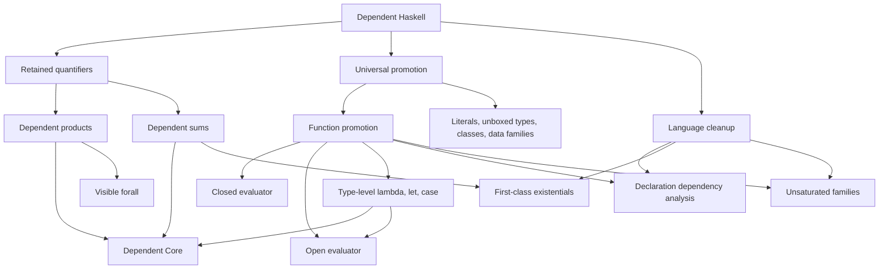

# Dependent Haskell program roadmap

Serokell’s roadmap has 50 cards and 67 edges. Its 2026-11-12 snapshot marks
23 cards complete and seven proposals accepted. Twenty cards have no status
marker. An edge can identify a prerequisite or a subtask. The
[dependency index](#upstream-checklist-and-complete-dependency-index)
records every edge. The R numbers are local labels for those cards.
[Upstream roadmap](https://ghc.serokell.io/dh).

## Where this fork stands

**23 of 50 cards (46%) are complete** on the upstream
checklist. The fork adds a tested part of **20 of the 27 open cards**.
This count includes a card when the fork demonstrates a behavior in
source Haskell or in compiled Core. Each card counts once, regardless
of the number of Showcase examples. The cards differ in scope and some
depend on others, so this count cannot estimate the remaining work time.

| Area | Open cards with a tested implementation in the fork |
| --- | --- |
| Dependent binders, Core and equality | R03, R04, R05, R11, R22 |
| Promotion and evaluation | R07, R10, R12, R13, R14, R15, R16, R17, R18, R19 |
| Declaration dependencies, families and GADTs | R21, R23, R24, R41 |
| Namespace warnings | R36 |

The 517-output Showcase includes a square whose row count is also its
column count, a polymorphic vector package with a runtime length, and a
closed family that matches `Int#`. A group of type-level let bindings can
name the width and the type of a vector with an optional header.
An ordinary consumer can open two vector packages independently, or
regroup two partitions at their original length.
[Two-stage verification](CHECKPOINTS.md#shared-r11-and-r16-rebuild).

Earlier [Showcase milestones and examples](CHECKPOINTS.md#showcase-history-through-502-outputs)
record how each behavior was introduced.

| Card | What works | Remaining gap |
| --- | --- | --- |
| [R03 dependent products](roadmap/R03-dependent-products.md) and [R04 dependent sums](roadmap/R04-dependent-sums.md) | GADT constructors can store nested retained sums that refer to erased parameters. An ordinary client can construct and match a `Pair` when its expected type reduces to a retained sum. An ordinary client can also use a GADT with one retained result index, ordinary fields that depend on that index, and other unchanged erased parameters. | Broaden dependent product domains and inference. Support compound constructor result indices and multiple retained result indices. |
| [R05 dependent Core](roadmap/R05-dependent-core.md) | The standard `-O2` pipeline specializes a recursive consumer and keeps retained case proofs scoped. A provider and an interface-only client can match rules that construct or open an erased package. Source rules can have an imported head and a local anchor, or come from a visible orphan module. | Rules for retained functions and general dependent coercions remain open. |
| [R15 closed evaluator](roadmap/R15-closed-term-evaluator.md#read-independent-row-and-column-counts) | A client proves the labels and all cells of a compiled rectangular table with two hidden dimensions. Both dimensions of a square can share one hidden index. | Extend readback beyond the checked matrix and container shapes. |
| [R16 open evaluator](roadmap/R16-open-term-evaluator.md) | The installed `filter not` handles a known Boolean head and an unknown tail. A separate ordinary client proves length preservation for the installed `map` by induction over a finite spine. | General open evaluation across arbitrary ordinary definitions. |
| [R19 type-level cases](roadmap/R19-type-level-cases.md) | Retained signatures can match a runtime index or an application of a checked function. Two qualified imports of the same checked function can share a case in one declaration group. The upgrade test rebuilds an affected home provider once. | Separately compiled modules still need a shared result type at an unknown index. Older installed providers need rebuilding to export a shared result. |
| [R22 erased existentials](roadmap/R22-existential-quantification.md) | A constructor pattern can open a hidden vector length inside a tuple. A typed consumer can fix the higher-rank witness of a guarded callback. | Extend inference to callbacks without a result declaration that determines the witness. |
| [R23 unsaturated families](roadmap/R23-unsaturated-type-families.md) | An unsigned closed family can infer a callback that accepts constructors and partially applied families. A later GADT argument can fix a receiver's matchability. The original `KindEqualities2` checks across its declaration splice. | Extend higher-order inference beyond the tested closed-family cases and check compatibility of existing unannotated programs. |

The published evaluator work covers closed calls such as `Prelude.sum` and
open equations such as mapping `Prelude.not` over a list with a known head
and unknown tail. The proofs depend on what the function demands and on its
visible rewrite rules. Local lambdas, lets and mixed declarations have
source examples. General promotion remains open.
[R15 closed evaluation](roadmap/R15-closed-term-evaluator.md),
[R16 open evaluation](roadmap/R16-open-term-evaluator.md),
[R17 lambdas](roadmap/R17-type-level-lambdas.md),
[R18 lets](roadmap/R18-type-level-lets.md) and
[R21 declaration dependencies](roadmap/R21-dependency-analysis.md).

## Current work queue

The following changes entered the fork before the shared R11/R16 rebuild.
They remain regression checks for subsequent changes. Reuse one normal build
for all cards that change the same checker or interface format.

| Cards | Integrated change | Regression coverage |
| --- | --- | --- |
| [R03](roadmap/R03-dependent-products.md), [R04](roadmap/R04-dependent-sums.md), [R41](roadmap/R41-nested-quantification-in-gadts.md) | A constructor supplies a runtime result index to a nested call. A retained package can carry a polymorphic element. A quoted GADT preserves the order of its binders and fields. | Check source-hidden clients, lazy fields, rejected index and payload mismatches, interface markers, and ordinary Quick Look allocation. |
| [R10](roadmap/R10-unboxed-promotion.md) | A closed family matches a signed machine integer of type `Int#`. | Check target-width conversion and the imported family axiom with both compiler stages. |
| [R15](roadmap/R15-closed-term-evaluator.md), [R17](roadmap/R17-type-level-lambdas.md) | Rectangular and square matrices retain their shape during readback. A type family recognizes equal lambda closures across an interface. | Check zero-sized and mismatched dimensions, imported closure equality, and the cost of nested family applications. |
| [R36](roadmap/R36-pun-warnings.md) | The renamer can warn when a type and a term share a name at an unqualified use. | Check qualified and explicitly disambiguated uses, implicit binders, diagnostic locations, and `-Werror=pun-uses`. |
| [R18](roadmap/R18-type-level-lets.md#ordered-binding-groups) | A group of type-level let bindings uses source order. A later binding can refer to an earlier binding with the same name. Both braced and layout groups work directly in source. | Check free variables in implicitly quantified signatures, an out-of-scope forward reference, an interface-only client, quotations, and exact and ordinary printing. |

The R05/R16 compiler at `fd5a526ea1` checks the full interfaces of home
modules whose rewrite rules a final Core proof consulted. Adding an
applicable rule now invalidates the warm proof in both object-code and
`-fno-code` builds. The registered regression also checks the next build
with no further edits.
[Recovered branches and remaining checks](BRANCHES.md).

R11 and R16 now share a compiler and library rebuild. The R11 worker
uses scoped same-kind evidence for supported GADT equalities. The v79
reader rejects v69 interfaces before a client can link their object
code. Rebuild the provider and its clients together. More general GADT
equality telescopes remain open.
[Worker and solver evidence](roadmap/R11-homogeneous-equality.md).

R16 records the method and arguments used by a checked proof. A
client with a conflicting rewrite rule receives GHC-83605 at the
proof use. An explicitly opaque, closed observation computed in a
rules-off provider can be used by an optimized ordinary client.
The next family case is a checked method in one equation of a family
with arguments, where a disjoint equation remains usable.
[Open evaluation](roadmap/R16-open-term-evaluator.md) and
[upgrade checks](CHECKPOINTS.md#shared-r11-and-r16-rebuild).

For the remaining work on each card, use the table below. The
[previous queue](CHECKPOINTS.md#vector-split-and-package-checkpoints)
records the earlier source and interface checks.

## Remaining work by roadmap area

The table gives the completion criteria for each area.

| Roadmap area | Remaining local work | Main obligations before completion |
| --- | --- | --- |
| R03: dependent products | General domains, broader invisible argument inference, and runtime type operands | An opted-in caller can pass `(type Bool)` to a visible `foreach (a :: Type)` binder through its interface. An abstract operand needs `Typeable a`. Hidden witnesses and runtime type patterns remain open. |
| R04 and R22: sums and existentials | First-class erased `exists` and retained `some` | Specify formation, introduction, elimination, scope and representation. Existing retained ADT fields provide a storage baseline. |
| R05: dependent Core | Typed conversion, proof operations, transformations, unfoldings and normal optimization | Reconcile the native forms with the calculi. Preserve roles, scope, demand, sharing and ordinary GHC behavior. |
| R15 and R16: closed and open evaluation | Computation in types over closed inputs and rigid variables | Specify staging, divergence, stuck terms and diagnostics. Reuse ordinary term definitions without parallel handwritten families. |
| R13, R17–R19 and R21: function promotion | Type-level lambda, let and case; mixed declaration dependencies | Integrate typed evaluation and matchability. Demonstrate one source function used at both levels across an interface. |
| R23 and R24: type families | Source unsaturation, inference/defaulting and family constraints | Complete the family design beyond the internal matchability foundation. Preserve noninjective application and evidence validity. |
| R07, R10–R12 and R14: promotion domains | General literals, unboxed types, homogeneous equality, classes and data families | Define each domain and its representation separately. Reuse inherited Char and Natural support. |
| R20, R27, R34–R36 and R41: language preparation | Remaining accepted cleanup and binder work | Follow each proposal and its current implementation. Track loose ends without reopening an entire completed upstream card. |
| R01, R02 and R06: aggregate goals | Integrate retained quantification, promotion and language preparation | Complete their required feature scope and broader compatibility checks. A single example cannot close an aggregate goal. |

## Local subset, library and assurance work

The user selected an opt-in dependent subset in modules. A small dependent-base
library should make that subset useful with ordinary Haskell libraries. These local tasks have their own acceptance criteria.

| Task | Roadmap relation | Next result and boundary |
| --- | --- | --- |
| Module interoperability | R03 and R05 | Check an indexed API from a module without dependent syntax. Preserve imported types and infer relationships where supported. Use an explicit adapter when a caller cannot express the contract. |
| Small dependent-base | R03 and R04 | Start with the existing Nat, Vec, Fin, equality and package operations. The example library provides list conversion, package elimination and the [exact-length adapter](PLAN.md#m95-check-ordinary-list-inputs-at-an-indexed-boundary). Package and module names remain provisional. |
| Conservative totality checking | Local assurance work related to R05 | Specify the property for lazy Haskell. Start with coverage and structural recursion. Keep checked results, trusted assumptions and unknown status distinct across imports. |
| Observational equality | R05 research | Compare explicit equality and transport with OTT. Keep checker conversion, contextual equivalence and inverse application distinct. No new equality rule is selected. |

A module flag enables source features. It does not remove imported contracts.
An ordinary import supplies no extra termination or proof guarantee unless a
check or an explicit trusted contract establishes it. Partial dependent code
can still preserve an index invariant when it returns. Totality remains a
separate promise. A termination checker alone does not establish logical
consistency; positivity, universes, proof elimination and unsafe operations
also need rules.
Specify the required inputs as well as the result. A checked function on total
inputs does not certify a result obtained from an unchecked lazy argument.

Use linear-base as the library and adapter reference. Use Idris and Agda as
references for conservative totality checks and imported assumptions.
[Design references](REFERENCES.md).

The first candidate is an advisory report for covered first-order functions
with direct structural recursion. Use the zonked source AST and the existing
coverage checker. Recompute the complete call graph; the inference graph omits
some signed-call edges. Unsupported recursion, callbacks and imports stay
unknown. No checker or new totality guarantee is implemented.

Use LiquidHaskell's [Refinement Types For Haskell](https://simon.peytonjones.org/assets/pdfs/refinement-types-for-haskell.pdf)
as Haskell-specific prior art. Its analysis distinguishes potentially divergent
terms, weak-head values and finite values. Keep the first report advisory.
It must not change conversion, proof erasure or imported type contracts.

## Main relationships

Arrows have the same direction as the upstream graph: a task points to a
prerequisite or subtask. This diagram omits completed preparation and smaller
branches. The full checklist below preserves every edge.

A retained-quantifier experiment can proceed before universal promotion is
complete. Completing that experiment will still leave the promotion and cleanup
branches open.

## Upstream checklist and complete dependency index

A checked box means **completed on the upstream roadmap snapshot**. It does not
mean that this fork completed the feature or that every related issue is closed.
`Accepted` is a design status. Leave its box unchecked until implementation is
verified. The `R` numbers are local reference labels; links retain upstream IDs.
`Needs/includes` records the graph relation without claiming that every edge is
a mandatory sequencing constraint. A leaf has no outgoing graph edge; it can
still require substantial research.

- [ ] **R01 [Dependent Haskell](https://ghc.serokell.io/dh#dependent-haskell)** — Unmarked. Needs/includes: R02, R06, R20.
- [ ] **R02 [Dependent retained quantifiers](https://ghc.serokell.io/dh#dependent-retained-quantifiers)** — Unmarked. Needs/includes: R03, R04.
- [ ] **R03 [Dependent products](https://ghc.serokell.io/dh#dependent-products)** — Unmarked. Needs/includes: R05, R39.
- [ ] **R04 [Dependent sums](https://ghc.serokell.io/dh#dependent-sums)** — Unmarked. Needs/includes: R05, R22.
- [ ] **R05 [Dependent Core language](https://ghc.serokell.io/dh#dependent-core-language)** — Unmarked. Needs/includes: no outgoing graph edge.
- [ ] **R06 [Universal promotion](https://ghc.serokell.io/dh#universal-promotion)** — Unmarked. Needs/includes: R07, R10, R12, R13, R14.
- [ ] **R07 [Promote literals](https://ghc.serokell.io/dh#promote-literals)** — Unmarked. Needs/includes: R08, R09, R24. M80 supplies nonnegative type numerals at registered index kinds. [M83](PLAN.md#m83-ordinary-numerals-in-retained-arguments) accepts term numerals in retained arguments when the actual conversion has checked equations. A complete monomorphic annotation can name the retained domain. [Written character literals](REFERENCES.md#written-character-indices) can supply retained indices directly or as elements of a written list. [Plain quoted strings](REFERENCES.md#quoted-strings-in-retained-operands) use the same lazy character lists. A saturated, certified binary method can compute the [result length of an indexed append](REFERENCES.md#certified-addition-in-an-indexed-append). [Written Natural literals](REFERENCES.md#written-retained-natural-literals) use DataKinds numerals and the ordinary boxed runtime representation with the standard `Num Natural` dictionary. General overloaded term promotion and constrained family evaluation remain open.
  [The one-cell vector package](examples/packed-vector/PackedProjection.hs)
  uses `1` at a registered Peano kind under `ExperimentalDependentTypes`.
  An ordinary caller can import its interface and prove that its length equals `'S 'Z`.
  Agda accepts decimal numerals directly at its builtin `Nat` in vector indices such as `1 + n`.
  Accepted GHC proposal #364 assigns ordinary type numerals the builtin `Natural` kind.
  [Agda vector operations](https://agda.github.io/agda-stdlib/v2.3/Data.Vec.Base.html)
  and [GHC proposal #364](https://ghc-proposals.readthedocs.io/en/latest/proposals/0364-unify-natural.html).
- [x] **R08 [Promote Char](https://ghc.serokell.io/dh#promote-char)** — Completed. Needs/includes: no outgoing graph edge. [Written character indices](REFERENCES.md#written-character-indices) use the existing DataKinds character literals.
- [x] **R09 [Promote Natural](https://ghc.serokell.io/dh#promote-natural)** — Completed. Needs/includes: no outgoing graph edge.
- [ ] **R10 [Promote unboxed types](https://ghc.serokell.io/dh#promote-unboxed-types)** — Unmarked. Needs/includes: R11. [Source probes and R11 acceptance check](roadmap/R10-unboxed-promotion.md).
- [ ] **R11 [Homogeneous equality](https://ghc.serokell.io/dh#homogeneous-equality)** — Unmarked. Needs/includes: no outgoing graph edge. Deferred heterogeneous equality holes and projected constructor, function, or matchable application Givens use same-kind evidence binders. Pattern-bound coercions can still have endpoints at different kinds. [Core check](roadmap/R10-unboxed-promotion.md#deferred-heterogeneous-equalities). The [v79 worker](roadmap/R11-homogeneous-equality.md) gives supported pattern-bound coercions a scoped kind proof. Rebuild native libraries for this compiler.
- [ ] **R12 [Promote classes](https://ghc.serokell.io/dh#promote-classes)** — Unmarked. Needs/includes: R13, R24. M82 connects a concrete instance method to a checked source function in a retained argument. M83 checks the selected ground `Num` instance’s conversion of a nonnegative literal. A direct class constraint can supply an opaque unary method in an exported index. The caller can infer an independent payload and its ordinary class constraints. Superclass selection and general class promotion remain open. [Abstract method example](roadmap/R12-promote-classes.md).
- [ ] **R13 [Function promotion](https://ghc.serokell.io/dh#function-promotion)** — Unmarked. Needs/includes: R15, R16, R17, R18, R19, R21, R23. The [map length example](roadmap/R16-open-term-evaluator.md#prove-that-map-preserves-length) calls the ordinary `size` function at runtime and uses its checked equations in a separate proof module.
- [ ] **R14 [Data family promotion](https://ghc.serokell.io/dh#data-family-promotion)** — Unmarked. Needs/includes: no outgoing graph edge. [Simple instance constructors](roadmap/R14-data-family-promotion.md).
- [ ] **R15 [Closed term evaluator](https://ghc.serokell.io/dh#closed-term-evaluator)** — Unmarked. Needs/includes: no outgoing graph edge. M99, M101 and M103 support qualified closed calls on a character or a list of natural number literals. The argument can determine a polymorphic function's specialization. M105 reads back one list layer of a supported scalar type. M106 composes qualified unary calls. M108 passes all supported result shapes between calls. M110 accepts written literals at those kinds. M111 checks the roadmap's length signature. M113 checks saturated calls with joint operand inference. M116 returns a boxed pair and passes it to a later call. M118 extends this to `Maybe` and `Either`. M120 adds recursive lists. M122 infers the kinds of constructor literals from the producer and the other inputs. M124 admits imported ordinary enumerations. M127 adds finite recursive datatypes with ground boxed fields. M129 admits GADT constructor equalities at a known index. M130 recovers constructor-local indices along nominally injective paths in the result. M132 consumes written existential packages. M135 recovers a runtime-selected index from a singleton field. M136 composes ordinary nested calls before observing their result. M139 uses a known expected kind to specialize a conversion. M140 passes a known domain to a nested conversion. M143 shares kinds between computed siblings. M145 carries kinds through a checked projection. M149 preserves a pair field’s laziness in an enclosing ordinary call. M153 also checks a direct projection of a copied field through interfaces. M157 exposed a compatibility failure for a computed field and remains experimental. M165 runs a closed call with an imported callback. See the [active card](roadmap/R15-closed-term-evaluator.md).
- [ ] **R16 [Open term evaluator](https://ghc.serokell.io/dh#open-term-evaluator)** — Unmarked. Needs/includes: no outgoing graph edge. M100 and M102 handle rigid projections. M104 retries a call before generalization when a pattern fixes a signature wildcard. M107 selects a branch with a known character and a rigid result operand. M109 publishes a closed family for finite character mappings and follows a checked alias across an interface. M114 checks boxed-pair projections and detects a blocked rigid pair. M119 preserves installed Prelude projections of an unknown pair in exported constraints. M121 also certifies an ordinary case that rebuilds a pair from its fields. M123 proves a projection of a swap for an unknown pair. M125 follows both projected fields through chains of checked pair constructors. M126 obtains an independent local producer from the current source module. M128 observes its chain of local helpers. M131 handles recursive value groups and tracks demanded source binders. M133 selects fields of known ordinary user constructors and checks the demanded imported unfoldings against rewrite rules. M137 returns supported constructors and boxed pairs with symbolic fields. M142 publishes checked pair cases from ordinary producers. M144 exports projections for ordinary sums. M146 checks nested constructor patterns and a fallback argument. M148 builds public constructors in the result of a case. M151 retains helper equations inside those constructors. M154 checks a private helper that itself returns a public lazy constructor. M155 follows acyclic private helper calls. M158 also checks a case inside a private helper. M159 publishes a structurally recursive unary call under a lazy output constructor. M162 checks a recursive call with an unchanged second operand. M168 and M169 preserve a callback during recursion on the second argument and check an ordinary client using its equation. See the [open-term examples and checks](roadmap/R16-open-term-evaluator.md).
- [ ] **R17 [Type-level lambdas](https://ghc.serokell.io/dh#type-level-lambdas)** — Unmarked. Needs/includes: R05, R16.
- [ ] **R18 [Type-level let-bindings](https://ghc.serokell.io/dh#type-level-let-bindings)** — Unmarked. Needs/includes: R05, R16. Braced and layout groups scope simple bindings in source order. A local binding can name an infix size computation used by a later binding and case. Local patterns and signatures remain open. [Ordered groups](roadmap/R18-type-level-lets.md#ordered-binding-groups), [optional vector header](roadmap/R18-type-level-lets.md#a-vector-with-an-optional-header), and [quotation example](roadmap/R18-type-level-lets.md#type-quotations-and-splices).
- [ ] **R19 [Type-level case-expressions](https://ghc.serokell.io/dh#type-level-case-expressions)** — Unmarked. Needs/includes: R05, R16. Template Haskell can quote a retained signature, splice a case on an enclosing runtime binder, and reify a retained GADT constructor from a stripped interface. A source plugin can forward the type splice during typechecking. [Examples and limits](roadmap/R19-type-level-cases.md#quote-and-reify-retained-gadt-constructors).
- [ ] **R20 [Clean up the language](https://ghc.serokell.io/dh#clean-up-the-language)** — Unmarked. Needs/includes: R21, R22, R23, R24, R27, R28, R35, R39, R49.
- [ ] **R21 [Dependency analysis](https://ghc.serokell.io/dh#dependency-analysis)** — Accepted. Needs/includes: no outgoing graph edge. M126 schedules an independent local producer for open evaluation. M128 extends scheduling to a chain of acyclic value bindings. M131 also schedules mutually recursive value groups, with or without complete signatures. M134 schedules local datatypes and synonyms with their ordinary value prerequisites. M138 admits deriving and default declarations with ready prerequisites. M147 installs ordinary class instance heads and associated type equations before local producers, then checks the methods. M150 also schedules associated data and standalone family instances. M152 schedules a local producer before the equations of a fresh local family. M156 checks independent local functions used by an imported family equation. M160 accepts imported functions with independent polymorphic signatures in those local producers. M163 admits saturated ordinary data constructors and checks their field types. M164 also infers an unsigned producer. [Scope and remaining dependencies](roadmap/R21-dependency-analysis.md).
- [ ] **R22 [Existential quantification](https://ghc.serokell.io/dh#existential-quantification)** — Unmarked. Needs/includes: no outgoing graph edge. The first acceptance check opens an erased package from another module. An implicitly packed vector filter must also return its first cell without forcing the tail. A reader can take the result of a conditional between two polymorphic vector producers. Ordinary type inference checks the branches once. [Source examples and Core checks](roadmap/R22-existential-quantification.md).
- [ ] **R23 [Unsaturated type families](https://ghc.serokell.io/dh#unsaturated-type-families)** — Accepted. Needs/includes: R25. M141 restores omitted-arrow inference for a dependent argument. M166 passes a partial user family through an interface at a known unmatchable arrow. General inference and ordinary-program compatibility remain open. [Checks and remaining work](roadmap/R23-unsaturated-type-families.md#m166-passing-an-unsaturated-family-to-an-unmatchable-binder).
- [ ] **R24 [Constrained type families](https://ghc.serokell.io/dh#constrained-type-families)** — Unmarked. Needs/includes: no outgoing graph edge. The fork checks associated family domains across module interfaces, including a kind that selects the class instance. Functional dependencies and superclass equalities can determine class parameters omitted from the family. Marked family defaults and explicit associated equations can use the owning class and its superclasses. A partial application must supply the owner parameters declared by the family. Imported type synonyms carry the same domain check. Partial signatures can use written premises. Inferred results must still satisfy the domain in their final context. Qualified family kinds and general Core evidence remain open. [Checked scope and open questions](roadmap/R24-constrained-type-families.md).
- [x] **R25 [Modifiers syntax](https://ghc.serokell.io/dh#modifiers-syntax)** — Completed. Needs/includes: no outgoing graph edge.
- [x] **R26 [Standalone kind signatures](https://ghc.serokell.io/dh#standalone-kind-signatures)** — Completed. Needs/includes: no outgoing graph edge.
- [ ] **R27 [Deprecate CUSKs](https://ghc.serokell.io/dh#deprecate-cusks)** — Accepted. Needs/includes: R26, R29.
- [x] **R28 [Invisible type arguments](https://ghc.serokell.io/dh#invisible-type-arguments)** — Completed. Needs/includes: R29, R30, R31, R32, R33.
- [x] **R29 [Invisible binders in types](https://ghc.serokell.io/dh#invisible-binders-in-types)** — Completed. Needs/includes: R26.
- [x] **R30 [Invisible binders in functions](https://ghc.serokell.io/dh#invisible-binders-in-functions)** — Completed. Needs/includes: no outgoing graph edge.
- [x] **R31 [Invisible binders in constructors](https://ghc.serokell.io/dh#invisible-binders-in-constructors)** — Completed. Needs/includes: no outgoing graph edge.
- [x] **R32 [Visible type applications](https://ghc.serokell.io/dh#visible-type-applications)** — Completed. Needs/includes: no outgoing graph edge.
- [x] **R33 [Visible kind applications](https://ghc.serokell.io/dh#visible-kind-applications)** — Completed. Needs/includes: no outgoing graph edge.
- [ ] **R34 [Syntactic unification](https://ghc.serokell.io/dh#syntactic-unification)** — Accepted. Needs/includes: R44, R45, R46, R47.
- [ ] **R35 [Namespace management](https://ghc.serokell.io/dh#namespace-management)** — Accepted. Needs/includes: R36, R37, R38, R42.
- [ ] **R36 [Pun warnings](https://ghc.serokell.io/dh#pun-warnings)** — Accepted. Needs/includes: no outgoing graph edge. [Proposal #765](https://ghc-proposals.readthedocs.io/en/latest/proposals/0765-pun-warnings.html) introduces two warnings. `-Wpun-bindings` checks top-level definitions in one declaration group and explicit type and term binders in one match. `-Wpun-uses` checks global names, implicit capture, and selected list and tuple type syntax. Explicit local use scope and staged imports remain open. [Checklist and source examples](roadmap/R36-pun-warnings.md).
- [x] **R37 [Namespace-specified imports](https://ghc.serokell.io/dh#namespace-specified-imports)** — Completed. Needs/includes: no outgoing graph edge.
- [x] **R38 [No list or tuple puns](https://ghc.serokell.io/dh#no-list-or-tuple-puns)** — Completed. Needs/includes: no outgoing graph edge.
- [x] **R39 [Visible forall](https://ghc.serokell.io/dh#visible-forall)** — Completed. Needs/includes: R34 (loose end), R40, R41 (loose end), R43.
- [x] **R40 [Visibility coercions](https://ghc.serokell.io/dh#visibility-coercions)** — Completed. Needs/includes: no outgoing graph edge.
- [ ] **R41 [Nested quantification in GADTs](https://ghc.serokell.io/dh#nested-quantification-in-gadts)** — Accepted. Needs/includes: no outgoing graph edge. Prefix constructors accept consecutive constraint groups before the first field ([GHC proposal #402](https://ghc-proposals.readthedocs.io/en/latest/proposals/0402-gadt-syntax.html), [#27424](https://gitlab.haskell.org/ghc/ghc/-/issues/27424)). An ordinary prefix constructor can end with a required forall after its last field. Its wrapper and pattern keep written argument order. A context before the fields can refer to the earlier type binders. Its constraints are available when checking the field and terminal type patterns. The promoted kind keeps written argument order when the constructor is promotable. Template Haskell can round-trip terminal-group prefix declarations with field bangs and multiplicities. A prefix constructor can also use `Int -> forall a. Eq a => T a`. Its caller supplies the field before the type argument and dictionary. A context can also follow the fields directly, as in `K :: a -> Eq a => F`. Pattern matching introduces the existential field type before checking the field and the dictionary afterward. Several specified `forall` groups can occur between value fields. The ordinary client supplies each type argument after the preceding field. Lifted prefix constructors can interleave class or equality contexts with fields and `forall` groups. A leading required binder can precede a context and a later group with inferred and specified binders. Template Haskell preserves that order and any field bangs. The worker keeps its representation order. Some terminal combinations and other constructor forms remain open ([#27425](https://gitlab.haskell.org/ghc/ghc/-/issues/27425), [#27426](https://gitlab.haskell.org/ghc/ghc/-/issues/27426)). [Checklist and source example](roadmap/R41-nested-quantification-in-gadts.md).
- [x] **R42 [Embed types](https://ghc.serokell.io/dh#embed-types)** — Completed. Needs/includes: no outgoing graph edge.
- [x] **R43 [Term variable capture](https://ghc.serokell.io/dh#term-variable-capture)** — Completed. Needs/includes: no outgoing graph edge.
- [x] **R44 [No star kind syntax](https://ghc.serokell.io/dh#no-star-kind-syntax)** — Completed. Needs/includes: R50.
- [x] **R45 [The forall keyword](https://ghc.serokell.io/dh#the-forall-keyword)** — Completed. Needs/includes: no outgoing graph edge.
- [x] **R46 [The tilde operator](https://ghc.serokell.io/dh#the-tilde-operator)** — Completed. Needs/includes: R48.
- [x] **R47 [The dot type operator](https://ghc.serokell.io/dh#the-dot-type-operator)** — Completed. Needs/includes: R48.
- [x] **R48 [Whitespace-sensitive operators](https://ghc.serokell.io/dh#whitespace-sensitive-operators)** — Completed. Needs/includes: no outgoing graph edge.
- [x] **R49 [Unify type and kind variables](https://ghc.serokell.io/dh#unify-type-and-kind-variables)** — Completed. Needs/includes: R50.
- [x] **R50 [Unify types and kinds](https://ghc.serokell.io/dh#unify-types-and-kinds)** — Completed. Needs/includes: no outgoing graph edge.

`R39 -> R34` and `R39 -> R41` are the two loose-end edges. Required type
arguments already exist while syntax unification and nested GADT quantifiers
remain incomplete. Do not infer completion by propagating checkmarks through
the graph.

## Research and provenance

The [reference ledger](REFERENCES.md) connects implementation decisions to
GHC proposals, Agda, the singleton encoding and the published Core calculi.
The [paper notes](papers/README.md) record the sections studied. The
[historical port](PORT.md) identifies Eisenberg’s branch and the commits
used for the native Core design.
