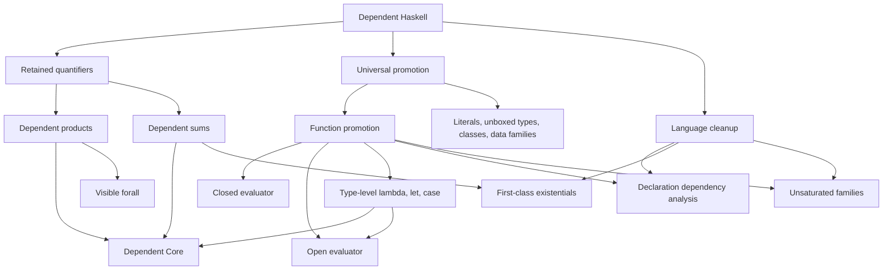

# Dependent Haskell program roadmap

Use this file to plan the whole program. Use [PLAN.md](PLAN.md) for individual
compiler increments, [CORE.md](CORE.md) for the current Core contract, and
[REFERENCES.md](REFERENCES.md) for design provenance. The work queue below owns
project priorities. The `M` checkpoints in PLAN.md record implementation and
evidence; their numbers do not define the program's structure.

The primary map is [Serokell's Dependent Haskell roadmap](https://ghc.serokell.io/dh),
dated **2026-11-12** and reviewed on **2026-11-16**. This checklist records its
50 feature cards and all 67 feature-to-feature graph edges. Layout nodes are
excluded. The graph describes prerequisites **or subtasks**. It is not a build
order. In particular, two edges below are explicitly loose ends of a completed
feature. The card lists omit already completed children; the graph retains them.

The upstream snapshot has 23 completed cards, seven accepted cards, and 20 cards
without a status marker. These counts do not measure implementation effort.
An unmarked card can have research or an implementation prototype.

## Where this fork stands

We have an end-to-end native experiment within the retained-quantifier part of
the map. Source programs use a runtime value as a type index, refine that index
by pattern matching, store it with dependent fields, and run compiled code.
The supported static subset and native pipeline remain restricted.

| Area | Demonstrated in this fork | Work before the roadmap task is complete |
| --- | --- | --- |
| Dependent Core (`R05`) | `TermVarTy`, `DepFunTy`, retained fields, scoped coercions, Core Lint, interfaces, and a checked backend path | Reconcile the representation with the published calculi. Complete transformations, normal optimization, unfoldings, and compatibility with the rest of GHC. |
| Dependent products (`R03`) | Visible `foreach (n :: Nat) -> ...`, dependent equations and checked lambdas, runtime indices from IO, qualified higher-order values, and checked positions for retained `[Bool]` | General domains and applications, invisible retained quantification, and predictable inference beyond the measured subset. |
| Dependent sums (`R04`) | ADTs with retained field telescopes, including a length with its vector and a bound proof | First-class existential and dependent-pair types. Current constructor syntax does not implement general `exists` or `some`. |
| Type computation (`R06`, `R13`) | Existing promoted constructors and saturated type families, with explicit equality proofs | Ordinary function promotion, closed and open evaluation, and lambda/let/case expressions in types. |
| Language preparation (`R20`) | Existing GHC facilities such as DataKinds, required type arguments, type abstractions, and explicit namespaces | The remaining upstream tasks below. Reuse their implementations and track their known restrictions. |

The example `Nat` is the source datatype `data Nat = Z | S Nat`. It is not a
claim about native support for every built-in numeric or unboxed domain.
Runtime names retain lexical identity: two separately bound lengths need a
proof to be interchangeable, even when their runtime values happen to agree.
This follows the identity rule in [proposal #378, term variables in types](https://ghc-proposals.readthedocs.io/en/latest/proposals/0378-dependent-type-design.html#term-variables-in-types).

These declarations already compile in the public vector example:

```haskell
replicateNative :: forall a. foreach (n :: Nat) -> a -> Vec a n
reverseNative :: forall a. foreach (n :: Nat) -> Vec a n -> Vec a n
appendNative :: forall a. foreach (n :: Nat) -> foreach (m :: Nat)
             -> Vec a n -> Vec a m -> Vec a (Add n m)
```

`Add` is still a type family. The implementation does not yet let an arbitrary
ordinary Haskell `length` or `append` compute inside a type.

The published compiler checkpoint is M62. Both stages pass the 88-observation
Showcase through fourteen source modules. M62 supplies its latest source group.
M56 provides
the closed parameterized domains. M57 provides nominal scalar-domain conversion
in Core. M58 exposes that conversion and scoped body solving from source.
M59 compares bodies beneath fixed function domains and selects ordinary payloads.
Its compiler checkpoint is `5c527cd8b92a`; its source fixture checkpoint is
`5e33b194f1e6`. Its independently audited documentation is `a5bdd43f6764`.
The canonical audit is
`_build/verification/dependent-haskell-M59-final-audit-v1.json`.
See [the M59 specification](PLAN.md#m59-bodies-beneath-fixed-function-domains).
M60 composes safe indexing with the existing compiler. Both stages pass its
nineteen runtime observations, five rejections, compile-only equal-count reuse
and the 84-observation Showcase. Its separate audit passes 616 checks.
The canonical record is
`_build/verification/dependent-haskell-M60-final-audit-v1.json`.
Observation counts measure those programs. They do not count roadmap features.

M61 checks opaque whole-function casts with both rebuilt compilers and the
selected API/source/registered cohort. A bounded native beta-substitution fix
prevents a function alias from escaping through a partial result type. The
existing cast supports the measured lowering path. Its independent audit passes.
The canonical record is
`_build/verification/dependent-haskell-M61-final-audit-v1.json`.
General opaque proof projection stays open.

## Current work queue

Use the roadmap card as the unit of work. Each active card has a feature page
with its goal, supported subset, next increments and completion boundary:

- [R05: Dependent Core language](roadmap/R05-dependent-core.md).
- [R03: Dependent products](roadmap/R03-dependent-products.md).
- [R23: Unsaturated type families](roadmap/R23-unsaturated-type-families.md).

The following order is our implementation plan. These gates are separate from
the upstream graph's prerequisites-or-subtasks relation. A completed increment
can advance a card while the card remains open.

| Order | Owner and contribution | State | Gate and next result |
| --- | --- | --- | --- |
| 1 | R03: fixed function-domain body comparison; exercises R05 evidence | Complete bounded increment: M59 | Both stages and independent audit pass. The larger R03/R05 features remain open. |
| 2 | R03: safe indexing over a retained `[Bool]` | Complete bounded increment: M60 | Both stages and the evidence audit pass. The next compiler task is the R05 opaque-cast probe. |
| 3 | R05: application through opaque whole-function evidence | Complete bounded increment: M61 | Both builds, selected cohort and independent audit pass. Typed opaque proof projection remains separate. |
| 4 | R03: explicit complete retained-function type arguments | Complete bounded increment: M62 | Both builds, nested source arguments, worker demand, the selected cohort and independent audit pass. Next: the R23 foundation. |
| 5 | R23: matchability foundation; also advances R05 | M63/M64 foundation passes selected builds and checks; publication pending | Explicit arrow and forall metadata pass Core, source, interface, TH and reflection checks. The generic native client and source family unsaturation remain open. |
| 6 | R05: function values in closed algebraic indices; enables R03 source work | Complete bounded increment: M65 | Both rebuilt stages pass source/interface controls and Showcase100/16. Seven registered tests pass. Generic `[a]`, higher-order endpoints and changed dependent domains remain open. |
| 7 | R05: bounded family views in native frontend inference | Research prepared; specification and implementation open | Replace the inherited pure native shape and argument views with the solver's depth-limited family API. Preserve proof direction and cached argument usage. |

M64 now carries explicit forall metadata in the development source. The
[Core contract](CORE.md#forall-matchability) records scope, nominal proofs,
runtime U and the conservative expression and constructor-evidence limits.
The selected builds and checks pass, including Showcase95 with 14 home
modules in both stages. The standard selection passes seven tests with
54 skipped ways. R23 remains open for the generic native client and family source
unsaturation.

M65 connects stored function values to canonical opaque call indices. A
saturated family can expose the stored function without losing its forward
application proof. Later package fields retain the actual function identity.
See [the Core contract](CORE.md#function-values-in-algebraic-indices) and
[the validation record](PLAN.md#m65-validation). This increment does not
complete R05, R03 or R23.

The user resumed GHC execution on **2026-11-16 at 17:53 CET**. Run heavy checks
serially under the configured memory cap. This execution policy does not add
feature dependencies.

### Remaining work by roadmap area

Keep these tasks visible when selecting the next increment. The first six
increments do not complete the program.

| Roadmap area | Remaining local work | Main obligations before completion |
| --- | --- | --- |
| R03: dependent products | General domains, invisible retained binders, runtime `Type` operands | Separate retention from visibility. Define a runtime universe bridge. Required erased `forall` and existing `TypeRep` do not supply that bridge. |
| R04 and R22: sums and existentials | First-class erased `exists` and retained `some` | Specify formation, introduction, elimination, scope and representation. Existing retained ADT fields provide a storage baseline. |
| R05: dependent Core | Typed conversion, proof operations, transformations, unfoldings and normal optimization | Reconcile the native forms with the calculi. Preserve roles, scope, demand, sharing and ordinary GHC behavior. |
| R15 and R16: closed and open evaluation | Computation in types over closed inputs and rigid variables | Specify staging, divergence, stuck terms and diagnostics. Reuse ordinary term definitions without parallel handwritten families. |
| R13, R17–R19 and R21: function promotion | Type-level lambda, let and case; mixed declaration dependencies | Integrate typed evaluation and matchability. Demonstrate one source function used at both levels across an interface. |
| R23 and R24: type families | Source unsaturation, inference/defaulting and family constraints | Complete the family design beyond the internal matchability foundation. Preserve noninjective application and evidence validity. |
| R07, R10–R12 and R14: promotion domains | General literals, unboxed types, homogeneous equality, classes and data families | Define each domain and its representation separately. Reuse inherited Char and Natural support. |
| R20, R27, R34–R36 and R41: language preparation | Remaining accepted cleanup and binder work | Follow each proposal and its current implementation. Track loose ends without reopening an entire completed upstream card. |
| R01, R02 and R06: aggregate goals | Integrate retained quantification, promotion and language preparation | Complete their required feature scope and broader compatibility checks. A single example cannot close an aggregate goal. |

### Rules for the next increment

1. Name one owning roadmap card. List related cards when the increment crosses
   layers. Keep the existing `M` identifiers for historical checkpoints.
2. Add the bounded specification to [PLAN.md](PLAN.md) before compiler changes.
   State the contribution, required prerequisites, acceptance checks and limits.
3. Use the owning feature page to find the research and open obligations.
   Record new sources and their reading scope in [REFERENCES.md](REFERENCES.md).
4. Record compiler, source, runtime and rejection evidence separately. Extend
   [Showcase.hs](Showcase.hs) when a source feature is checked.
5. Update the feature page and this queue after verification. Mark the increment
   complete only within its measured scope. Close a roadmap card only when its
   full goal and compatibility requirements are supported.

## Local subset, library and assurance work

The user selected an opt-in dependent subset in modules. A small dependent-base
library should make that subset useful with ordinary Haskell libraries. These
local tasks do not add cards or edges to the upstream roadmap. They do not
change M63's acceptance criteria.

| Task | Roadmap relation | Next result and boundary |
| --- | --- | --- |
| Module interoperability | R03 and R05 | Check an indexed API from a module without dependent syntax. Preserve imported types and infer relationships where supported. Use an explicit adapter when a caller cannot express the contract. |
| Small dependent-base | R03 and R04 | Start with the existing Nat, Vec, Fin, equality and package operations. Add list conversion, package elimination and a length-checking adapter. Package and module names remain provisional. |
| Conservative totality checking | Local assurance work related to R05 | Specify the property for lazy Haskell. Start with coverage and structural recursion. Keep checked results, trusted assumptions and unknown status distinct across imports. |
| Observational equality | R05 research | Compare explicit equality and transport with OTT. Keep checker conversion, contextual equivalence and inverse application distinct. No new equality rule is selected. |

A module flag enables source features. It does not remove imported contracts.
An ordinary import supplies no extra termination or proof guarantee unless a
check or an explicit trusted contract establishes it. Partial dependent code
can still preserve an index invariant when it returns. Totality remains a
separate promise. A termination checker alone does not establish logical
consistency; positivity, universes, proof elimination and unsafe operations
also need rules.
Specify the required inputs as well as the result. A checked function on total
inputs does not certify a result obtained from an unchecked lazy argument.

Use linear-base as the library and adapter reference. Use Idris and Agda as
references for conservative totality checks and imported assumptions. Their
current guarantees do not transfer to this fork. See the new boundary and
observational-equality entries in [REFERENCES.md](REFERENCES.md).

The first candidate is an advisory report for covered first-order functions
with direct structural recursion. Use the zonked source AST and the existing
coverage checker. Recompute the complete call graph; the inference graph omits
some signed-call edges. Unsupported recursion, callbacks and imports stay
unknown. No checker or new totality guarantee is implemented.

Use LiquidHaskell's [Refinement Types For Haskell](https://simon.peytonjones.org/assets/pdfs/refinement-types-for-haskell.pdf)
as Haskell-specific prior art. Its analysis distinguishes potentially divergent
terms, weak-head values and finite values. Keep the first report advisory.
It must not change conversion, proof erasure or imported type contracts.

## Main relationships

Arrows have the same direction as the upstream graph: a task points to a
prerequisite or subtask. This diagram omits completed preparation and smaller
branches. The full checklist below preserves every edge.



A retained-quantifier experiment can proceed before universal promotion is
complete. Completing that experiment will still leave the promotion and cleanup
branches open.

## Upstream checklist and complete dependency index

A checked box means **completed on the upstream roadmap snapshot**. It does not
mean that this fork completed the feature or that every related issue is closed.
`Accepted` is a design status. Leave its box unchecked until implementation is
verified. The `R` numbers are local reference labels; links retain upstream IDs.
`Needs/includes` records the graph relation without claiming that every edge is
a mandatory sequencing constraint. A leaf has no outgoing graph edge; it can
still require substantial research.

- [ ] **R01 [Dependent Haskell](https://ghc.serokell.io/dh#dependent-haskell)** — Unmarked. Needs/includes: R02, R06, R20.
- [ ] **R02 [Dependent retained quantifiers](https://ghc.serokell.io/dh#dependent-retained-quantifiers)** — Unmarked. Needs/includes: R03, R04.
- [ ] **R03 [Dependent products](https://ghc.serokell.io/dh#dependent-products)** — Unmarked. Needs/includes: R05, R39.
- [ ] **R04 [Dependent sums](https://ghc.serokell.io/dh#dependent-sums)** — Unmarked. Needs/includes: R05, R22.
- [ ] **R05 [Dependent Core language](https://ghc.serokell.io/dh#dependent-core-language)** — Unmarked. Needs/includes: no outgoing graph edge.
- [ ] **R06 [Universal promotion](https://ghc.serokell.io/dh#universal-promotion)** — Unmarked. Needs/includes: R07, R10, R12, R13, R14.
- [ ] **R07 [Promote literals](https://ghc.serokell.io/dh#promote-literals)** — Unmarked. Needs/includes: R08, R09, R24.
- [x] **R08 [Promote Char](https://ghc.serokell.io/dh#promote-char)** — Completed. Needs/includes: no outgoing graph edge.
- [x] **R09 [Promote Natural](https://ghc.serokell.io/dh#promote-natural)** — Completed. Needs/includes: no outgoing graph edge.
- [ ] **R10 [Promote unboxed types](https://ghc.serokell.io/dh#promote-unboxed-types)** — Unmarked. Needs/includes: R11.
- [ ] **R11 [Homogeneous equality](https://ghc.serokell.io/dh#homogeneous-equality)** — Unmarked. Needs/includes: no outgoing graph edge.
- [ ] **R12 [Promote classes](https://ghc.serokell.io/dh#promote-classes)** — Unmarked. Needs/includes: R13, R24.
- [ ] **R13 [Function promotion](https://ghc.serokell.io/dh#function-promotion)** — Unmarked. Needs/includes: R15, R16, R17, R18, R19, R21, R23.
- [ ] **R14 [Data family promotion](https://ghc.serokell.io/dh#data-family-promotion)** — Unmarked. Needs/includes: no outgoing graph edge.
- [ ] **R15 [Closed term evaluator](https://ghc.serokell.io/dh#closed-term-evaluator)** — Unmarked. Needs/includes: no outgoing graph edge.
- [ ] **R16 [Open term evaluator](https://ghc.serokell.io/dh#open-term-evaluator)** — Unmarked. Needs/includes: no outgoing graph edge.
- [ ] **R17 [Type-level lambdas](https://ghc.serokell.io/dh#type-level-lambdas)** — Unmarked. Needs/includes: R05, R16.
- [ ] **R18 [Type-level let-bindings](https://ghc.serokell.io/dh#type-level-let-bindings)** — Unmarked. Needs/includes: R05, R16.
- [ ] **R19 [Type-level case-expressions](https://ghc.serokell.io/dh#type-level-case-expressions)** — Unmarked. Needs/includes: R05, R16.
- [ ] **R20 [Clean up the language](https://ghc.serokell.io/dh#clean-up-the-language)** — Unmarked. Needs/includes: R21, R22, R23, R24, R27, R28, R35, R39, R49.
- [ ] **R21 [Dependency analysis](https://ghc.serokell.io/dh#dependency-analysis)** — Accepted. Needs/includes: no outgoing graph edge.
- [ ] **R22 [Existential quantification](https://ghc.serokell.io/dh#existential-quantification)** — Unmarked. Needs/includes: no outgoing graph edge.
- [ ] **R23 [Unsaturated type families](https://ghc.serokell.io/dh#unsaturated-type-families)** — Accepted. Needs/includes: R25.
- [ ] **R24 [Constrained type families](https://ghc.serokell.io/dh#constrained-type-families)** — Unmarked. Needs/includes: no outgoing graph edge.
- [x] **R25 [Modifiers syntax](https://ghc.serokell.io/dh#modifiers-syntax)** — Completed. Needs/includes: no outgoing graph edge.
- [x] **R26 [Standalone kind signatures](https://ghc.serokell.io/dh#standalone-kind-signatures)** — Completed. Needs/includes: no outgoing graph edge.
- [ ] **R27 [Deprecate CUSKs](https://ghc.serokell.io/dh#deprecate-cusks)** — Accepted. Needs/includes: R26, R29.
- [x] **R28 [Invisible type arguments](https://ghc.serokell.io/dh#invisible-type-arguments)** — Completed. Needs/includes: R29, R30, R31, R32, R33.
- [x] **R29 [Invisible binders in types](https://ghc.serokell.io/dh#invisible-binders-in-types)** — Completed. Needs/includes: R26.
- [x] **R30 [Invisible binders in functions](https://ghc.serokell.io/dh#invisible-binders-in-functions)** — Completed. Needs/includes: no outgoing graph edge.
- [x] **R31 [Invisible binders in constructors](https://ghc.serokell.io/dh#invisible-binders-in-constructors)** — Completed. Needs/includes: no outgoing graph edge.
- [x] **R32 [Visible type applications](https://ghc.serokell.io/dh#visible-type-applications)** — Completed. Needs/includes: no outgoing graph edge.
- [x] **R33 [Visible kind applications](https://ghc.serokell.io/dh#visible-kind-applications)** — Completed. Needs/includes: no outgoing graph edge.
- [ ] **R34 [Syntactic unification](https://ghc.serokell.io/dh#syntactic-unification)** — Accepted. Needs/includes: R44, R45, R46, R47.
- [ ] **R35 [Namespace management](https://ghc.serokell.io/dh#namespace-management)** — Accepted. Needs/includes: R36, R37, R38, R42.
- [ ] **R36 [Pun warnings](https://ghc.serokell.io/dh#pun-warnings)** — Accepted. Needs/includes: no outgoing graph edge.
- [x] **R37 [Namespace-specified imports](https://ghc.serokell.io/dh#namespace-specified-imports)** — Completed. Needs/includes: no outgoing graph edge.
- [x] **R38 [No list or tuple puns](https://ghc.serokell.io/dh#no-list-or-tuple-puns)** — Completed. Needs/includes: no outgoing graph edge.
- [x] **R39 [Visible forall](https://ghc.serokell.io/dh#visible-forall)** — Completed. Needs/includes: R34 (loose end), R40, R41 (loose end), R43.
- [x] **R40 [Visibility coercions](https://ghc.serokell.io/dh#visibility-coercions)** — Completed. Needs/includes: no outgoing graph edge.
- [ ] **R41 [Nested quantification in GADTs](https://ghc.serokell.io/dh#nested-quantification-in-gadts)** — Accepted. Needs/includes: no outgoing graph edge.
- [x] **R42 [Embed types](https://ghc.serokell.io/dh#embed-types)** — Completed. Needs/includes: no outgoing graph edge.
- [x] **R43 [Term variable capture](https://ghc.serokell.io/dh#term-variable-capture)** — Completed. Needs/includes: no outgoing graph edge.
- [x] **R44 [No star kind syntax](https://ghc.serokell.io/dh#no-star-kind-syntax)** — Completed. Needs/includes: R50.
- [x] **R45 [The forall keyword](https://ghc.serokell.io/dh#the-forall-keyword)** — Completed. Needs/includes: no outgoing graph edge.
- [x] **R46 [The tilde operator](https://ghc.serokell.io/dh#the-tilde-operator)** — Completed. Needs/includes: R48.
- [x] **R47 [The dot type operator](https://ghc.serokell.io/dh#the-dot-type-operator)** — Completed. Needs/includes: R48.
- [x] **R48 [Whitespace-sensitive operators](https://ghc.serokell.io/dh#whitespace-sensitive-operators)** — Completed. Needs/includes: no outgoing graph edge.
- [x] **R49 [Unify type and kind variables](https://ghc.serokell.io/dh#unify-type-and-kind-variables)** — Completed. Needs/includes: R50.
- [x] **R50 [Unify types and kinds](https://ghc.serokell.io/dh#unify-types-and-kinds)** — Completed. Needs/includes: no outgoing graph edge.

`R39 -> R34` and `R39 -> R41` are the two loose-end edges. Required type
arguments already exist while syntax unification and nested GADT quantifiers
remain incomplete. Do not infer completion by propagating checkmarks through
the graph.

## Historical work packages

These names predate the roadmap-aligned work queue. Keep them as references for
the recorded increments. S0–S3 map to R03/R05; C1/C2 to R05; Q1 to R03; Q2 to
R04/R22; E1/E2 to R15/R16; P1 to R13; P2 to the remaining promotion domains;
L1 to R20; and I1 to R01. The current queue above owns the next work.

- [x] **S0: Retain a runtime index.** Native Bool functions, checked case
  refinement, and `choose`/`keep` execution. `keep` does not force its index.
  Evidence: CORE.md and the existing Core/API runtime fixtures.
- [x] **S1: Use dependent data from source.** Nat-indexed vectors, retained
  packages, append/reverse, dynamic-length equality, and bounded filtering.
  Evidence: the public packed-vector example and its 562 observations.
- [x] **S2: Cross module and IO boundaries.** Separate interfaces, retained
  closures, runtime IO indices, scoped local types, and measured lazy fields.
  Evidence: the public examples and the M23–M35 checkpoints in PLAN.md.
  M52 also exports complete ordinary function-retained signatures through the
  existing interface type forms. Both stages pass the19-line imported worker
  program and53-line showcase. This does not complete the general product or
  transformation tasks.
- [x] **S3: Instantiate known native workers.** Expected types, visible type
  arguments, and declared monomorphic arguments select immutable erased choices.
  ImpredicativeTypes controls pass at M38. General mutable native instantiation
  stays gated. Evidence: `KnownArgumentClient.hs`, M36–M38, and the two source
  matrices above. M52 calls an imported `idCall @a f n xs` with actual stored
  function/input fields. Exact local function operands and ordinary one-time
  argument/usage checks remain required. No new inference rule is added.
- [ ] **C1: Reconcile the Core contract with the research.** Depends on the
  measured S0–S3 baseline. Map each native form and coercion to the relevant
  rules in the 2017 specification, 2019 roles paper, and 2021 graded paper.
  State the differences. Specify substitution, conversion, scope, runtime usage,
  and erasure before extending the representation. Close this task with a
  reviewable contract and focused transformation checks, not a claim that the
  papers prove our implementation. Advances `R05`.
  M39 records the correspondence limits and adds checked Core beta exposure.
  The [contract](CORE.md#checked-beta-exposure) and existing API fixtures cover
  this bounded reduction. M40 exposes the same subset from source with checked
  scope, multiplicity and Strict-mode boundaries. Its
  [source contract](CORE.md#bounded-source-beta-applications) preserves ordinary
  usage checking. The full C1 obligation remains open.
  M54 reports detected recursive interface-domain failures through the normal
  interface diagnostic path. It preserves valid first-order recursive domains
  and ordinary fields containing valid retained Pi types. This is not a
  shape-first loader, guaranteed loop detection or a termination proof.
  M55 adds derived data and synonym views before field decoding and generic
  binder allocation. Known unsupported graphs fail before typed recursion.
  Valid data cycles remain supported. Unclassified normalization keeps the
  typed fallback. Missing headers and general termination remain open.
  C1 remains open.
  M42 adds scoped opaque call indices with independently closed scalar input
  and result domains. It checks forward nominal congruence, conservative
  noninjectivity, function-head substitution and actual strict-call lowering.
  M43 adds source formation and exact whole-call refinement for `case f n`.
  Checked alias evidence preserves call demand, captures and lazy fields.
  Both stages pass the focused source, runtime and negative controls.
  M44 admits checked constructor-tree arguments in these source cases. It
  preserves exact whole-call identity and reuses the existing Core bridge.
  Both stages pass source, demand and located negative controls. General
  computation and a preservation theorem remain open.
  M45 implements an explicitly signed immediate-lambda step. It requires
  actual assigned Many metadata and excludes Strict from that new path.
- [ ] **C2: Complete native Core transformations.** Depends on C1. Add the
  missing transformations incrementally, including normal simplification and
  unfolding handling. Preserve Core Lint, type preservation, runtime demand,
  sharing, and diagnostics at each step. Keep unsupported passes gated until
  checked. Run broader GHC compatibility checks before closing this task.
  Advances `R05`; it is also a release gate for later frontend work.
  M41 adds one checked local variable-alias substitution. Direct API checks
  cover scope, exact types, type-only dependencies and demand. Both stages
  preserve the 106 raw/public and 562 vector observations. Ordinary inlining,
  occurrence analysis and general unfolding handling remain gated.
  M53 adds a restricted dead-local analysis from GHC's deep FV annotations.
  It retains type-only dependencies and removes eligible unused lifted Many
  locals. It preserves remaining nodes and metadata and adds no occurrence
  counts. Both stages pass source19 and Showcase53. General occurrence
  analysis, native unfolding export and the full optimizer remain gated.
  M42 extends the checked alias and traversal rules to eligible function heads.
  Direct CorePrep checks consume call proofs and preserve argument demand.
  Top-level Tidy protection is implemented and reviewed. It has no separate
  isolated execution probe.
  M43 adds a typed source carrier and preserves native index identities through
  `seq` desugaring. Its `Strict` and opaque-head demand controls pass both stages.
  M44 extends the source classifier and structural annotation matcher. It adds
  no Core or backend transformation. Ordinary optimization remains gated.
  M45 adds assigned-Many signed source beta using the existing scalar bridge.
  It preserves the checked runtime expression and ordinary Strict fallback.
  M46 implements complete local keepCall/idCall signatures with a separate
  binder policy and exact local variable function operands. Scalar TermVarTy,
  constructor fields and exported call codecs keep their gates. Bootstrap
  snapshot6 builds, source/API catalogs, constructor supplements, legacy8 and
  final9 pass. Canonical audit/publication records are separate. Direct
  in-case probes2/3 reject
  payloads with GHC-83865 in both stages. M47 remembers the motive-to-call
  equality as an ordinary evidence parameter. Existing constructor transport
  and Wanted/Given solving support direct calls, including row `where`
  bindings. Bootstrap, self-host, API and selected both-stage source/runtime
  controls pass. Final9 passes its two API4 reuses and seven launches, including
  both-stage raw/public106 and packed562. The registered run gives five passes,
  39 cases and 34 skips, with no unexpected/framework failures or warnings. No custom App cast, solver rule,
  evaluator or codec is added. M48 adds a metadata-only activation policy for
  known lexical workers when earlier triggers are absent. Bootstrap fresh and
  freshwhere clients run without payload annotations. Snapshot2 API1 passes
  ten new quiet values with exact 1/37 goldens. Ordinary, quote and duplicate
  controls retain their measured behavior; independent wrong-head/index clients
  reject with located errors. Self-hosting, selected both-stage source controls
  and public17 pass. Legacy8, both-stage constructor11 and all nine final
  phases pass. Both stages preserve raw/public106 and packed562; registered
  results are 39 cases, 34 skips and five expected passes, with no unexpected/
  framework failures or warnings. Artifact audit and publication remain separate. This changes no Core, evidence,
  solver or backend rule. M48 is published at `3e6f9aa35f`, with canonical
  audit `953f58351b6ed84eaaccf0a93e957fe7fc7e291ac7bfafef0161cb3516d16aa8`.
  M49 extends the metadata query to resolved scalar constructor trees, using
  expected field domains and the existing scalar converter. Function operands
  stay bare local Vars. The selected source matrix and public21 pass both stages;
  legacy8, constructor11 and final9 pass. Both-stage raw/public106 and packed562
  pass. The registered run has 39 cases, 34 skips and five expected passes,
  with zero unexpected/framework failures or warnings. Artifact checks remain
  separate. M49 is published at `7029ed2a7d`, canonical audit
  `ba310681ec8effaf4c6a84bc4e4dfe26ca902ee0545a89cd0aefe5f069cf25a7`.
  M50 changes source package pattern checking and row desugaring, with no new
  Core, solver, codec or backend rule. C1 and C2 remain open.
- [ ] **Q1: Complete retained products.** Depends on C1; C2 gates general
  release. Broaden the documented static subset and supported domains. Implement
  invisible retained binders and their explicit `@` overrides. Reuse inherited
  visibility and scoping machinery. State when annotations are required. Never
  infer a new retained quantifier merely because a definition could have one.
  Advances `R03` and `R02`.
- [ ] **Q2: Add first-class dependent sums.** Depends on C1 and a specified
  first-class existential design (`R22`). Reuse retained fields for storage,
  but specify first-class formation, introduction, elimination, scope, and
  erasure separately. Existing `PackVec` is the execution baseline. Keep erased
  `exists` and retained `some` distinct. Advances `R04` and `R02`.
  M50 admits the bounded multi-constructor package slice. Both stages pass
  public17, mixed17 and twin17 through actual interfaces; lazy and linear
  clients retain located compile-only rejections. Constructor-local scopes
  and row failure reuse existing field metadata and case lowering. The Sigma3
  control already passes the parent baseline. This does not implement general
  first-class sums, universes or dependent projections and closes none of R22,
  C1 or C2. Legacy/final evidence and artifact checks remain separate.
  M51 adds closed function-valued retained fields with generic call-indexed
  payloads. Source24 and mixed14 pass both stages through actual object
  interfaces. Matching retains actual function/input scope and lazy fields.
  Four logical body errors and two policy guards pass per stage. The maintained
  `docs/dependent-haskell/Showcase.hs` now passes both stages with51 lines and
  twelve actual source modules. M52 admits complete ordinary exported function
  Pi signatures. Public19 and the updated53-line showcase pass both stages.
  The source permission remains separate from class, instance, foreign,
  partial and hs-boot contexts. Native coercion encoding, unfolding handling
  and general optimization remain separate gates. The malformed ordinary-
  domain interface-knot gap remains open. C1, C2 and R22 stay unchecked.
- [ ] **E1: Specify and implement closed evaluation.** Depends on a typed
  representation from C1 and an explicit compile-time evaluation boundary.
  Select the smallest closed pure expression subset. Specify constraint,
  divergence, caching, staging, and error behavior. A closed computation such
  as list length must work in an actual type without a parallel handwritten
  type family. A runtime executable alone does not close this task.
  Advances `R15`.
- [ ] **E2: Specify and implement open evaluation.** Depends on C1. Select and
  document normalization rules for expressions with rigid variables. Include
  stuck terms and capture avoidance. A lambda application to a rigid variable
  must normalize while an opaque function application remains well scoped.
  Closed evaluation alone does not close this task. Advances `R16`.
- [ ] **P1: Reuse term definitions in types.** Depends on E1, E2, and the
  selected requirements from `R17`–`R19`, `R21`, and `R23`. Integrate lambda,
  let, and case syntax with the Core rules. Interleave term/type declaration
  dependencies. Track matchability for unsaturated families. Demonstrate one
  source function used at both levels across a module interface. Advances
  `R13`; completing it does not finish all of `R06`.
- [ ] **P2: Complete promotion domains.** Coordinate `R07`, `R10`–`R12`,
  `R14`, and `R24`. Account for homogeneous equality, unboxed representations,
  overloaded literals, dictionaries, and data families. Reuse the completed
  Char/Natural work. Close each domain with its own boundary and evidence.
- [ ] **L1: Finish language preparation.** Coordinate accepted upstream work
  on `R21`, `R23`, `R27`, `R34`–`R36`, and `R41`, plus `R22` and `R24`.
  Reuse inherited parser, renamer, namespace, and binder implementations.
  Treat known issues on completed cards as individual follow-ups. This work can
  proceed beside Core and evaluation work.
- [ ] **I1: Integrate the full program.** Depends on the required work above.
  Check ordinary Haskell compatibility, normal optimization, interfaces,
  recompilation, tools, backends, errors, documentation, and compiler resources.
  Establish a broad GHC regression baseline. State the remaining research and
  implementation restrictions before a production-readiness claim.

M56 completes a bounded part of C1: closed parameterized first-order domains.
Ordinary type arguments now remain consistent across constructor indices,
substitution, branch evidence, Lint, lowering and separate interfaces. Both
stages check runtime `[Bool]`, `Maybe Nat` and `Tree Bool` source examples.
Closed families compute vector lengths and heterogeneous tree payloads.
Uniform recursive declarations qualify. General promotion, arbitrary term
computation in types, native unfoldings and normal optimization remain open.
This increment does not complete C1, C2 or R22.

M57 adds nominal domain conversion to retained congruence. Its body proof uses
one source-domain binder. Its right endpoint substitutes a backward-converted
target argument. Checked application uses that same actual argument. Scope,
substitution, role weakening, symmetry and distinct-domain composition pass
the Core controls. Seven bytecode observations and one native object control
check runtime behavior. The object control preserves native forms through
SimpleOpt and ignores a bottom token. This increment adds no source observation.
C1, C2 and R22 remain open.

M58 uses that nominal rule from source. A private body solve preserves ordinary
payload inference and keeps runtime indices local. Source wrappers retain the
nominal proof through zonking. Both compilers run the 68-observation Showcase,
including nine new conversion and demand observations. Three located rejection
controls prevent unrelated domains, mismatched payloads and local-index escape.
The older parameterized-domain rejection controls remain in force.
This is progress within R05/C1. It completes none of C1, C2 or R22.
M59 addresses fixed function-domain body comparison. Opaque Pi instantiation
and domain projection remain separate obligations. Representational Pi equality
alone cannot supply nominal domain equality.

## Research constraints and references

[Proposal #378](https://ghc-proposals.readthedocs.io/en/latest/proposals/0378-dependent-type-design.html)
is the accepted design direction. It leaves room for later proposals. Its
quantifiers separate visibility from retention. Its dependent matching rules
use a known result type. Its static subset can grow incrementally. Ordinary
let-bound runtime names remain opaque. Preserve these distinctions when an
experiment adds syntax or inference.

The roadmap cites several complementary Core results. The
[2017 specification](https://richarde.dev/papers/2017/dep-haskell-spec/dep-haskell-spec.pdf)
studies explicit equality and erasure with nontermination. The
[2019 roles paper](https://richarde.dev/papers/2019/dep-roles/dep-roles.pdf)
studies dependent nominal and representational equality. The
[2021 graded paper](https://richarde.dev/papers/2021/grad/grad-extended.pdf)
studies usage and dependent typing. These results do not constitute a combined
implementation proof. See [the paper reading records](papers/README.md) for the
sections already read and the limits of each result. Use Agda as the primary
comparison for dependent checking and normalization. Preserve Haskell's chosen
nontermination, laziness, coercion, and erasure behavior explicitly.

The [first-class existentials proposal](https://github.com/ghc-proposals/ghc-proposals/pull/473)
remains a proposal under discussion. Its witness is erased. The roadmap's
retained sums need a separate runtime representation. The
[type-functions proposal](https://github.com/ghc-proposals/ghc-proposals/pull/509)
also remains under discussion. Its closed evaluation design does not supply
general open evaluation. Neither proposal is a completed feature in this fork.

The remaining family work has its own prior art:
[Higher-Order Type-Level Programming in Haskell](https://simon.peytonjones.org/assets/pdfs/higher-order-type.pdf)
and [Constrained Type Families](https://richarde.dev/papers/2017/partiality/partiality-extended.pdf).
These references guide `R23` and `R24`; they are not evidence that our fork
implements them. The roadmap also cites
[Gundry's thesis](https://adam.gundry.co.uk/pub/thesis/) for the static
subset. This review does not claim a full reading of that thesis.

The ignored cache `_build/verification/native-known-arguments-roadmap-research-v1/`
keeps the fetched HTML, SVG, extracted cards and edges, proposal snapshots,
paper extracts, reading notes, and hashes. The checklist contains all graph
relations so that it remains usable without the cache. Refresh the source date
and evidence when upstream changes. At each compiler checkpoint, update the
relevant local box, record the narrower completed behavior in PLAN.md, and leave
an upstream box open until its full stated task is supported.
